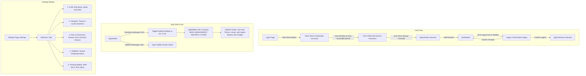

# Implementation Plan — Batch 1 UI/UX Refinement Addendum

## Goal Description
Perform a comprehensive UI/UX and navigation refinement for **Inventra** ahead of Batch 2. The objective is to elevate user ergonomics, resolve layout glitches across desktop, tablet, and mobile viewports, implement accessible demo credential auto-fill and logout confirmation, restructure the sidebar navigation into dedicated semantic groups (MAIN, MANAGEMENT, REPORTS, OTHER), integrate a multi-tab Settings page strictly respecting existing system capabilities, eliminate hardcoded text across all dashboards and tables, and verify the entire system with automated unit tests, linting, typechecking, production builds, and browser automation evidence.

---

## User Review Required

> [!IMPORTANT]
> **Strict Adherence to Safety Boundaries:**
> - **Zero Database / RLS / RPC Modifications:** No database migrations, role changes, or Supabase schema edits will be performed.
> - **Zero Dependency Additions:** No new packages will be installed; existing shadcn, Radix UI, `@tanstack/react-table`, `next-intl`, and `next-themes` primitives will be utilized.
> - **No Auto-Login on Demo Account Click:** Clicking demo evaluator chips will populate the email and password fields in the form and announce an accessible status message, requiring the user to manually click the **Masuk** (Log In) button.
> - **Role Self-Elevation Guard:** The Settings page profile editor allows updating `fullName`, but strictly denies role edits via both UI constraints and server-level profile update validation.
> - **Deferred Features Transparency:** Submenus like Notification Preferences and Password Reset display transparent roadmapped notices rather than fake interactive controls.

---

## Proposed Changes



---

### Component Group 1: Internationalization (i18n)

#### [MODIFY] [messages/id/auth.json](file:///c:/Experience/Projects/inventra/messages/id/auth.json) & [messages/en/auth.json](file:///c:/Experience/Projects/inventra/messages/en/auth.json)
- Add accessible announcement strings for demo account selection:
  - `demoFilledNotice`: "Akun demo {role} dipilih. Kredensial telah diisi ke formulir. Silakan tekan tombol Masuk." / "Demo account {role} selected. Credentials filled into form. Please press the Log In button."
  - `logout.cancel`: "Batal" / "Cancel"
  - `logout.confirm`: "Ya, Keluar" / "Yes, Log Out"

#### [MODIFY] [messages/id/sidebar.json](file:///c:/Experience/Projects/inventra/messages/id/sidebar.json) & [messages/en/sidebar.json](file:///c:/Experience/Projects/inventra/messages/en/sidebar.json)
- Add 4 menu group labels:
  - `groups.main`: "MAIN"
  - `groups.management`: "MANAGEMENT"
  - `groups.reports`: "REPORTS"
  - `groups.other`: "OTHER"
- Add labels and tooltips for icon buttons in sidebar footer:
  - `themeTooltip`: "Ganti Tema" / "Switch Theme"
  - `localeTooltip`: "Ganti Bahasa" / "Switch Language"
  - `logoutTooltip`: "Keluar dari Sesi" / "Log Out"

#### [MODIFY] [messages/id/navigation.json](file:///c:/Experience/Projects/inventra/messages/id/navigation.json) & [messages/en/navigation.json](file:///c:/Experience/Projects/inventra/messages/en/navigation.json)
- Add navigation items for:
  - `links.productAnalysis`: "Analisis Produk" / "Product Analysis"
  - `links.settings`: "Pengaturan" / "Settings"

#### [MODIFY] [messages/id/dashboard.json](file:///c:/Experience/Projects/inventra/messages/id/dashboard.json) & [messages/en/dashboard.json](file:///c:/Experience/Projects/inventra/messages/en/dashboard.json)
- Localize all static table headers in `RecentMovementsCard` and `LowStockWatchlist`:
  - `recentMovements.time`: "Waktu" / "Time"
  - `recentMovements.product`: "Produk" / "Product"
  - `recentMovements.type`: "Tipe" / "Type"
  - `recentMovements.quantity`: "Kuantitas" / "Quantity"
  - `recentMovements.finalStock`: "Stok Akhir" / "Final Stock"
  - `recentMovements.subtitleCount`: "5 transaksi mutasi stok fisik terbaru" / "5 latest physical stock mutation records"
  - `watchlist.sku`: "SKU"
  - `watchlist.name`: "Nama Produk" / "Product Name"
  - `watchlist.unitPrice`: "Harga Satuan" / "Unit Price"
  - `watchlist.remainingStock`: "Sisa Stok" / "Remaining Stock"
  - `watchlist.status`: "Status"
  - `watchlist.criticalBadge`: "Kritis (< 5)" / "Critical (< 5)"
- Add comprehensive settings page dictionary entries under `"settings": { ... }` for all 5 submenus (`profile`, `appearance`, `security`, `notifications`, `about`).

---

### Component Group 2: Authentication & Demo Accounts

#### [MODIFY] [src/app/actions/auth-actions.ts](file:///c:/Experience/Projects/inventra/src/app/actions/auth-actions.ts)
- Add `getDemoCredentialsAction(role: UserRole)`: Returns `{ success: true, email, password }` for client form pre-population from server environment variables without executing sign-in.
- Add `updateProfileNameAction(fullName: string)`: Validates name length (2–100 chars), verifies authenticated session, updates `public.profiles` for `auth.uid()`, revalidates path.

#### [MODIFY] [src/features/auth/login-form.tsx](file:///c:/Experience/Projects/inventra/src/features/auth/login-form.tsx)
- Refactor demo buttons:
  - Clicking "Admin Gudang" or "Business Owner" button calls `getDemoCredentialsAction(role)`.
  - Sets form fields using `setValue('email', data.email, { shouldValidate: true, shouldDirty: true })` and `setValue('password', data.password, { shouldValidate: true, shouldDirty: true })`.
  - Displays an accessible announcement banner (`role="status"`, `aria-live="polite"`) confirming that credentials have been loaded.
  - Does **NOT** trigger login automatically; user must click the "Masuk" (Log In) button manually.

#### [MODIFY] [src/features/auth/logout-button.tsx](file:///c:/Experience/Projects/inventra/src/features/auth/logout-button.tsx)
- Transform into an accessible dialog-backed component or trigger:
  - Support `variant?: 'icon' | 'default'`.
  - In `'icon'` mode, renders a clean 36x36px button with `LogOut` icon wrapped in a `Tooltip`.
  - On click, opens `Dialog` (Radix UI) displaying `auth.logout.confirmTitle` and `auth.logout.confirmDesc`.
  - Footer provides "Batal" (Cancel, returns focus) and "Ya, Keluar" (Confirm, executes `signOutAction`).
  - Supports keyboard navigation (Escape to dismiss, Tab/Shift-Tab focus trap, Enter to confirm).

---

### Component Group 3: App Shell, Navbar & Sidebar Navigation

#### [MODIFY] [src/components/shared/app-header.tsx](file:///c:/Experience/Projects/inventra/src/components/shared/app-header.tsx)
- Add hamburger menu button on desktop (`hidden lg:flex`) that triggers `onToggleSidebar` to collapse/expand the persistent sidebar.
- Keep mobile hamburger button (`flex lg:hidden`) that triggers the mobile slide-over `Sheet`.
- Remove duplicate `ThemeToggle`, `LocaleSwitcher`, and `LogoutButton` from navbar to eliminate redundancy.
- Right side of navbar displays:
  - Authoritative role badge (`admin_gudang` / `owner`).
  - User name and avatar chip with clean responsive truncation, eliminating layout crowding on tablet/mobile screens.

#### [MODIFY] [src/components/shared/app-sidebar.tsx](file:///c:/Experience/Projects/inventra/src/components/shared/app-sidebar.tsx)
- Reorganize menu items into 4 distinct groups with `next-intl` group headers:
  - **MAIN**: Dashboard (`/dashboard`)
  - **MANAGEMENT**: Produk (`/inventory`), Kategori Produk (`/categories`), Transaksi Stok (`/transactions`)
  - **REPORTS**: Riwayat Stok (`/movements`), Analitik & Laporan (`/reports`), Analisis Produk (`/reports/products`)
  - **OTHER**: AI Assistant (`/assistant`), Pengaturan (`/settings`)
- Remove old chevron collapse toggle from the brand header (now controlled via navbar hamburger).
- Update sidebar footer:
  - Render ThemeToggle, LocaleSwitcher, and LogoutButton as **icons only** with accessible tooltips.
  - In expanded mode: clean horizontal row of icon buttons.
  - In collapsed mode: vertical column of icon buttons.
- Layout constraint: brand header and role badge marked `shrink-0`, navigation list wrapped in `flex-1 min-h-0 overflow-y-auto`, footer marked `shrink-0 mt-auto`. This prevents the footer from ever overflowing off the bottom of the viewport.

#### [MODIFY] [src/components/shared/dashboard-shell.tsx](file:///c:/Experience/Projects/inventra/src/components/shared/dashboard-shell.tsx)
- Pass `handleToggleCollapse` to `AppHeader` for desktop navbar hamburger control.
- Ensure `isCollapsed` state syncs with browser cookies (`sidebar_collapsed`) to prevent CLS.

---

### Component Group 4: Responsive Dashboard Polish

#### [MODIFY] [src/features/dashboard/kpi-stat-card.tsx](file:///c:/Experience/Projects/inventra/src/features/dashboard/kpi-stat-card.tsx)
- Prevent IDR valuation truncation:
  - Apply adaptive font sizing: `text-xl sm:text-2xl xl:text-3xl font-extrabold tracking-tight tabular-nums break-words sm:break-normal`.
  - Add optional tooltip or full-value title attribute for accessibility.

#### [MODIFY] [src/app/[locale]/(dashboard)/dashboard/page.tsx](file:///c:/Experience/Projects/inventra/src/app/[locale]/(dashboard)/dashboard/page.tsx)
- Adjust KPI card grid: `grid grid-cols-1 sm:grid-cols-2 xl:grid-cols-4 gap-4` for optimal tablet and desktop breathing room.
- Pass localized translations to sub-components.

#### [MODIFY] [src/features/dashboard/recent-movements-card.tsx](file:///c:/Experience/Projects/inventra/src/features/dashboard/recent-movements-card.tsx) & [src/features/dashboard/low-stock-watchlist.tsx](file:///c:/Experience/Projects/inventra/src/features/dashboard/low-stock-watchlist.tsx)
- Wrap tables in `<div className="overflow-x-auto w-full">` with explicit minimum widths on dense columns to prevent entire page horizontal overflow.
- Clean up all remaining hardcoded strings to `next-intl`.

---

### Component Group 5: Settings Page

#### [NEW] [src/app/[locale]/(dashboard)/settings/page.tsx](file:///c:/Experience/Projects/inventra/src/app/[locale]/(dashboard)/settings/page.tsx)
- Server Component: enforces `requireAuth(locale)`, fetches authoritative profile, metadata, and renders `SettingsView`.

#### [NEW] [src/features/settings/settings-view.tsx](file:///c:/Experience/Projects/inventra/src/features/settings/settings-view.tsx)
- Interactive Client Component with 5 accessible tabs:
  1. **Profil (`profile`)**: Edit Full Name with `updateProfileNameAction`, read-only Email and Role, explicit notification that user role is managed by the system administrator and cannot be modified.
  2. **Tampilan (`appearance`)**: Theme switcher (Light, Dark, System) and Language switcher (Bahasa Indonesia, English) utilizing existing `next-themes` and `next-intl` mechanisms.
  3. **Akun & Keamanan (`security`)**: Session details, authoritative role status, active security guards overview (RLS, Immutability, Row Lock), explicit note that password change is disabled in demo mode, and logout button with confirmation dialog.
  4. **Preferensi Notifikasi (`notifications`)**: Honest status card detailing upcoming email and low-stock alerts roadmap (no fake or dead controls).
  5. **Tentang Aplikasi (`about`)**: Inventra ERP overview, version (v0.1.0-dev), tech stack badges, system status.

---

### Component Group 6: Roadmap Route Placeholders

#### [NEW] [src/app/[locale]/(dashboard)/transactions/page.tsx](file:///c:/Experience/Projects/inventra/src/app/[locale]/(dashboard)/transactions/page.tsx)
#### [NEW] [src/app/[locale]/(dashboard)/reports/page.tsx](file:///c:/Experience/Projects/inventra/src/app/[locale]/(dashboard)/reports/page.tsx)
#### [NEW] [src/app/[locale]/(dashboard)/reports/products/page.tsx](file:///c:/Experience/Projects/inventra/src/app/[locale]/(dashboard)/reports/products/page.tsx)
#### [NEW] [src/app/[locale]/(dashboard)/assistant/page.tsx](file:///c:/Experience/Projects/inventra/src/app/[locale]/(dashboard)/assistant/page.tsx)
- Server Components with clean, professional overview/status views explaining the feature's upcoming batch release, providing quick navigation to available features (e.g. Transactions links to `/movements` and `/inventory`), preventing 404 errors during navigation.

---

## Verification Plan

### Automated Tests
1. **Unit Tests:**
   ```bash
   npm run test:unit
   ```
   Add new test suites:
   - `tests/unit/demo-accounts-fill.test.ts`: Test that `getDemoCredentialsAction` returns valid credentials without executing sign in.
   - `tests/unit/logout-confirmation.test.ts`: Test that logout requires explicit confirmation.
   - `tests/unit/sidebar-navigation.test.ts`: Verify 4 sidebar groups, icon-only footer button configuration, and active state matching.
   - `tests/unit/settings-support.test.ts`: Verify that profile update only modifies name and prevents role tampering.
   - `tests/i18n/translations.test.ts`: Verify 1:1 parity and non-empty translation values across all 7 namespaces.
2. **Linting & Code Quality:**
   ```bash
   npm run lint
   npx prettier --check .
   ```
3. **Type Checking:**
   ```bash
   npx tsc --noEmit
   ```
4. **Production Build:**
   ```bash
   npm run build
   ```

### Manual & Browser Automation Verification
Using `browser_subagent` on `http://localhost:3000`:
1. **Login Flow:**
   - Click "Admin Gudang" demo button -> verify email & password fields are filled -> verify visual status announcement -> verify page has NOT navigated yet -> click "Masuk" -> verify successful dashboard login.
2. **Responsive & Navigation Verification:**
   - **Desktop (1280px):** Click navbar hamburger -> verify sidebar collapses to `w-18` -> verify tooltips on icon buttons -> click again -> verify sidebar expands to `w-64`.
   - **Tablet (768px):** Verify KPI cards adapt to 2 columns -> verify no IDR valuation truncation -> verify navbar elements do not collide.
   - **Mobile (375px):** Click navbar hamburger -> verify slide-over sheet drawer opens with backdrop -> verify no horizontal overflow on dashboard page -> click outside or Escape to close drawer.
3. **Sidebar Footer:**
   - Verify theme toggle switches light/dark mode.
   - Verify locale switcher switches between ID and EN.
   - Click logout icon -> verify confirmation dialog opens -> click Cancel -> verify session remains active -> click logout icon -> click Confirm -> verify user is redirected to login page.
4. **Settings Page:**
   - Navigate to `/settings` -> test all 5 tabs -> update profile name -> verify change persists -> verify role is read-only.

### Reporting
- Compile full findings and evidence in:
  `docs/reports/Dashboard UI UX Refinement/batch1_ui_ux_addendum_report.md`
