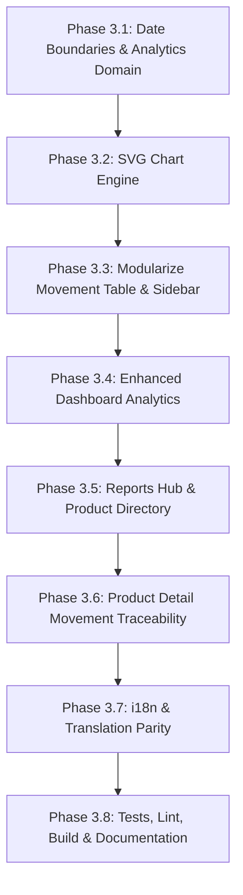

# INVENTRA — BATCH 3: IMPLEMENTATION & MODULARIZATION PLAN

**Dashboard Analytics, Advanced Reports & Code Modularization Standards**

---

## 1. Executive Summary & Objectives

Batch 3 elevates Inventra from an inventory transaction recorder into an analytical management system for warehouse operations (`administrator`, `staff_gudang`, `auditor`).

### Core Objectives

1. **Analytics Dashboard (`/dashboard`)**: Left accent-border summary cards, authentic movement volume mini-charts, period-filtered IN/OUT flow charts, and clear date/timezone boundaries without fictitious metrics.
2. **Advanced Reports (`/reports` & `/reports/products`)**: High-level warehouse movement summary and interactive Product Movement Directory with TanStack Table.
3. **Product Detail Traceability (`/reports/products/[id]`)**: Deep-dive audit page showing product identity, stock health, period mutation summary, velocity, and full movement ledger.
4. **Code Modularization Standards**: Enforce a strict file length rule (< 250 lines target, hard review at > 250 lines, avoid > 300 lines) across the codebase, permanently updating `AGENTS.md` and architecture documentation.
5. **Quality & Stability**: Maintain 100% pass rate across the existing 266 Vitest tests, add new unit/integration tests for Batch 3 features, ensure 100% i18n parity, and keep the Turbopack build error-free.

---

## 2. Pre-Implementation Audit Findings

### 2.1 Database Contracts & Ledger Limitations

- **`public.stock_movements`**: Contains `(id, product_id, user_id, type, quantity, stock_before, stock_after, note, created_at)`.
  - `product_id` references `public.products(id)`.
  - `user_id` references `auth.users(id)`. There is **NO direct foreign key** to `public.profiles`.
  - `public.profiles` enforces RLS `profiles_select_own` (`auth.uid() = id`).
  - **Audit Ruling**: Never perform SQL-level joins on `profiles` that assume cross-tenant visibility. User attribution must use safe server attribution or caller profile mapping.
- **Historical Snapshot Reality Check**:
  - The database does **NOT** store historical stock valuation snapshots or historical price logs.
  - Current product valuation is `Σ (stock * price)`.
  - **Audit Ruling**: Under no circumstances will past valuation be simulated by multiplying current price with past stock and labeling it "historical valuation". Valuation remains an authoritative **current catalog metric**. Period filters govern **stock flow (IN vs OUT units, transaction counts, net mutation flow)**.
- **Ledger Volume**: Currently contains 1 authentic production row. Charting and analytics must handle sparse data, zero-state periods, and single-data-point timelines with absolute visual honesty (no fake interpolation or mock sparklines).

### 2.2 Dependencies & Charting Strategy

- **Installed**: `@tanstack/react-table` (v8.21.2), `lucide-react`, `next-intl` (v4.14.9), `next-themes` (v0.4.6), `radix-ui`, `zustand`, `tailwindcss` (v4).
- **Charting Library**: No external charting library (Recharts, Chart.js) is installed.
- **Audit Ruling & Decision**: Adhering strictly to _"Jangan memasang dependensi tanpa persetujuan"_, we will build a **lightweight, pure SVG + Tailwind responsive charting component**:
  - Zero bundle weight increase.
  - Native dark/light mode responsiveness using `--chart-1` through `--chart-5` OKLCH tokens already in `globals.css`.
  - Accessible SVG markup (`role="img"`, `aria-label`, `<title>`, and focusable interactive data points).
  - Built-in tooltip with nominal precision.
  - 100% responsive (`viewBox` auto-scaling, fluid layout).

### 2.3 File Length Audit (> 250 Lines in `src/`)

Audit revealed 16 files currently exceeding 250 lines:

| File                                                  | Lines |   Scope in Batch 3   | Action / Exemption Rationale                                                                                       |
| :---------------------------------------------------- | :---: | :------------------: | :----------------------------------------------------------------------------------------------------------------- |
| `src/features/transactions/transaction-cart-view.tsx` |  655  |    Batch 2 Trans     | Exempted in Batch 3 (stable, tested in Batch 2). Refactoring scheduled for later batch to prevent regressions.     |
| `src/features/settings/settings-view.tsx`             |  547  |       Settings       | Exempted in Batch 3 (separate feature domain).                                                                     |
| `src/features/movements/movement-table.tsx`           |  423  | **Reports / Ledger** | **Refactor in Batch 3**: Split into `movement-filters.tsx`, `movement-columns.tsx`, and `movement-pagination.tsx`. |
| `src/features/catalog/catalog-table.tsx`              |  379  |       Catalog        | Exempted in Batch 3 (core catalog module).                                                                         |
| `src/features/categories/category-form-dialog.tsx`    |  352  |      Categories      | Exempted in Batch 3.                                                                                               |
| `src/features/catalog/product-form-dialog.tsx`        |  338  |       Catalog        | Exempted in Batch 3.                                                                                               |
| `src/features/movements/stock-mutation-dialog.tsx`    |  316  |      Movements       | Retain as modal dialog; extracted pure helpers.                                                                    |
| `src/app/actions/category-actions.ts`                 |  310  |    Server Actions    | Server boundary file containing multi-step validations.                                                            |
| `src/features/categories/category-table.tsx`          |  304  |      Categories      | Exempted in Batch 3.                                                                                               |
| `src/components/shared/app-sidebar.tsx`               |  299  |    **Shared Nav**    | **Refactor in Batch 3**: Extract `sidebar-nav-items.ts` to reduce line count under 200 lines.                      |
| `src/app/actions/stock-actions.ts`                    |  298  |    Server Actions    | Server mutation actions with pre-flight checks and audit logging.                                                  |
| `src/features/auth/login-form.tsx`                    |  294  |         Auth         | Stable auth form with demo user credentials.                                                                       |
| `src/types/inventory.ts`                              |  284  |        Types         | Centralized domain type definitions (declarative).                                                                 |
| `src/components/shared/app-header.tsx`                |  281  |    Shared Header     | Responsive header with role badges and profile menu.                                                               |
| `src/components/shared/image-dropzone.tsx`            |  281  |        Upload        | Cloudinary / local image uploader with canvas resize.                                                              |
| `src/app/actions/product-actions.ts`                  |  252  |    Server Actions    | Product CRUD server actions.                                                                                       |

---

## 3. Architecture & Functional Specifications

```
                     ┌─────────────────────────────────────────┐
                     │          Next.js App Router             │
                     │  /dashboard  |  /reports  |  /movements  │
                     └────────────────────┬────────────────────┘
                                          │
            ┌─────────────────────────────┼────────────────────────────┐
            ▼                             ▼                            ▼
┌───────────────────────┐   ┌───────────────────────────┐   ┌───────────────────────┐
│   Analytics Service   │   │  Product Movement Service │   │  Auth & RBAC Service  │
│  - Period aggregation │   │  - Product ledger query   │   │  - canViewReports     │
│  - Timezone buckets   │   │  - Product velocity       │   │  - Authoritative role │
└───────────┬───────────┘   └─────────────┬─────────────┘   └───────────┬───────────┘
            │                             │                             │
            └─────────────────────────────┼─────────────────────────────┘
                                          ▼
                     ┌─────────────────────────────────────────┐
                     │          Supabase PostgreSQL           │
                     │    products  |  stock_movements         │
                     └─────────────────────────────────────────┘
```

### 3.1 Date Boundaries & Timezone Policy

- **Target Timezone**: `Asia/Jakarta` (WIB, UTC+7).
- **Date Boundary Calculation**:
  - `today`: `startOfDay` to `endOfDay` of current local date.
  - `week`: Past 7 calendar days (`now - 7 days` to `now`).
  - `month`: Past 30 calendar days (`now - 30 days` to `now`).
  - `year`: Past 365 calendar days.
  - `custom`: User-selected `startDate (00:00:00.000)` to `endDate (23:59:59.999)`.
  - `all`: Unbounded starting timestamp up to `now`.
- **Pure Utility**: `src/lib/date-boundaries.ts` with comprehensive unit tests for leap years, month boundaries, and UTC conversion.

### 3.2 Metric Semantics

- **Catalog Snapshot (Current)**:
  - `Total SKUs`: Distinct active products in catalog.
  - `Total Physical Stock`: Sum of current stock quantities.
  - `Current Valuation`: Sum of `(stock * price)` in IDR.
  - `Low Stock Count`: Count of products where `stock < 5`.
- **Period Flow Metrics (Historical Ledger)**:
  - `Total IN Units`: Sum of quantities for `type = 'IN'` within the selected period.
  - `Total OUT Units`: Sum of quantities for `type = 'OUT'` within the selected period.
  - `Net Flow`: `Total IN - Total OUT`.
  - `Total Transactions`: Total number of movement ledger entries recorded within the selected period.
- **Visual Design**: Summary cards feature accent borders on the left side:
  - Total SKUs: Primary (Deep Navy) `border-l-4 border-l-primary`
  - Total Physical Stock: Accent (Teal) `border-l-4 border-l-accent`
  - Valuation: Secondary / Neutral `border-l-4 border-l-border`
  - Low Stock: Destructive (Amber/Red) `border-l-4 border-l-destructive`

### 3.3 Zero-Dependency SVG Charting Engine

Located in `src/components/shared/charts/`:

1. **`movement-bar-chart.tsx`**: Grouped bar visualization showing IN (Teal) vs OUT (Coral/Amber) per time bucket (daily for week/month, monthly for year/all).
2. **`mini-sparkline.tsx`**: Compact inline SVG trendline using authentic ledger points only (hidden or showing clean flatline if 0 data).
3. **Features**:
   - Native SVG `<rect>` and `<path>` elements with smooth hover effects.
   - Interactive SVG or Radix Tooltip showing date, IN units, OUT units, and net delta.
   - Fully responsive `viewBox="0 0 600 240"` scaling with fluid container width.
   - Empty state illustration when zero movements occurred in the selected range.

---

## 4. Route & Component Architecture

### Route 1: `/dashboard` (Analytics Enhanced)

- Add period selector filter bar: `[Hari Ini | 7 Hari | 30 Hari | Tahun Ini | Khusus | Semua]`.
- Update KPI Stat Cards with left accent borders and authentic mini-charts.
- Add Stock Movement Flow Chart (IN vs OUT) for the selected period.
- Maintain existing Low Stock Watchlist and Recent Activity feed.

### Route 2: `/reports` (Warehouse Overview & Analytics Hub)

- Remove `Batch 3 Feature Roadmap` placeholder.
- KPI Overview: Period IN/OUT flow, total transactions, high-turnover categories.
- Movement Flow Chart with period filtering.
- Quick links to Product Movement Analysis (`/reports/products`) and Full Ledger History (`/movements`).

### Route 3: `/reports/products` (Product Movement Directory)

- Remove placeholder card.
- Search and filter bar (SKU/name, category, stock health: Normal vs Low Stock).
- TanStack Table (`ProductReportTable`):
  - Product thumbnail & SKU / Name
  - Category badge
  - Current physical stock & safety status
  - Period movement volume (IN units, OUT units, net flow)
  - Action button: "Lihat Detail Pergerakan" -> links to `/reports/products/[id]`
- Full pagination and column sorting.

### Route 4: `/reports/products/[id]` (Product Detail Movement Traceability)

- Server Component with dynamic route validation:
  - Product not found -> 404 / friendly error page.
- Header: Product identity, image thumbnail, category, SKU, unit price, current stock badge.
- Period filter: Today, Week, Month, Year, Custom, All.
- Product Summary Cards:
  - Current Stock (with low stock warning if < 5)
  - Total IN in period
  - Total OUT in period
  - Net Movement in period
- Product Timeline Chart (daily movement activity for this specific SKU).
- Product Movement Ledger Table (TanStack Table):
  - Timestamp, mutation type (IN/OUT badge), quantity, stock before, stock after, user/actor attribution, note/reference document.
  - Type filter (ALL, IN, OUT).

---

## 5. Code Modularization Standards

### Permanent Rules to be written into `AGENTS.md` and `docs/ARCHITECTURE.md`:

1. **Target File Length**: Keep files under 250 lines.
2. **Review Threshold**: Any file reaching 250 lines must be reviewed for separation of concerns.
3. **Hard Ceiling**: Avoid files exceeding 300 lines unless a formal architectural exemption applies.
4. **Separation of Concerns Checklist**:
   - `presentation`: UI components and dialogs.
   - `columns`: TanStack Table column definitions (`*-columns.tsx`).
   - `filters`: Filter bars and search inputs (`*-filters.tsx`).
   - `domain`: Pure business logic, calculations, date manipulations (`*-domain.ts`).
   - `services`: Data access and Supabase query orchestration (`*-service.ts`).
   - `schemas`: Zod validation schemas (`src/schemas/`).
   - `types`: TypeScript interfaces and types (`src/types/`).
5. **Prohibited Patterns**: No circular imports, no barrel re-exports creating cycles, no logic duplication.
6. **Exemption Documentation**: Any file intentionally kept above 250 lines must document its justification in the completion report.

---

## 6. Implementation Plan & Phases



### Phase 3.1: Pure Domain & Analytics Utilities

- Create `src/lib/date-boundaries.ts` (timezone-aware boundary calculation).
- Create `src/services/analytics-domain.ts` (pure aggregation, bucket sorting, zero-fill).
- Add unit tests: `tests/unit/date-boundaries.test.ts`, `tests/unit/analytics-domain.test.ts`.

### Phase 3.2: Zero-Dependency SVG Chart Engine

- Create `src/components/shared/charts/chart-types.ts`.
- Create `src/components/shared/charts/movement-flow-chart.tsx` (< 220 lines).
- Create `src/components/shared/charts/mini-sparkline.tsx` (< 120 lines).
- Create `src/components/shared/charts/chart-tooltip.tsx` (< 90 lines).

### Phase 3.3: Modularization of Existing Files

- Refactor `src/features/movements/movement-table.tsx`:
  - Extract `src/features/movements/movement-filters.tsx`.
  - Extract `src/features/movements/movement-columns.tsx`.
  - Reduce `movement-table.tsx` to < 200 lines.
- Refactor `src/components/shared/app-sidebar.tsx`:
  - Extract `src/components/shared/sidebar-nav-items.ts`.
  - Remove Batch 3 roadmap badge from `/reports` and `/reports/products`.
  - Reduce `app-sidebar.tsx` to < 200 lines.

### Phase 3.4: Enhanced Dashboard Analytics

- Update `src/features/dashboard/kpi-stat-card.tsx` to support left accent borders (`border-l-4`).
- Add period selector and movement flow chart to `/dashboard`.
- Ensure authoritative current valuation is separate from period movement metrics.

### Phase 3.5: Reports Hub & Product Reports Page

- Implement `/reports/page.tsx` with full metrics, period filters, and navigation links.
- Implement `/reports/products/page.tsx` with TanStack Table, search, categories, and stock status.
- Create modular components:
  - `src/features/reports/product-report-table.tsx` (< 200 lines)
  - `src/features/reports/product-report-columns.tsx` (< 150 lines)

### Phase 3.6: Product Detail Movement Traceability

- Implement `/reports/products/[id]/page.tsx` dynamic route.
- Create modular detail components:
  - `src/features/reports/product-detail-header.tsx` (< 150 lines)
  - `src/features/reports/product-detail-summary.tsx` (< 160 lines)
  - `src/features/reports/product-detail-history.tsx` (< 200 lines)

### Phase 3.7: Internationalization Parity

- Add comprehensive translation keys in `messages/id/dashboard.json` and `messages/en/dashboard.json` under `analytics` and `reports`.
- Verify 1:1 key parity using `tests/i18n/translations.test.ts`.

### Phase 3.8: Verification, Quality Gates & Completion Report

- Run `npm test` (all 266+ tests passing).
- Run `npm run lint` (0 errors).
- Run `npx tsc --noEmit` (strict TypeScript check).
- Run `npm run build` (Turbopack production build).
- Update `AGENTS.md` and `docs/ARCHITECTURE.md` with modularization guidelines.
- Generate completion report at:
  `docs/reports/Batch 3 - Dashboard Analytics and Reports/batch3_completion_report.md`.
- **STOP & WAIT FOR USER APPROVAL.**

---

## 7. Verification Gates & Success Criteria

1. **Test Suite**: 100% pass rate across all unit and integration tests (28+ test files, > 280 tests).
2. **Zero Errors**: `eslint` and `tsc` pass with zero errors.
3. **Zero Dependencies**: No new packages added to `package.json`.
4. **File Length Adherence**: All newly created files strictly under 250 lines; refactored files reduced under 250 lines.
5. **Visual Honesty**: Zero fictitious sparklines, zero fake historical valuation formulas, zero mock trends.
6. **RBAC Fidelity**: All roles (`administrator`, `staff_gudang`, `auditor`) can view reports; reports are 100% read-only with no unauthorized mutation paths.
