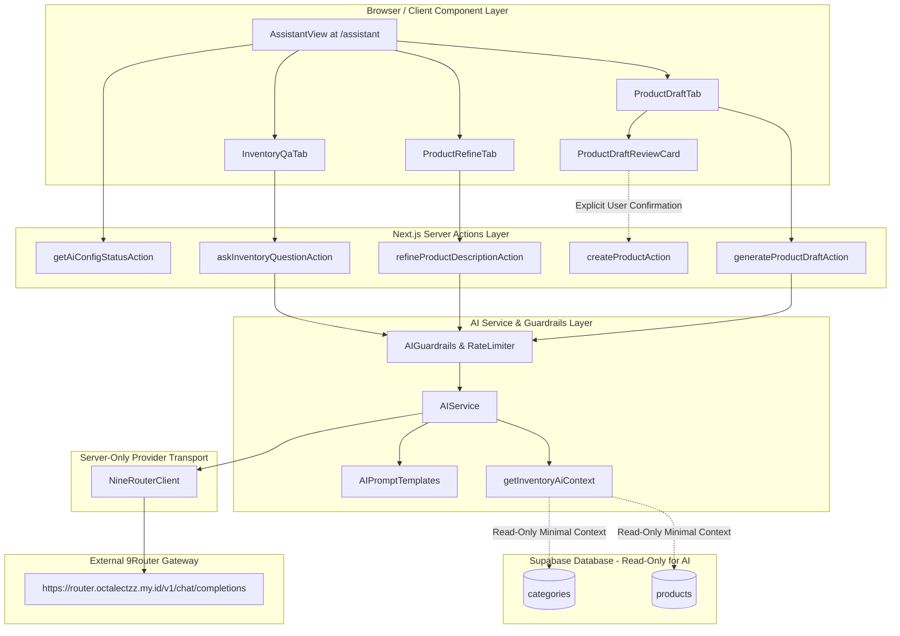

# BATCH 4 — AI ASSISTANT INTEGRATION WITH 9ROUTER
## Implementation Plan & Technical Design Document

---

## 1. Goal Description

Implement **Batch 4: Secure AI Assistant Integration with 9Router** in Inventra Mini ERP. This module equips warehouse administrators and staff with an intelligent, server-guarded AI copilot at `/[locale]/assistant` for:
1. **Product Draft Generation**: Generates complete, schema-compliant product catalog drafts (SKU, name, category, unit, reference price, specifications, description, and image prompt) from raw product names or notes, distinguishing facts from assumptions.
2. **Product Description & Specification Refinement**: Expands, clarifies technical specifications, shortens, or translates warehouse catalog descriptions.
3. **Inventory Q&A Assistant**: Allows authenticated users to query authorized inventory status (stock levels, low-stock items, category summaries) based strictly on minimal, server-side read-only context without hallucination or arbitrary execution.

### Architectural Invariants & Safety Principles
- **Zero Database Schema Changes**: No new migrations, no tables altered, no RPC changes.
- **Zero New Dependencies**: Implemented strictly with existing dependencies (`fetch`, `@hookform/resolvers`, `zod`, `lucide-react`, `next-intl`, `next-themes`, shadcn/ui components).
- **Strict Human-in-the-Loop**: The AI cannot create products, change stock, or mutate the database. AI outputs are drafts displayed in an editable review form requiring explicit user confirmation before delegating to the existing `createProductAction`.
- **Opening Stock Immutability**: All AI-assisted product creation strictly defaults stock to `0` via the existing `productCatalogInputSchema`. No initial stock may be set.
- **Server-Only Provider Isolation**: 9Router API keys and endpoints reside strictly server-side (`import 'server-only'`) and are never exposed to the browser, logs, network responses, or client bundles.
- **File Modularization Standard**: Every file adheres to the repository's strict `< 250 lines` standard (hard ceiling 300 lines).

---

## 2. 9Router Protocol & Provider Specification

### 2.1 Provider Discovery & Protocol Verification
Direct probing of `https://router.octalectzz.my.id/v1` confirmed:
- **Provider Architecture**: 9Router (`decolua/9router`), an AI gateway exposing an **OpenAI-compatible `/v1` endpoint**.
- **Chat Endpoint**: `POST https://router.octalectzz.my.id/v1/chat/completions`.
- **Authentication**: `Authorization: Bearer <NINE_ROUTER_API_KEY>`.
- **Remote Access Protection**: When accessed remotely, 9Router enforces strict token authentication. Requests with invalid or missing keys return HTTP `401 Unauthorized` with JSON payload `{ error: "API key required for remote API access" }`.
- **Payload Schema**:
  ```json
  {
    "model": "<NINE_ROUTER_MODEL>",
    "messages": [
      { "role": "system", "content": "..." },
      { "role": "user", "content": "..." }
    ],
    "temperature": 0.2,
    "max_tokens": 1000
  }
  ```

### 2.2 Environment Variables Architecture
The system uses three server-only environment variables:
| Variable Name | Default Value | Exposure | Purpose |
| :--- | :--- | :--- | :--- |
| `NINE_ROUTER_BASE_URL` | `https://router.octalectzz.my.id/v1` | Server-Only | Base URL for 9Router gateway |
| `NINE_ROUTER_API_KEY` | *(Set in `.env.local`)* | Server-Only | Bearer API token |
| `NINE_ROUTER_MODEL` | *(Set in `.env.local`)* | Server-Only | Model identifier (e.g. `gpt-4o-mini`, `gemini-1.5-flash`, etc.) |

Safe placeholder values will be documented in `.env.example`. `.env.local` is already confirmed to be ignored by Git via `.gitignore`.

---

## 3. User Review Required

> [!IMPORTANT]
> **API Key Setup in `.env.local`**:
> Our preflight inspection confirmed `.env.local` currently lacks `NINE_ROUTER_BASE_URL`, `NINE_ROUTER_API_KEY`, and `NINE_ROUTER_MODEL`.
> Per Section 7 of the specification:
> 1. Offline tests, schemas, guardrails, and quality gates will run first using mocked provider responses.
> 2. Instructions will be provided for setting `NINE_ROUTER_API_KEY` and `NINE_ROUTER_MODEL` in `.env.local`.
> 3. We will pause before making any live authenticated request to 9Router, awaiting your explicit confirmation that `.env.local` is populated.

> [!NOTE]
> **Role-Based Permissions for Saving Catalog Products**:
> - `administrator` / `admin_gudang`: Can generate AI drafts, edit, and click **"Simpan ke Katalog"** (delegating to existing `createProductAction`).
> - `staff_gudang`: Can generate AI drafts, refine descriptions, and **"Salin Draf"** (copy to clipboard). The "Simpan ke Katalog" button will be disabled or clearly badged with a tooltip, since the existing `canManageCatalog('staff_gudang')` returns `false` to maintain the existing authorization test suite.
> - `auditor` / `owner`: Read-only access to Inventory Q&A and summary insights. Product draft generation is restricted.

---

## 4. Proposed Architecture & Component Flow



---

## 5. File Modularization & Line Count Budget

To strictly honor the permanent `< 250 lines` rule, responsibilities are cleanly divided into specialized modules:

| Path | Responsibility | Estimated Lines | Max Limit |
| :--- | :--- | :---: | :---: |
| `src/types/ai.ts` | AI domain types & result interfaces | ~90 lines | 250 |
| `src/schemas/ai-schema.ts` | Zod validation schemas for AI inputs & structured outputs | ~160 lines | 250 |
| `src/lib/ai/nine-router-client.ts` | Server-only HTTP transport & Bearer auth to 9Router | ~170 lines | 250 |
| `src/lib/ai/ai-guardrails.ts` | In-memory token-bucket rate limiter & prompt sanitizers | ~130 lines | 250 |
| `src/lib/ai/ai-prompts.ts` | Guardrailed system prompts with delimiter framing | ~180 lines | 250 |
| `src/services/ai-service.ts` | Server orchestrator & minimal inventory context builder | ~210 lines | 250 |
| `src/app/actions/ai-actions.ts` | Authenticated Next.js Server Actions with RBAC gates | ~200 lines | 250 |
| `src/features/assistant/assistant-view.tsx` | Main page client container & tab navigator | ~170 lines | 250 |
| `src/features/assistant/product-draft-tab.tsx` | Draft generator prompt form & trigger controls | ~190 lines | 250 |
| `src/features/assistant/product-draft-review-card.tsx` | Editable review form, fact/assumption badges, save modal | ~240 lines | 250 |
| `src/features/assistant/product-refine-tab.tsx` | Description expander, summarizer & specification parser | ~180 lines | 250 |
| `src/features/assistant/inventory-qa-tab.tsx` | Chat-style Q&A with inventory questions & context chips | ~220 lines | 250 |
| `src/features/assistant/assistant-status-banner.tsx` | Visual connection status, error banner & hints | ~95 lines | 250 |
| `src/app/[locale]/(dashboard)/assistant/page.tsx` | Server component page replacing Batch 4 placeholder | ~85 lines | 250 |
| `messages/id/assistant.json` | Complete Indonesian translations dictionary | ~110 lines | N/A (JSON) |
| `messages/en/assistant.json` | Complete English translations dictionary | ~110 lines | N/A (JSON) |
| `.env.example` | Added safe placeholders for 9Router configuration | +8 lines | N/A |
| `src/i18n/request.ts` | Register `assistant` namespace loader | +2 lines | < 50 |
| `tests/i18n/translations.test.ts` | Include `assistant.json` in namespace parity test | +2 lines | < 100 |

---

## 6. Detailed Implementation Specifications

### 6.1 Provider Transport Client (`src/lib/ai/nine-router-client.ts`)
```typescript
import 'server-only'

export interface NineRouterMessage {
  role: 'system' | 'user' | 'assistant'
  content: string
}

export interface NineRouterOptions {
  temperature?: number
  maxTokens?: number
  timeoutMs?: number
}

export interface NineRouterResult {
  text: string
  usage?: { promptTokens: number; completionTokens: number; totalTokens: number }
}
```
- Validates that `NINE_ROUTER_API_KEY` and `NINE_ROUTER_MODEL` are set; returns explicit, localized error if missing.
- Sets standard request timeout via `AbortSignal.timeout(options.timeoutMs ?? 20000)`.
- Sends `POST ${baseUrl}/chat/completions` with `Authorization: Bearer ${apiKey}`.
- Sanitizes error messages so no secret key or internal URL is ever leaked in thrown errors or returned strings.

### 6.2 AI Guardrails & Rate Limiter (`src/lib/ai/ai-guardrails.ts`)
- **Sliding-window token bucket**: Limits each user session to a maximum of 10 requests per minute.
- **Input Sanitization**: Rejects prompts exceeding 500 characters, strips invisible control characters, and neutralizes prompt-injection attempts.
- **Delimiter Framing**: Frames user input and database facts inside distinct delimiters (`<<<USER_INPUT>>>` and `<<<INVENTORY_DATA>>>`) to prevent instruction overriding.

### 6.3 Structured Schemas (`src/schemas/ai-schema.ts`)
- `aiProductDraftRequestSchema`:
  ```typescript
  export const aiProductDraftRequestSchema = z.object({
    prompt: z.string().trim().min(2, 'promptTooShort').max(500, 'promptTooLong'),
    categoryHint: z.string().trim().max(100).optional(),
    locale: z.enum(['id', 'en']).default('id')
  })
  ```
- `aiProductDraftResponseSchema`:
  ```typescript
  export const aiProductDraftResponseSchema = z.object({
    name: z.string().trim().min(1),
    sku: z.string().trim().regex(/^[A-Z0-9-]+$/),
    category: z.string().trim().min(1),
    unit: z.string().trim().min(1),
    price: z.number().int().nonnegative(),
    description: z.string().trim(),
    specifications: z.array(z.object({
      key: z.string(),
      value: z.string(),
      isAssumption: z.boolean()
    })).default([]),
    notes: z.string().default(''),
    imagePrompt: z.string().optional(),
    assumptions: z.array(z.string()).default([])
  })
  ```
- `aiRefineDescriptionRequestSchema`:
  Modes: `'expand' | 'shorten' | 'specifications' | 'translate'`
- `aiInventoryQuestionRequestSchema`:
  Bounded question string (3..500 characters).

### 6.4 AI Service & Inventory Context Aggregator (`src/services/ai-service.ts`)
- `getInventoryAiContext(supabase)`: Reads:
  1. Summary KPI (total SKUs, total units, low stock count, inventory valuation).
  2. Active categories list.
  3. Top 10 low-stock products (SKU, name, category, current stock).
  4. Returns a compact markdown/plaintext payload (< 1KB) to pass into the system prompt.
- `generateProductDraft(input, userProfile)`: Injects existing categories as suggestions so the model picks valid registered categories whenever possible.
- `refineProductDescription(input, userProfile)`: Preserves user-provided facts and formats specs clearly.
- `answerInventoryQuestion(question, userProfile, supabase)`: Instructs the model to answer only using the provided facts and decline any requests for speculative data or database mutations.

### 6.5 Server Actions (`src/app/actions/ai-actions.ts`)
- All actions execute server-side with `'use server'`.
- Enforces `requireAuth(locale)` on every invocation.
- Enforces role boundaries:
  - Draft generation / Refinement: `administrator`, `staff_gudang`, `admin_gudang`.
  - Inventory Q&A: All valid authenticated roles (`administrator`, `staff_gudang`, `auditor`, `admin_gudang`, `owner`).
- Returns standardized `{ success: true, data: T } | { success: false, error: string, message: string }`.

### 6.6 UI Components (`src/features/assistant/`)
1. **`assistant-view.tsx`**:
   - Modern tabbed container (`Tabs` / segmented control) with 3 modes:
     - 📝 **Draf Produk** (`draft`)
     - ✨ **Penyusun Deskripsi** (`refine`)
     - 💬 **Tanya Inventaris** (`qa`)
   - Header with sparkler icon, locale-aware title and subtitle, and `AssistantStatusBanner`.
2. **`product-draft-tab.tsx` & `product-draft-review-card.tsx`**:
   - Quick prompt starter chips (e.g. *"Minyak Atsiri Nilam 50ml"*, *"Botol Kaca Amber 100ml Dropper"*, *"Karton Box Corrugated 30x20x15"*).
   - Editable review form showing generated SKU, Name, Category dropdown, Unit, Reference Price, and Description.
   - Clear distinction between **Fakta Pengguna** (User Facts) and **Saran AI / Asumsi** (AI Assumptions).
   - **"Simpan ke Katalog"** button: Opens confirmation dialog, calls `createProductAction`, verifies stock = 0, and notifies user with toast/alert.
3. **`product-refine-tab.tsx`**:
   - Input textarea with mode selector (Sempurnakan Deskripsi, Ekstrak Spesifikasi, Ringkas, Terjemahkan).
   - Side-by-side or stacked diff view with copy-to-clipboard button.
4. **`inventory-qa-tab.tsx`**:
   - Conversational UI with message bubbles (User vs AI Assistant).
   - Context chips: *"Berapa barang yang stoknya menipis?"*, *"Kategori apa saja yang terdaftar?"*, *"Berapa total nilai gudang saat ini?"*.
   - Disclaimer: *"Informasi berbasis ringkasan data inventaris terkini. Asisten ini beroperasi dalam mode baca (read-only)."*

---

## 7. Verification Plan

### 7.1 Automated Vitest Test Suite
We will add 6 comprehensive test files in `tests/ai/`:

1. `tests/ai/nine-router-client.test.ts`:
   - Request construction with `Authorization: Bearer <token>`.
   - Missing environment variables error handling (`AI_CONFIG_MISSING`).
   - AbortSignal timeout handling (`REQUEST_TIMEOUT`).
   - HTTP 401, 429, 500 error code mapping.
   - Malformed JSON response recovery.
   - Verifies that API keys never appear in error objects or strings.

2. `tests/ai/ai-guardrails.test.ts`:
   - Prompt length truncation & character limits (max 500 chars).
   - Sliding-window rate limiter (rejects > 10 requests within 60s window per user).
   - Prompt-injection delimiter isolation.

3. `tests/ai/ai-schemas.test.ts`:
   - Valid product draft payload parsing.
   - Invalid SKU formats rejected.
   - Negative prices rejected.
   - Empty names rejected.

4. `tests/ai/ai-rbac.test.ts`:
   - Administrator can generate drafts and save to catalog.
   - Staff Gudang can generate drafts and copy, but `createProductAction` rejects catalog save.
   - Auditor cannot generate drafts.
   - Auditor can ask inventory questions.
   - Unauthenticated access rejected.

5. `tests/ai/ai-inventory-qa.test.ts`:
   - Inventory context generator produces bounded summary string.
   - Verifies model prompt prevents fabrication of stock/movements.

6. `tests/ai/stock-immutability.test.ts`:
   - Verifies that drafts saved via AI assistant always pass `stock = 0` to `createProductAction`.
   - Confirms that AI has no access to `record_stock_movement` RPC or `batchStockMutationSchema`.

### 7.2 Full Quality Gates
Commands to execute:
```bash
# 1. Run all unit tests (including new AI tests)
npm run test:unit

# 2. Run all tests (unit + live Supabase tests)
npm test

# 3. TypeScript strict check
npx tsc --noEmit

# 4. ESLint verification
npm run lint

# 5. Prettier formatting check
npx prettier --check "src/**/*.{ts,tsx}" "tests/**/*.ts"

# 6. Production Turbopack build
npm run build
```

### 7.3 Safe Provider Smoke Test Protocol (Section 7 Compliance)
1. Run a non-leaking script to check whether `NINE_ROUTER_API_KEY` and `NINE_ROUTER_MODEL` exist in `.env.local`:
   - Print only `CONFIG_READY: TRUE/FALSE`.
   - NEVER print the key, its prefix, suffix, or character count.
2. If `CONFIG_READY: FALSE`:
   - Pause before making any real remote HTTP call.
   - Present exact instructions for the user to populate `.env.local`.
   - Await user confirmation.
3. If `CONFIG_READY: TRUE`:
   - Send one minimal non-sensitive request (`"ping"` or `"Halo"`).
   - Verify HTTP status 200, response envelope, and model identifier.
   - Report only status code, model identifier, and latency.

---

## 8. Summary of Files to Modify/Create

- **[NEW]** `src/types/ai.ts` (< 100 lines)
- **[NEW]** `src/schemas/ai-schema.ts` (< 170 lines)
- **[NEW]** `src/lib/ai/nine-router-client.ts` (< 180 lines)
- **[NEW]** `src/lib/ai/ai-guardrails.ts` (< 140 lines)
- **[NEW]** `src/lib/ai/ai-prompts.ts` (< 190 lines)
- **[NEW]** `src/services/ai-service.ts` (< 220 lines)
- **[NEW]** `src/app/actions/ai-actions.ts` (< 210 lines)
- **[NEW]** `src/features/assistant/assistant-view.tsx` (< 180 lines)
- **[NEW]** `src/features/assistant/product-draft-tab.tsx` (< 200 lines)
- **[NEW]** `src/features/assistant/product-draft-review-card.tsx` (< 240 lines)
- **[NEW]** `src/features/assistant/product-refine-tab.tsx` (< 190 lines)
- **[NEW]** `src/features/assistant/inventory-qa-tab.tsx` (< 230 lines)
- **[NEW]** `src/features/assistant/assistant-status-banner.tsx` (< 95 lines)
- **[MODIFY]** `src/app/[locale]/(dashboard)/assistant/page.tsx` (< 90 lines)
- **[NEW]** `messages/id/assistant.json` (Indonesian translations)
- **[NEW]** `messages/en/assistant.json` (English translations)
- **[MODIFY]** `src/i18n/request.ts` (Register `assistant` namespace)
- **[MODIFY]** `.env.example` (Add safe 9Router placeholder documentation)
- **[MODIFY]** `tests/i18n/translations.test.ts` (Update `expectedNamespaces`)
- **[NEW]** `tests/ai/nine-router-client.test.ts`
- **[NEW]** `tests/ai/ai-guardrails.test.ts`
- **[NEW]** `tests/ai/ai-schemas.test.ts`
- **[NEW]** `tests/ai/ai-rbac.test.ts`
- **[NEW]** `tests/ai/ai-inventory-qa.test.ts`
- **[NEW]** `tests/ai/stock-immutability.test.ts`
- **[NEW]** `docs/reports/Batch 4 - AI Assistant/batch4_completion_report.md`
