# Implementation Plan — Inventra Dashboard UI/UX Refinement

## Goal Description
Melakukan penyempurnaan UI/UX secara menyeluruh pada aplikasi Inventra (Mini ERP Inventory Management) pasca Fase 9. Transformasi ini mencakup:
1. Navigasi aplikasi enterprise berbasis **Persistent Left Sidebar** pada desktop dan **Slide-over Drawer Sheet** pada mobile.
2. Migrasi tabel katalog ke **TanStack React Table** dengan fitur sorting kolom, faceted filtering, pencarian multi-atribut, dan paginasi fleksibel.
3. Penyempurnaan dashboard overview dengan KPI cards modern, visualisasi watchlist stok menipis, dan penambahan kartu aktivitas mutasi terkini.
4. Pengalaman pengguna yang responsif, berkecepatan tinggi, dan sepenuhnya mematuhi standar aksesibilitas WCAG 2.2 AA serta bilingual (ID/EN).

---

## User Review Required

> [!IMPORTANT]
> **Izin Instalasi Dependensi `@tanstack/react-table`:**
> Paket `@tanstack/react-table` belum terpasang di `package.json`. Kami memerlukan persetujuan eksplisit Anda sebelum menjalankan:
> ```bash
> npm install @tanstack/react-table
> ```
> Paket ini murni merupakan *headless utility* untuk kalkulasi tabel di sisi klien dan tidak melanggar batasan `AGENTS.md` (yang hanya mengecualikan TanStack Query dan ORM).

> [!IMPORTANT]
> **Adopsi Layout Navigasi Sidebar Baru:**
> Saat ini navigasi berada di top header bar. Kami mengusulkan migrasi ke layout standar enterprise ERP: **Persistent Sidebar di sebelah kiri (256px)** pada desktop dengan opsi collapsible ke icon-rail (64px), dan **Slide-over Sheet Drawer** pada mobile. Mohon konfirmasi apakah arsitektur layout ini disetujui.

> [!NOTE]
> **Integritas Database dan Keamanan:**
> Perubahan ini murni berada di layer presentasi (UI/UX). **Tidak ada perubahan skema database PostgreSQL, RLS policies, RPC functions, atau data Supabase** yang dilakukan. Hak akses RBAC (`admin_gudang` write, `owner` read-only) tetap ditegakkan secara otoritatif di server boundary.

---

## Open Questions

> [!IMPORTANT]
> 1. Apakah Anda ingin memasang skill agen `tanstack-skills/tanstack-skills@tanstack-table` (5.2K installs) ke lingkungan workspace, atau cukup melanjutkan dengan implementasi kode standar yang sudah dirancang tanpa menambah skill baru?
> 2. Apakah Anda menyetujui penambahan kartu **Aktivitas Mutasi Terkini** di halaman overview Dashboard (`/dashboard`) untuk melengkapi metrik KPI dan Watchlist Stok Menipis?

---

## Proposed Changes

Pengerjaan akan dieksekusi secara bertahap dalam batch-batch kecil terisolasi:

```mermaid
graph LR
    subgraph B2["Batch 2: Foundation"]
        DEP["@tanstack/react-table"]
        SHAD["shadcn UI Primitives"]
        I18N["i18n Messages"]
    end
    subgraph B3["Batch 3: App Shell"]
        SIDE["Sidebar Component"]
        HEAD["Header & Breadcrumbs"]
        SHEET["Mobile Drawer"]
    end
    subgraph B4["Batch 4: Dashboard"]
        KPI["Refined KPI Cards"]
        WATCH["Low Stock Watchlist"]
        REC["Recent Movements Feed"]
    end
    subgraph B5["Batch 5: TanStack Table"]
        COL["Catalog ColumnDef"]
        DT["Generic DataTable"]
        PAGE["Inventory Catalog View"]
    end
    subgraph B6["Batch 6: QA"]
        TEST["Vitest Tests"]
        E2E["Browser Verification"]
        DOC["Walkthrough & Report"]
    end
    B2 --> B3 --> B4 --> B5 --> B6
```



---

### Component Layer: Dependencies & UI Primitives (Batch 2)

#### [NEW] `src/components/ui/table.tsx`
Primitif tabel semantic shadcn/ui untuk membungkus elemen tabel HTML dengan styling konsisten token OKLCH:
```tsx
import * as React from "react"
import { cn } from "@/lib/utils"

export function Table({ className, ...props }: React.ComponentProps<"table">) {
  return (
    <div className="relative w-full overflow-x-auto">
      <table className={cn("w-full caption-bottom text-xs", className)} {...props} />
    </div>
  )
}
export function TableHeader({ className, ...props }: React.ComponentProps<"thead">) {
  return <thead className={cn("[&_tr]:border-b border-border bg-muted/40", className)} {...props} />
}
export function TableBody({ className, ...props }: React.ComponentProps<"tbody">) {
  return <tbody className={cn("[&_tr:last-child]:border-0 divide-y divide-border", className)} {...props} />
}
export function TableRow({ className, ...props }: React.ComponentProps<"tr">) {
  return <tr className={cn("hover:bg-muted/30 transition-colors data-[state=selected]:bg-muted", className)} {...props} />
}
export function TableHead({ className, ...props }: React.ComponentProps<"th">) {
  return <th className={cn("h-10 px-4 text-left align-middle font-semibold text-muted-foreground", className)} {...props} />
}
export function TableCell({ className, ...props }: React.ComponentProps<"td">) {
  return <td className={cn("p-4 align-middle", className)} {...props} />
}
```

#### [NEW] `src/components/ui/sheet.tsx`
Komponen slide-over drawer berbasis `@radix-ui/react-dialog` untuk navigasi mobile:
```tsx
import * as React from "react"
import * as SheetPrimitive from "@radix-ui/react-dialog"
import { cn } from "@/lib/utils"

export const Sheet = SheetPrimitive.Root
export const SheetTrigger = SheetPrimitive.Trigger
export const SheetClose = SheetPrimitive.Close
export const SheetPortal = SheetPrimitive.Portal
export const SheetOverlay = React.forwardRef<
  React.ComponentRef<typeof SheetPrimitive.Overlay>,
  React.ComponentPropsWithoutRef<typeof SheetPrimitive.Overlay>
>(({ className, ...props }, ref) => (
  <SheetPrimitive.Overlay
    className={cn("fixed inset-0 z-50 bg-black/60 backdrop-blur-xs transition-opacity data-[state=open]:animate-in data-[state=closed]:animate-out", className)}
    {...props}
    ref={ref}
  />
))
```

#### [NEW] `src/components/ui/skeleton.tsx`
Untuk rendering loading state yang halus pada kartu KPI dan tabel:
```tsx
import { cn } from "@/lib/utils"

export function Skeleton({ className, ...props }: React.HTMLAttributes<HTMLDivElement>) {
  return <div className={cn("animate-pulse rounded-md bg-muted/60", className)} {...props} />
}
```

#### [MODIFY] `messages/id/sidebar.json` & `messages/en/sidebar.json`
Menambahkan key terjemahan untuk label breadcrumb, kontrol penciutan, dan aksi cepat.

---

### Component Layer: App Shell & Navigation (Batch 3)

#### [NEW] `src/components/shared/app-sidebar.tsx`
Sidebar navigasi lateral desktop dengan drawer responsif untuk mobile:
- Menggunakan `usePathname` untuk penanda link aktif.
- Menampilkan branding Inventra, role badge otoritatif, link navigasi utama, profil user, theme toggle, locale switcher, dan tombol logout.
- Menyediakan status collapsed/expanded yang smooth tanpa layout shift.

#### [NEW] `src/components/shared/app-header.tsx`
Top header bar yang bersih dengan:
- Tombol hamburger untuk memicu drawer di mobile.
- Breadcrumb navigasi dinamis (misal: "Inventra / Katalog Produk").
- Profil singkat user dan badge peran.

#### [MODIFY] `src/app/[locale]/(dashboard)/layout.tsx`
Mengubah struktur pembungkus dari top-bar tunggal menjadi 2-kolom layout shell:
```tsx
export default async function DashboardLayout({ children, params }: DashboardLayoutProps) {
  const { locale } = await params
  setRequestLocale(locale)
  const { profile } = await requireAuth(locale)

  return (
    <div className="flex min-h-screen bg-background text-foreground">
      {/* Persistent Desktop Sidebar & Mobile Sheet */}
      <AppSidebar locale={locale} profile={profile} />

      {/* Main Content Area */}
      <div className="flex flex-1 flex-col overflow-hidden">
        <AppHeader locale={locale} profile={profile} />
        <main className="flex-1 overflow-y-auto px-4 py-6 sm:px-6 lg:px-8">
          <div className="mx-auto max-w-7xl">{children}</div>
        </main>
      </div>
    </div>
  )
}
```

---

### Component Layer: Dashboard Overview (Batch 4)

#### [MODIFY] `src/app/[locale]/(dashboard)/dashboard/page.tsx`
- Memperbarui kartu KPI dengan visual hierarchy yang lebih tegas, kontras tinggi, dan ikon beraksen.
- Menambahkan kartu **Aktivitas Mutasi Terkini** (`recent-movements-card.tsx`) di samping **Watchlist Stok Menipis** (`low-stock-watchlist.tsx`).
- Menambahkan shortcut tombol mutasi cepat langsung dari watchlist bagi peran `admin_gudang`.

#### [NEW] `src/features/dashboard/recent-movements-card.tsx`
Menampilkan 5 mutasi inventaris terbaru menggunakan data dari `getStockMovements`:
- Menampilkan waktu/tanggal mutasi.
- Badge tipe `IN` (hijau/teal) dan `OUT` (amber/orange).
- Delta kuantitas (`+20`, `-5`).
- Nama produk dan pengguna yang mencatat.

---

### Component Layer: TanStack React Table Catalog (Batch 5)

#### [NEW] `src/components/shared/data-table/data-table.tsx`
Komponen generic headless table yang membungkus `@tanstack/react-table`:
- Mengelola state `sorting`, `columnFilters`, `globalFilter`, dan `pagination`.
- Terintegrasi dengan `TableHeader`, `TableBody`, `TableRow`, `TableCell`.

#### [NEW] `src/features/catalog/catalog-columns.tsx`
Definisi kolom `ColumnDef<Product>[]`:
- `sku`: Sortable, font-mono, badge style.
- `name`: Sortable, thumbnail gambar + nama + deskripsi.
- `category`: Faceted filterable.
- `unit`: Muted text.
- `price`: Sortable, format mata uang IDR.
- `stock`: Sortable, angka tebal dengan styling merah jika $< 5$.
- `status`: Badge status aksesibel (ikon + teks).
- `actions`: Edit button untuk `admin_gudang` (disembunyikan untuk `owner`).

#### [MODIFY] `src/features/catalog/catalog-table.tsx`
Refactor komponen dari custom table lama ke TanStack Data Table dengan Toolbar, Faceted Filters, dan Kontrol Paginasi.

---

## Verification Plan

### Automated Tests
1. **Unit Tests (Vitest):**
   ```bash
   npm run test:unit
   ```
   - Menjalankan 171 tes yang ada untuk memastikan zero regressions.
   - Menambahkan unit test baru untuk TanStack Table column sorting comparator dan faceted filtering logic.
2. **Build Verification:**
   ```bash
   npm run build
   ```
   - Memverifikasi tidak ada error TypeScript strict atau bundling Next.js Turbopack.
3. **Linter Check:**
   ```bash
   npm run lint
   ```
   - Memastikan kode mematuhi ESLint dan Prettier.

### Manual Verification
1. **Browser Subagent Navigation Test:**
   - Navigasi antar halaman (Dashboard $\leftrightarrow$ Katalog $\leftrightarrow$ Riwayat Mutasi) memastikan active indicator benar.
   - Uji responsive breakpoint pada Desktop (1440px), Tablet (768px), dan Mobile (375px).
   - Uji interaksi drawer sheet mobile: buka drawer, klik link, verifikasi drawer menutup dan halaman berpindah.
2. **Data Table Interaction Test:**
   - Klik header kolom SKU, Nama, Harga, dan Stok untuk menguji sorting bolak-balik (asc/desc).
   - Masukkan kata kunci pencarian global dan periksa pemfilteran instan.
   - Pilih filter kategori dan status stok secara bersamaan.
   - Uji pergantian ukuran halaman (10, 20, 50 item) dan tombol navigasi halaman.
3. **RBAC & Theme Verification:**
   - Login sebagai `owner`: pastikan kolom aksi edit tersembunyi dan banner hanya-baca aktif.
   - Login sebagai `admin_gudang`: pastikan tombol tambah produk dan edit berfungsi normal.
   - Beralih ke Dark Mode: verifikasi kontras teks $\ge 4.5:1$, garis pemisah tabel terlihat, dan warna badge terbaca jelas.
