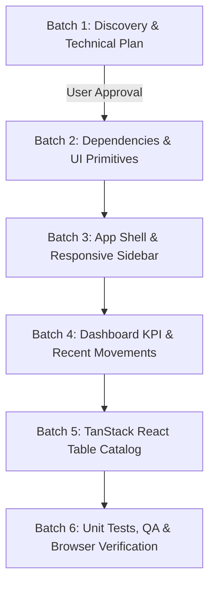

# INVENTRA — DASHBOARD UI/UX REFINEMENT
## Discovery, Skills Research, and Technical Implementation Plan (Batch 1)

> **Document Status:** Draft for Review & User Approval  
> **Target Sub-Phase:** Dashboard & Inventory UI/UX Refinement (Post-Phase 9)  
> **Author:** Antigravity AI Assistant  
> **Date:** 2026-10-14  
> **Workspace:** `c:\Experience\Projects\inventra`  
> **Baseline Status:** Phase 0–Phase 9 Verified (171 Unit Tests Passing, Zero Regressions)

---

## 1. Executive Summary & Context

Fase 9 (*Final QA, Documentation & Assessment Submission*) telah tuntas diselesaikan dengan status 100% pass pada Requirement Traceability Matrix (RTM), verifikasi concurrency locking transaksi stok pada live Supabase, dan kepatuhan penuh terhadap 12 dokumen standar rekayasa.

Pekerjaan saat ini adalah **subfase terpisah** yang berfokus pada **peningkatan kualitas pengalaman pengguna (UI/UX) pada dashboard dan antarmuka katalog Inventra**. Tujuan utama adalah mentransformasikan antarmuka operasional gudang menjadi produk kelas enterprise yang modern, bersih, intuitif, berkinerja tinggi, dan sepenuhnya aksesibel di perangkat desktop, tablet, maupun mobile.

### Prinsip Utama Batch 1:
1. **Zero Code Changes:** Tidak ada perubahan kode aplikasi sebelum rencana disetujui secara eksplisit oleh pengguna.
2. **Zero Unauthorized Dependencies:** Tidak memasang package npm baru (termasuk `@tanstack/react-table`) tanpa persetujuan eksplisit.
3. **Zero Database / Security Schema Drift:** Skema PostgreSQL, RLS policies, RPC functions, dan tata kelola otorisasi RBAC tetap 100% utuh tanpa modifikasi.
4. **Skills Integration:** Mengidentifikasi dan memanfaatkan skill arsitektur UI/UX yang tersedia serta meneliti skill relevan di ekosistem open agent skills.

---

## 2. Audit Kondisi Implementasi Aktual

Audit mendalam terhadap kode aktual (bukan sekadar membaca laporan fase sebelumnya) menghasilkan temuan-temuan berikut:

### 2.1 Kondisi Dashboard (`src/app/[locale]/(dashboard)/dashboard/page.tsx`)
- **Sumber Data & Kalkulasi KPI:**
  - Data diambil melalui `getInventoryDashboardData(supabase)` di `src/services/product-service.ts`.
  - Mengambil seluruh baris produk (`supabase.from('products').select('*')`) dan menghitung ringkasan secara murni di memori melalui domain logic `calculateInventorySummary` (`src/services/inventory-domain.ts`).
  - Menghasilkan 4 metrik KPI: `totalSkus` (jumlah produk unik), `totalUnits` (total unit fisik), `totalInventoryValue` ($\sum(\text{stok} \times \text{harga})$), dan `lowStockCount` (item dengan $\text{stok} < 5$).
- **Low-Stock Alert:**
  - Difilter secara deterministik dengan `p.stock < LOW_STOCK_THRESHOLD` (ambang batas $< 5$).
  - Diurutkan berdasarkan stok terkecil (`a.stock - b.stock`).
  - Ditampilkan dalam bentuk tabel sederhana di dalam `Card`.
- **Aktivitas Mutasi Terbaru (Recent Activity):**
  - **Temuan Kritis:** Halaman dashboard saat ini **belum menampilkan** aktivitas mutasi terbaru. Meskipun key terjemahan `tables.recentActivity` sudah didefinisikan di `messages/id/dashboard.json`, komponen tampilannya belum diimplementasikan di `dashboard/page.tsx`.
- **State Handling (Loading, Error, Empty):**
  - Menggunakan Server Component langsung tanpa boundary `loading.tsx` atau `error.tsx` spesifik di direktori `dashboard/`.
  - Empty state pada watchlist stok rendah ditangani dengan baik (menampilkan pesan sukses hijau saat stok aman).

### 2.2 Kondisi Navigasi & Sidebar (`src/app/[locale]/(dashboard)/layout.tsx`)
- **Struktur Saat Ini:**
  - Layout saat ini menggunakan **Top Navigation Bar** statis setinggi 64px (`h-16`) di bagian header, bukan sidebar lateral.
  - Terdapat `DashboardNav` (`src/features/dashboard/dashboard-nav.tsx`) yang merender 3 tautan tab horizontal: Dashboard (`/dashboard`), Katalog (`/inventory`), dan Riwayat Mutasi (`/movements`).
- **Penanda Menu Aktif:**
  - Menggunakan `usePathname()` dengan styling `bg-primary text-primary-foreground` saat aktif.
- **Identitas Role & Autentikasi:**
  - Menampilkan badge role (`admin_gudang` atau `owner`) di header, nama pengguna, email, `LocaleSwitcher`, `ThemeToggle`, dan tombol `LogoutButton`.
- **Kelemahan Responsivitas Mobile:**
  - Pada layar kecil (`md:hidden`), navigasi dipindahkan ke sub-header horizontal sekunder di bawah header utama (`border-b px-4 py-2`).
  - Belum ada drawer/sheet samping yang ergonomis untuk navigasi mobile satu tangan.
  - Tidak ada sidebar navigasi lateral di desktop yang khas pada aplikasi ERP/Enterprise Inventory.

### 2.3 Kondisi Data Table (`catalog-table.tsx` & `movement-table.tsx`)
- **Status `@tanstack/react-table`:**
  - **Belum terpasang** di `package.json`. Tidak ada jejak impor TanStack Table di seluruh repositori.
  - Seluruh filtering, searching, dan paginasi saat ini dilakukan secara manual menggunakan custom React `useState` + `useMemo` dengan tag HTML native `<table>`, `<thead>`, `<tbody>`, `<tr>`, `<td>`.
- **Fitur Tabel Katalog Saat Ini:**
  - Kolom: SKU, Nama Produk (termasuk thumbnail gambar opsional), Kategori, Satuan, Harga Referensi (IDR), Sisa Stok, Status Kesehatan Stok, dan Tombol Aksi (Edit).
  - Pencarian: Filter in-memory terhadap SKU dan Nama produk.
  - Filter: Dropdown native `<select>` untuk Kategori dan Status Stok (`all`, `low_stock`, `normal`).
  - Paginasi: Sederhana (10 item per halaman) dengan tombol *Previous* / *Next*.
  - **Kekurangan:** Tidak ada fitur **Column Sorting** (klik header untuk urutkan berdasarkan SKU, Nama, Stok, atau Harga); tidak ada column visibility toggle; tidak menggunakan abstraksi headless table yang modular.
- **Aksi Berdasarkan Peran (RBAC):**
  - Admin Gudang: Menampilkan tombol "Tambah Produk" dan "Edit" di setiap baris.
  - Owner: Menampilkan banner notifikasi *Read-Only Notice* dengan tombol mutasi dan edit tersembunyi. Server Actions tetap memvalidasi hak akses di layer backend.

### 2.4 Kondisi Design System & UI Tokens
- **Palet Warna & Tokens (`globals.css`):**
  - Menggunakan token semantic berbasis Tailwind CSS v4 `@theme inline` dan OKLCH.
  - Brand Navy: `oklch(0.291 0.064 250.3)` (`#0F2D4A`).
  - Electric Teal (Accent): `oklch(0.704 0.123 182.5)` (`#14B8A6`).
  - Pale Surface (Secondary): `oklch(0.956 0.015 186.7)` (`#E6F4F2`).
  - Token sidebar sudah didefinisikan di `globals.css` (`--color-sidebar`, `--color-sidebar-foreground`, `--color-sidebar-primary`, dll.) namun belum dimanfaatkan secara optimal karena belum ada sidebar layout.
- **Komponen shadcn/ui yang Tersedia (`src/components/ui/`):**
  - Tersedia: `badge.tsx`, `button.tsx`, `card.tsx`, `dialog.tsx`, `input.tsx`, `label.tsx`, `textarea.tsx`.
  - **Belum tersedia:** `table.tsx`, `sheet.tsx` (untuk mobile drawer), `dropdown-menu.tsx`, `tooltip.tsx`, `separator.tsx`, `skeleton.tsx`.
- **Tema:**
  - `next-themes` aktif dengan mode light default, dark mode kontras tinggi, dan persistensi `localStorage`.
- **i18n:**
  - Dictionary bilingual lengkap di `messages/id/` dan `messages/en/`. Namespace `sidebar.json` sudah dibuat pada Fase 2 dan siap dipakai.

---

## 3. Riset dan Evaluasi Skills

Sesuai instruksi, evaluasi dilakukan terhadap skill yang tersedia di lingkungan Antigravity serta penelusuran di ekosistem open agent skills (`skills.sh`).

### 3.1 Skills yang Ditemukan di Lingkungan Antigravity (.agents/skills)

| Nama Skill | Sumber / Lokasi | Tujuan & Cakupan | Aturan Penting | Relevansi untuk Inventra | Potensi Konflik / Precedence |
| :--- | :--- | :--- | :--- | :--- | :--- |
| **`frontend-design`** | Anthropic (`.agents/skills/frontend-design/SKILL.md`) | Panduan arah visual distingtif, tipografi, hierarki, dan tata letak profesional tanpa elemen klise AI. | - Hindari all-caps label berlebihan.<br>- Batasi panjang baris < 80 karakter.<br>- Gunakan motion hanya untuk merespons aksi.<br>- Tulis copy ringkas dan fungsional. | **SANGAT TINGGI:** Fondasi utama untuk memastikan dashboard terlihat seperti enterprise ERP berkelas, bukan template standar. | Tidak ada. Sesuai dengan filosofi desain di `docs/DESIGN.md`. |
| **`ui-ux-pro-max`** | NextLevelBuilder (`.agents/skills/ui-ux-pro-max/SKILL.md`) | Basis data kecerdasan desain UI/UX (79 style, 119 pedoman UX, aksesibilitas WCAG 2.2, aturan tabel data-dense). | - Kontras teks normal $\ge 4.5:1$.<br>- Touch target minimum $44 \times 44$ px.<br>- Penanganan tabel responsif (horizontal scroll wrapper / card layout).<br>- Jangan andalkan warna semata untuk status.<br>- Fokus indikator yang jelas. | **SANGAT TINGGI:** Membantu audit aksesibilitas, densitas data tabel, navigasi touch, dan state loading/empty. | Tidak ada. Sangat selaras dengan WCAG 2.2 AA di `SECURITY.md` dan `DESIGN.md`. |
| **`nextjs-shadcn`** | Anthropic (`.agents/skills/nextjs-shadcn/SKILL.md`) | Pola integrasi komponen shadcn/ui dan arsitektur Next.js App Router. Termasuk panduan khusus `sidebar.md`. | - Letakkan provider navigasi dan shared layout di layout route.<br>- Pertahankan Server Components seminimal mungkin dibatasi oleh Client boundaries.<br>- Kelola state collapsible sidebar via cookie untuk mencegah hydration mismatch. | **SANGAT TINGGI:** Menjadi cetak biru arsitektur pembuatan sidebar dan integrasi shadcn komponen. | Di `nextjs-shadcn` disebutkan penggunaan `bun`, namun `AGENTS.md` mengatur prioritas mutlak: **HANYA gunakan npm**. Aturan `AGENTS.md` menang. |
| **`tailwind-v4-shadcn`** | Workspace (`.agents/skills/tailwind-v4-shadcn/SKILL.md`) | Konfigurasi Tailwind CSS v4 dengan pattern `@theme inline`, variabel CSS OKLCH, dan tema gelap. | - Pertahankan variabel CSS di `globals.css`.<br>- Hindari arbitrary hex hardcoded di JSX.<br>- Komposisi utility class yang efisien. | **TINGGI:** Memastikan styling sidebar dan tabel mematuhi arsitektur token yang sudah ada. | Tidak ada. Repositori sudah menggunakan Tailwind v4. |
| **`optimized-nextjs-typescript`** | Workspace (`.agents/skills/optimized-nextjs-typescript/SKILL.md`) | Praktik terbaik performa, SSR vs Client boundaries, dan TypeScript strict mode. | - Minimalkan bundle size Client Components.<br>- Hindari `any` (strict mode).<br>- Pisahkan komponen data fetching dari komponen presentasi interaktif. | **TINGGI:** Memastikan penambahan TanStack Table dan Sidebar interaktif tidak membebani performa client bundle. | Tidak ada. |

### 3.2 Penelusuran Skills Ekosistem Terbuka (`npx skills find`)

Melalui mekanisme Skills CLI (`npx skills find`), dilakukan pencarian spesifik untuk TanStack React Table:

- **Skill Ditemukan:** `tanstack-skills/tanstack-skills@tanstack-table`
- **Sumber:** Official TanStack (`https://skills.sh/tanstack-skills/tanstack-skills/tanstack-table`)
- **Popularitas:** 5.2K installs
- **Tujuan:** Panduan resmi implementasi TanStack Table v8, konfigurasi ColumnDef, sorting, faceted filtering, pagination, dan optimasi headless table.
- **Status Saat Ini:** **Belum terpasang di workspace.**
- **Perintah Instalasi (Jika Diizinkan):**
  ```bash
  npx skills add tanstack-skills/tanstack-skills@tanstack-table -g -y
  ```
- **Rekomendasi:** Memasang skill ini akan memberikan referensi arsitektur TanStack Table v8 yang presisi. Namun karena aturan pembatasan, **skill ini tidak dipasang sekarang** dan dicatat dalam daftar persetujuan pengguna.

---

## 4. Analisis Dependensi & Komponen

### 4.1 Status Dependensi `@tanstack/react-table`
- `@tanstack/react-table` saat ini **TIDAK TERPASANG** di `package.json`.
- Versi stabil saat ini di ekosistem npm adalah `^8.21.2`.
- Ukuran bundle core terbilang ringan (~14 kB minified gzipped) dan tidak membawa dependensi runtime pihak ketiga yang berat.
- **Rekomendasi:** Memerlukan izin instalasi dari pengguna:
  ```bash
  npm install @tanstack/react-table
  ```
- **Catatan Arsitektur:** `AGENTS.md` mengecualikan TanStack Query dan ORM, namun `@tanstack/react-table` adalah headless UI table utility yang sepenuhnya berjalan di layer presentasi/klien dan selaras dengan pola shadcn Data Table.

### 4.2 Kebutuhan Komponen shadcn/ui Tambahan
Untuk mendukung antarmuka enterprise dashboard dan TanStack Data Table, komponen UI dasar berikut diusulkan untuk ditambahkan ke `src/components/ui/`:
1. `table.tsx` — Primitif tabel semantic shadcn (`Table`, `TableHeader`, `TableBody`, `TableHead`, `TableRow`, `TableCell`).
2. `sheet.tsx` — Primitif slide-over drawer berbasis `@radix-ui/react-dialog` (sudah terpasang di dependencies) untuk navigasi mobile yang elegan.
3. `dropdown-menu.tsx` — Untuk filter menu, toggle column visibility, dan aksi cepat.
4. `tooltip.tsx` — Untuk memberikan label aksesibel pada icon-only buttons di sidebar saat diciutkan (collapsed).
5. `skeleton.tsx` — Untuk placeholder state saat data sedang dimuat (`loading.tsx`).

---

## 5. Rencana Arsitektur & Desain Teknis

### 5.1 Komponen yang Dipertahankan (Preserved Assets)
Untuk menjamin integritas fungsional dan mencegah regresi:
1. **Core Domain & Services:**
   - `src/services/inventory-domain.ts` (kalkulasi invariant stok, summary KPI, threshold $< 5$).
   - `src/services/product-service.ts` (query database `products`, kategori, dashboard metrics).
   - `src/services/stock-movement-service.ts` (query ledger mutasi dan filter tanggal).
   - `src/services/auth-service.ts` (`requireAuth` boundary dan verifikasi profil).
2. **Server Actions & Database:**
   - `src/app/actions/product-actions.ts` (mutasi CRUD katalog, proteksi imutabilitas stok).
   - `src/app/actions/stock-actions.ts` (RPC atomic pessimistic locking).
   - Seluruh migration SQL Supabase dan RLS policies.
3. **Form Dialogs:**
   - `src/features/catalog/product-form-dialog.tsx` (modal tambah/edit produk).
   - `src/features/movements/stock-mutation-dialog.tsx` (modal mutasi stok IN/OUT).
4. **Validasi & Skema:**
   - `src/schemas/product-schema.ts` dan `src/schemas/stock-movement-schema.ts`.
5. **Autentikasi & Routing:**
   - `src/proxy.ts` (Canonical Next.js 16 proxy auth & i18n).
   - `src/features/auth/logout-button.tsx`.

### 5.2 Komponen Baru dan Modifikasi yang Diusulkan

```
src/
├── app/
│   └── [locale]/
│       └── (dashboard)/
│           ├── layout.tsx                [MODIFY] Migrasi ke App Shell Sidebar Layout
│           ├── dashboard/
│           │   ├── page.tsx              [MODIFY] KPI cards refined, Low-Stock watchlist, Recent Movements feed
│           │   └── loading.tsx           [NEW] Skeleton fallback untuk dashboard metrics
│           └── inventory/
│               ├── page.tsx              [MODIFY] Penyesuaian header & integration dengan TanStack Table
│               └── loading.tsx           [NEW] Skeleton fallback untuk katalog tabel
├── components/
│   ├── ui/
│   │   ├── table.tsx                     [NEW] shadcn table primitive
│   │   ├── sheet.tsx                     [NEW] Slide-over drawer untuk mobile navigation
│   │   ├── dropdown-menu.tsx             [NEW] Dropdown untuk filter & column toggle
│   │   ├── tooltip.tsx                   [NEW] Tooltip untuk collapsed sidebar
│   │   └── skeleton.tsx                  [NEW] Loading state skeletons
│   └── shared/
│       ├── app-sidebar.tsx               [NEW] Desktop sidebar + mobile sheet navigation
│       ├── app-header.tsx                [NEW] Top bar dengan breadcrumbs, role badge, theme & user menu
│       └── data-table/
│           ├── data-table.tsx            [NEW] Generic reusable TanStack Table wrapper
│           ├── data-table-pagination.tsx [NEW] Standar kontrol paginasi dengan ukuran halaman
│           ├── data-table-toolbar.tsx    [NEW] Search bar, filter faceted, dan reset button
│           └── data-table-column-header.tsx [NEW] Header dengan sorting indicator & toggle
└── features/
    ├── dashboard/
    │   ├── kpi-stat-card.tsx             [NEW] Card KPI modular dengan aksen visual & trend context
    │   ├── recent-movements-card.tsx     [NEW] Tabel feed ringkas mutasi terkini
    │   └── low-stock-watchlist.tsx       [NEW] Watchlist interaktif dengan quick-action restock
    └── catalog/
        ├── catalog-table.tsx             [MODIFY] Refactor menggunakan TanStack React Table
        └── catalog-columns.tsx           [NEW] Definisi ColumnDef bertipe kuat untuk katalog
```

---

## 6. Rancangan Antarmuka & Wireframe

### 6.1 Rancangan Sidebar Navigasi (`app-sidebar.tsx`)
- **Desktop ($\ge 1024$px):**
  - Posisi: Fixed di sisi kiri layar dengan lebar 256px (`w-64`) atau mini-rail 64px (`w-16`) saat collapsed.
  - Header Sidebar: Logo Boxes + Teks "Inventra" + Badge versi.
  - Section Menu Utama:
    - Dashboard (`/dashboard`) — Icon: `LayoutDashboard`
    - Katalog Produk (`/inventory`) — Icon: `Package`
    - Riwayat Mutasi (`/movements`) — Icon: `ArrowLeftRight`
  - Section Cepat (Admin Only):
    - Tombol shortcut "Catat Mutasi Stok" atau "Tambah Produk".
  - Footer Sidebar:
    - Profil ringkas (Nama, Email, Role Chip).
    - Kontrol tema (`ThemeToggle`) & bahasa (`LocaleSwitcher`).
    - Tombol Logout (`LogoutButton`).
- **Mobile (< 768px):**
  - Header bar horizontal dengan tombol hamburger (`Menu` icon).
  - Mengklik hamburger membuka **Mobile Drawer Sheet** yang meluncur dari kiri dengan backdrop blur.
  - Menampilkan navigasi lengkap dengan touch target ramah jari ($\ge 44 \times 44$ px).

#### Desktop Layout Wireframe:
```text
+----------------------------------------------------------------------------------------------------+
| [Logo] INVENTRA       | Breadcrumb: Dashboard > Overview                  [ID/EN] [Theme] [Logout] |
| Mini ERP v0.1.0       | Role: Admin Gudang (Authoritative)                        User: John Doe   |
+-----------------------+----------------------------------------------------------------------------+
| [=] MENU UTAMA        | WELCOME BACK, John Doe!                                                    |
|                       | Ringkasan metrik inventaris gudang hari ini                                |
| [*] Dashboard (Aktif) +------------------+------------------+------------------+------------------+
| [ ] Katalog Produk    | TOTAL SKU        | TOTAL UNIT       | TOTAL VALUASI    | STOK MENIPIS     |
| [ ] Riwayat Mutasi    | 30               | 4,250            | Rp 485.200.000   | 4 Item Kritis    |
|                       | SKU terdaftar    | Unit fisik       | Nilai persediaan | Perlu restock    |
| [!] AKSI CEPAT        +------------------+------------------+------------------+------------------+
| [+] Catat Mutasi      |                                                                            |
|                       | +------------------------------------+ +---------------------------------+ |
|                       | | DAFTAR PANTAU STOK MENIPIS (< 5)   | | AKTIVITAS MUTASI TERKINI        | |
|                       | +------------------------------------+ +---------------------------------+ |
|                       | | SKU      Produk    Stok   Aksi     | | Waktu    SKU   Tipe   Qty   User  | |
|                       | | PRD-001  Kabel USB  2     [Mutasi] | | 10:45    P-01  [IN]   +20   Admin | |
|                       | | PRD-004  Adaptor    1     [Mutasi] | | 09:30    P-04  [OUT]  -5    Admin | |
|-----------------------| | PRD-009  Baterai    3     [Mutasi] | | Kemarin  P-12  [IN]   +50   Admin | |
| (o) John Doe          | +------------------------------------+ +---------------------------------+ |
|     admin_gudang      |                                                                            |
+-----------------------+----------------------------------------------------------------------------+
```

#### Mobile Layout Wireframe:
```text
+----------------------------------------------------+
| [= Menu]  INVENTRA               [ID/EN] [Profile] |
+----------------------------------------------------+
| Ringkasan Inventaris                               |
| John Doe • Admin Gudang                            |
+----------------------------------------------------+
| [ TOTAL SKU: 30 ]       | [ TOTAL UNIT: 4,250 ]    |
| [ VALUASI: Rp 485.2M ]  | [ STOK KRITIS: 4 Item ]  |
+----------------------------------------------------+
| DAFTAR PANTAU STOK MENIPIS                         |
| +------------------------------------------------+ |
| | [Img] PRD-001 - Kabel Type-C                   | |
| | Stok: 2 pcs (Kritis)             [Catat Stok]  | |
| +------------------------------------------------+ |
| | [Img] PRD-004 - Adaptor 65W                    | |
| | Stok: 1 pcs (Kritis)             [Catat Stok]  | |
| +------------------------------------------------+ |
| AKTIVITAS TERBARU                                  |
| +------------------------------------------------+ |
| | [+] Masuk: +20 Kabel Type-C (10:45)            | |
| | [-] Keluar: -5 Adaptor 65W (09:30)             | |
+----------------------------------------------------+
```

### 6.2 Rancangan Kolom dan Fitur TanStack React Table Katalog

Struktur kolom yang didefinisikan secara kuat (`ColumnDef<Product>[]`):
1. **SKU (`sku`):**
   - Header: Sortable (A-Z / Z-A).
   - Cell: Badge font monospaced (`font-mono font-bold text-primary`).
2. **Produk (`name`):**
   - Header: Sortable.
   - Cell: Thumbnail gambar 36x36px dengan fallback SVG `Package` + Nama produk (bold) + Deskripsi singkat (truncate).
3. **Kategori (`category`):**
   - Header: Filterable via Faceted Filter.
   - Cell: Badge outline neutral kapital.
4. **Satuan (`unit`):**
   - Cell: Text muted (`pcs`, `box`, `unit`).
5. **Harga Referensi (`price`):**
   - Header: Sortable (Murah - Mahal).
   - Cell: Format mata uang IDR (`Intl.NumberFormat`), perataan kanan (`text-right`).
6. **Stok Fisik (`stock`):**
   - Header: Sortable (Sedikit - Banyak).
   - Cell: Angka tebal font mono. Teks merah (`text-destructive`) jika $< 5$.
7. **Status Kesehatan (`status`):**
   - Cell:
     - Jika $< 5$: Badge `destructive` dengan ikon `AlertTriangle` + label "Menipis (< 5)".
     - Jika $\ge 5$: Badge `success` dengan ikon `CheckCircle2` + label "Aman".
8. **Aksi (`actions`) — Khusus Admin Gudang:**
   - Cell: Tombol `Edit` (membuka modal edit produk).
   - Pada peran Owner: Kolom ini otomatis disembunyikan via `columnVisibility`.

#### Fitur Interaktif TanStack Table:
- **Global Search:** Input pencarian multi-atribut (mencocokkan SKU dan Nama).
- **Faceted Filters:** Dropdown multi-select kategori dan status stok.
- **Sorting State:** Klik header kolom dengan indikator panah atas/bawah/netral.
- **Paginasi Fleksibel:** Opsi pemilihan jumlah baris per halaman (10, 20, 50 item) dan lompatan halaman.
- **Column Visibility:** Dropdown toggle untuk memilih kolom yang ingin ditampilkan/disembunyikan.
- **Empty State Elegan:** Menampilkan ilustrasi dan tombol "Reset Filter" saat pencarian tidak menghasilkan data.

#### Catalog Table Wireframe:
```text
+----------------------------------------------------------------------------------------------------+
| KATALOG INVENTARIS PRODUK                                                         [+ Tambah Produk]|
| Kelola master data produk dan pantau status persediaan stok                       (Admin Gudang)   |
+----------------------------------------------------------------------------------------------------+
| [Q Cari SKU atau nama produk...]  [Kategori: Semua v]  [Status: Semua v]  [Kolom v]  [Reset Filter]|
+----------------------------------------------------------------------------------------------------+
| SKU ^v    PRODUK ^v             KATEGORI     SATUAN   HARGA ^v         STOK ^v   STATUS    AKSI    |
+----------------------------------------------------------------------------------------------------+
| PRD-001   [img] USB-C Hub 7in1  Elektronik   pcs      Rp 350.000            2    [!] Menipis [Edit]|
| PRD-002   [img] Mouse Wireless  Aksesoris    pcs      Rp 150.000           45    [v] Aman    [Edit]|
| PRD-003   [img] Keyboard Mech   Aksesoris    pcs      Rp 850.000           12    [v] Aman    [Edit]|
| PRD-004   [img] Kabel HDMI 2m   Elektronik   pcs      Rp  75.000            1    [!] Menipis [Edit]|
+----------------------------------------------------------------------------------------------------+
| Menampilkan 1 - 10 dari 30 produk             Baris per halaman: [10 v]   [< Prev] [1] [2] [Next >]|
+----------------------------------------------------------------------------------------------------+
```

---

## 7. Strategi Aksesibilitas, Responsivitas, dan i18n

### 7.1 Standar Aksesibilitas (WCAG 2.2 AA)
Mengacu pada pedoman `ui-ux-pro-max` dan `DESIGN.md`:
1. **Rasio Kontras:**
   - Teks normal memiliki kontras minimal $4.5:1$ terhadap background di mode terang maupun gelap.
   - Elemen interaktif dan border memiliki kontras minimal $3:1$.
2. **Indikator Status Bebas Ketergantungan Warna:**
   - Status stok menipis tidak hanya menggunakan warna merah, melainkan menyertakan ikon `AlertTriangle`, teks "Menipis", dan angka unit riil.
3. **Navigasi Keyboard:**
   - Seluruh elemen interaktif (tombol, input, link, drawer toggle, sortable header) dapat diakses dengan Tab / Shift+Tab.
   - Tombol sortable header mendukung Enter dan Spasi untuk mengubah arah sorting.
   - Focus ring tampak jelas (`focus-visible:ring-2 focus-visible:ring-accent`).
4. **Semantik ARIA:**
   - Tombol icon-only memiliki `aria-label` eksplisit (misal: "Buka menu navigasi", "Ciutkan sidebar").
   - Ikon dekoratif yang berdampingan dengan teks diberi `aria-hidden="true"`.
   - Tabel TanStack menggunakan markup HTML semantic native `<table>`, `<thead>`, `<tbody>`, `<th>`, `<td>` dengan scope yang benar.

### 7.2 Strategi Responsif (Desktop, Tablet, Mobile)
| Breakpoint | Target Layar | Perilaku Sidebar | Perilaku Dashboard | Perilaku Tabel Katalog |
| :--- | :--- | :--- | :--- | :--- |
| **Desktop** ($\ge 1024$px) | Laptop & Monitor ($1280 \times 800+$) | Sidebar tetap terlihat di kiri (lebar 256px), dapat diciutkan ke mini-rail (64px). | Grid 4 kolom untuk KPI, 2 kolom untuk Watchlist & Mutasi Terkini. | Full Data Table dengan seluruh kolom terlihat, sorting, dan filter toolbar lengkap. |
| **Tablet** ($768$px – $1023$px) | iPad & Tablet Portabel | Sidebar otomatis diciutkan menjadi icon rail atau drawer samping. | Grid 2 kolom untuk KPI, watchlist dan mutasi bertumpuk vertikal. | Data Table dengan wrapper `overflow-x-auto` yang mulus atau kolom sekunder disembunyikan default. |
| **Mobile** ($< 768$px) | Smartphone ($375 \times 667+$) | Sidebar disembunyikan; diakses melalui tombol hamburger menjadi slide-over Drawer Sheet. | Grid 1–2 kolom untuk KPI, card ringkas berurutan vertikal. | Tampilan hybrid: data table dengan scroll horizontal ramah sentuh atau card layout terpadu. |

### 7.3 Strategi i18n & Tema
1. **Dukungan Dua Bahasa Penuh:**
   - Seluruh teks antarmuka baru menggunakan `next-intl` dengan kamus `messages/id/` (default) dan `messages/en/`.
   - Tidak ada teks hardcoded Bahasa Indonesia maupun Bahasa Inggris di dalam komponen JSX.
2. **Dukungan Tema Terang & Gelap:**
   - Menggunakan semantic CSS variables (`bg-card`, `text-foreground`, `border-border`, dll.).
   - Tidak menggunakan arbitrary inline styles atau hex color hardcoded.

---

## 8. Rencana Pengujian dan Verifikasi

Untuk memastikan tidak ada regresi dan seluruh peningkatan berfungsi dengan sempurna:

### 8.1 Automated Unit Tests (Vitest)
1. **Table Filtering & Sorting Logic Test:**
   - Menulis pengujian unit untuk fungsi komparator sorting TanStack Table (string SKU, nama case-insensitive, angka harga, angka stok).
   - Menulis pengujian filter faceted (kombinasi kategori + ambang batas stok $< 5$).
2. **Regression Check:**
   - Menjalankan seluruh 171 tes unit yang ada saat ini (`npm run test:unit`) untuk memastikan tidak ada efek samping pada auth, product service, atau domain inventory logic.

### 8.2 Browser Subagent Verification (E2E & Responsiveness)
Menggunakan tool `browser_subagent` untuk menguji alur visual di browser aktual:
1. **Desktop Flow (1440x900):**
   - Login sebagai `admin_gudang` dan `owner`.
   - Verifikasi tampilan sidebar desktop dan navigasi antar halaman.
   - Uji klik sorting pada kolom SKU, Nama, dan Stok.
   - Uji pencarian katalog dan filter status stok.
2. **Mobile Flow (375x812 - iPhone):**
   - Uji pembukaan mobile drawer sheet melalui tombol hamburger.
   - Uji navigasi link dan penutupan drawer saat tautan diklik.
   - Verifikasi tidak adanya layout overflow horizontal pada layar sempit.
3. **Dark Mode Inspection:**
   - Toggle tema gelap dan verifikasi kontras teks, border tabel, dan kartu KPI.

---

## 9. Estimasi Tahapan Pengerjaan (Phased Batches)

Pekerjaan dipecah menjadi batch-batch kecil yang terukur untuk memudahkan review:



- **Batch 1 (Selesai pada sesi ini):**
  - Audit kode aktual, riset skills, perumusan arsitektur, dan pembuatan dokumen rencana teknis.
- **Batch 2 (Dependensi & UI Primitives):**
  - Pemasangan `@tanstack/react-table` (setelah persetujuan).
  - Penambahan komponen UI: `table.tsx`, `sheet.tsx`, `dropdown-menu.tsx`, `tooltip.tsx`, `skeleton.tsx`.
  - Penambahan translation keys di `messages/id/` dan `messages/en/`.
- **Batch 3 (Responsive Sidebar & App Shell):**
  - Implementasi `app-sidebar.tsx` dan `app-header.tsx`.
  - Refactor `src/app/[locale]/(dashboard)/layout.tsx` menjadi sidebar enterprise shell.
  - Verifikasi mobile drawer sheet dan penanda menu aktif.
- **Batch 4 (Penyempurnaan Dashboard):**
  - Refactor KPI cards dengan styling modern dan aksen visual.
  - Implementasi kartu Aktivitas Mutasi Terkini (`recent-movements-card.tsx`).
  - Penyempurnaan Watchlist Stok Menipis dengan shortcut aksi restock.
- **Batch 5 (TanStack React Table Katalog):**
  - Implementasi `catalog-columns.tsx` dan reusable `data-table.tsx`.
  - Refactor `src/features/catalog/catalog-table.tsx` menggunakan TanStack Table.
  - Fitur sorting, searching, faceted filter kategori/stok, dan pagination.
  - Penegakan hak akses RBAC (`admin_gudang` edit, `owner` read-only).
- **Batch 6 (Testing, QA & Laporan Akhir):**
  - Penulisan unit test untuk sorting dan filtering.
  - Menjalankan seluruh test suite Vitest (target: 100% pass).
  - Pengujian visual browser pada desktop dan mobile.
  - Pembuatan laporan penyelesaian akhir subfase.

---

## 10. Daftar Hal yang Memerlukan Persetujuan Pengguna

Sebelum masuk ke tahap eksekusi kode (Batch 2), hal-hal berikut memerlukan persetujuan eksplisit:

1. **Pemasangan dependensi npm:**
   - Izin untuk menjalankan `npm install @tanstack/react-table` (diperlukan untuk headless table engine).
2. **Pemasangan agent skill (Opsional):**
   - Izin apakah pengguna ingin memasang skill `tanstack-skills/tanstack-skills@tanstack-table` ke agent workspace atau cukup mengandalkan implementasi kode standar yang sudah dirancang.
3. **Persetujuan desain Layout Shell:**
   - Penggantian layout top header menjadi **Persistent Left Sidebar** pada desktop dan **Slide-over Drawer Sheet** pada mobile.
4. **Persetujuan penambahan fitur Dashboard:**
   - Penambahan kartu *Aktivitas Mutasi Terkini* pada halaman overview dashboard di samping *Watchlist Stok Menipis*.
5. **Persetujuan Urutan Batch Pengerjaan:**
   - Persetujuan untuk mengeksekusi implementasi secara bertahap mulai dari Batch 2.
