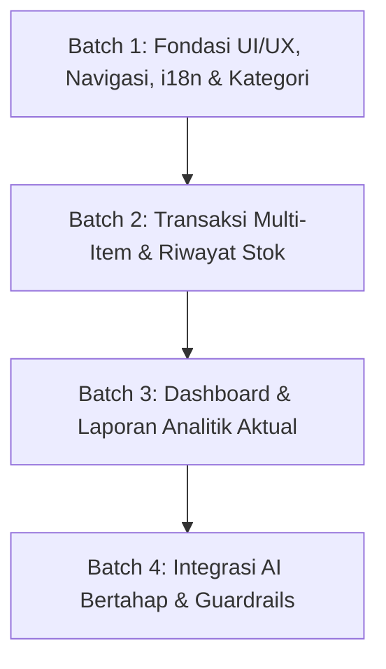

# INVENTRA — MASTER REVISION PLAN
## Batch 1A: Audit Update and Consolidated Technical Plan

> **Status Dokumen:** Master Technical Plan & System Audit Resmi (Pasca Phase 9 & Dashboard UI/UX Refinement)  
> **Ruang Lingkup:** Batch 1–4 Konsolidasi Arsitektur, Desain, Database, dan Eksekusi  
> **Penyusun:** Antigravity AI Assistant  
> **Tanggal:** 14 Oktober 2026  
> **Workspace:** `c:\Experience\Projects\inventra`  
> **Verifikasi Baseline:** 15 Test Files, **175 Unit Tests Passing (100% PASS)**, Next.js 16 Turbopack Build Bersih, Clean Git Tree  
> **Mandat Batasan:** **DILARANG** mengubah source code aplikasi, menginstal dependensi baru, menjalankan migrasi database, memodifikasi peran (roles), atau melakukan git commit/push pada tahap audit ini.

---

## 1. Kondisi Aktual Repository

Audit empiris menyeluruh telah dilakukan langsung terhadap seluruh berkas kode sumber, konfigurasi bundler, skema basis data PostgreSQL, kamus internasionalisasi, dan repositori pengujian per 14 Oktober 2026:

### 1.1 Metrik Baseline & Verifikasi Sistem
- **Git Status:** Tree dalam kondisi bersih (`clean working tree`). Tidak ada berkas uncommitted, unstaged modifications, file sementara (*scratch scripts*), atau secret credentials yang tercecer.
- **Test Suite (Vitest v3.2.7):**
  - Perintah verifikasi: `npm run test:unit`
  - Hasil audit: **15 file pengujian, 175 pengujian lulus 100% (0 gagal, 0 flaky)** dengan durasi ~33 detik.
  - Cakupan tes aktif: Simulasi logika RPC pesimistis (21 tes), sintaks SQL & kontrak migrasi (23 tes), integrasi i18n dwibahasa (30 tes), domain summary & valuasi stok (7 tes), schema input katalog & mutasi (18 tes), domain mutasi & ledger stok (23 tes), otentikasi & RBAC session service (25 tes), Server Actions (12 tes), serta kolom TanStack Table (4 tes).
- **Arsitektur Compiler & Framework:**
  - Next.js 16.4.0 App Router dengan Turbopack engine (`next dev` & `next build`).
  - React 19.3.0 & React DOM 19.3.0.
  - TypeScript 5.x strict mode aktif tanpa error kompilasi.
- **Sistem Desain & Token Warna:**
  - Tailwind CSS v4 dengan arsitektur `@theme inline` di `src/app/globals.css`.
  - Menggunakan palet semantic OKLCH berdaya kontras tinggi: Brand Navy (`#0F2D4A` / `oklch(0.291 0.064 250.3)`), Electric Teal (`#14B8A6` / `oklch(0.704 0.123 182.5)`), Warm Surface (`#E6F4F2` / `oklch(0.957 0.015 182.5)`), dan Slate Dark Surface (`#1F2937` / `oklch(0.278 0.033 256.8)`).
- **Basis Data & Keamanan (Supabase PostgreSQL):**
  - Instance Supabase live: `vwzlvsggpuvmkubkzfzp`.
  - Tiga berkas migrasi aktif di `supabase/migrations/`:
    1. `20261013000001_initial_schema.sql` (Tabel `profiles`, `products`, `stock_movements`, check constraints, enum roles `admin_gudang` dan `owner`, serta security triggers).
    2. `20261013000002_rls_policies.sql` (Kebijakan Row-Level Security ketat untuk profiles, products, dan stock_movements).
    3. `20261013000003_stock_mutation_rpc.sql` (Fungsi PostgreSQL RPC `record_stock_movement` dengan pessimistic row lock `FOR UPDATE` dan proteksi mutasi ganda atomik).
- **Otentikasi & Manajemen Sesi:**
  - `@supabase/ssr` v0.12.7 dengan enkapsulasi cookie di Server Components dan Server Actions.
  - Hak akses otorisasi diverifikasi secara autoritatif melalui pembacaan record `public.profiles` di server boundary, bukan hanya dari metadata JWT.
- **Internasionalisasi (i18n):**
  - Menggunakan `next-intl` v4.14.9 dengan dynamic segment `src/app/[locale]/` dan canonical request handler `src/proxy.ts`.
  - Berkas kamus tersimpan di root `messages/id/*.json` dan `messages/en/*.json` (terdiri dari 7 namespace: `auth`, `common`, `dashboard`, `index`, `navigation`, `sidebar`, `validation`).
- **Package Manifest (`package.json`):**
  - Dependensi inti: `@hookform/resolvers`, `@supabase/ssr`, `@supabase/supabase-js`, `@tanstack/react-table` (v8.21.2), `class-variance-authority`, `cn`, `lucide-react`, `next` (16.4.0), `next-intl`, `next-themes`, `radix-ui`, `react` (19.3.0), `react-hook-form`, `shadcn`, `zustand`.

---

## 2. Inventaris Fitur: Tersedia, Belum Tersedia, dan Perlu Direvisi

Berdasarkan penelusuran kode sumber aktual, berikut adalah inventarisasi fitur nyata di repositori saat ini versus backlog rancangan:

| Modul / Komponen | Status Implementasi | Fitur yang Benar-Benar Sudah Ada | Kekurangan / Fitur yang Belum Ada | Bagian yang Perlu Direvisi |
| :--- | :--- | :--- | :--- | :--- |
| **App Shell & Navigasi** | Sebagian Lengkap | - `DashboardShell` terintegrasi dengan Persistent Desktop Sidebar (`src/components/shared/app-sidebar.tsx`).<br>- Dukungan collapse toggle (`w-64` ke `w-18`).<br>- Mobile drawer slide-over (`Sheet`) di `src/components/shared/app-header.tsx`.<br>- Dinamis breadcrumb dan user role chip di header. | - Navigasi untuk halaman baru: `/categories`, `/transactions`, `/reports`, `/assistant`.<br>- State collapse sidebar desktop belum tersimpan di cookie browser (masih React `useState` lokal sehingga reset saat navigasi/refresh). | - Tambahkan sinkronisasi cookie untuk state sidebar guna mencegah Cumulative Layout Shift (CLS).<br>- Tambahkan tautan menu baru yang selaras dengan izin hak akses. |
| **Dashboard Metrik & KPI** | Sebagian Lengkap | - 4 Kartu KPI modular (`KpiStatCard`): Total SKU, Total Unit Fisik, Valuasi Total Stok (IDR), dan Low Stock Alerts.<br>- `LowStockWatchlist`: Daftar barang dengan stok < 5 unit.<br>- `RecentMovementsCard`: Feed ringkas 5 mutasi stok terakhir.<br>- Perhitungan in-memory aman via domain engine `calculateInventorySummary`. | - Filter rentang waktu analitik (Hari Ini, Minggu Ini, Bulan Ini, Tahun Ini, Custom Range, All-time).<br>- Sparkline visual mini-trend pada kartu KPI.<br>- Grafik perbandingan tren mutasi masuk vs keluar (IN vs OUT).<br>- Link menuju halaman detail pergerakan per produk (`/inventory/[id]`). | - **Pembersihan Teks Hardcoded:** Seluruh deskripsi kartu KPI, badge "Dashboard & Katalog Terpadu", dan teks kartu "Ringkasan Keamanan & Otorisasi Sesi" masih berupa teks statis Bahasa Indonesia di `src/app/[locale]/(dashboard)/dashboard/page.tsx`. |
| **Katalog Produk** | Lengkap (Dasar) | - Terintegrasi dengan `@tanstack/react-table` v8.21.2 (`CatalogTable` & `catalog-columns.tsx`).<br>- Sorting kolom multi-arah (SKU, Nama, Kategori, Harga, Sisa Stok).<br>- Pencarian teks instan (SKU dan Nama produk).<br>- Filter status stok (`all`, `low_stock`, `normal`) dan filter kategori dropdown.<br>- Kontrol visibilitas kolom (`DataTableViewOptions`) & paginasi 10 baris (`DataTablePagination`).<br>- Modal Tambah/Edit Produk (`ProductFormDialog`) dengan penjagaan imutabilitas stok. | - Upload berkas gambar produk ke cloud storage (masih berupa input teks URL biasa).<br>- Filter lanjutan rentang harga (*price range slider/input*).<br>- Tautan langsung dari baris produk ke riwayat pergerakan produk. | - **Pembersihan Teks Hardcoded:** Label kolom di `catalog-columns.tsx` ("Nama Produk", "Kategori", "Satuan", "Harga", "Stok", "Status", "Stok Menipis", "Stok Normal", "Aksi", "Edit") dan teks counter `<span>{products.length} SKU Terdaftar</span>` di `inventory/page.tsx` masih hardcoded Bahasa Indonesia. |
| **Kategori Produk** | Belum Ada (Freeform) | - Kategori tersimpan sebagai kolom teks string bebas (`varchar`) pada tabel `public.products`.<br>- Opsi kategori di UI diambil dari deduplikasi in-memory (`Array.from(new Set(...))`). | - Tabel master terpisah `public.categories`.<br>- Halaman manajemen kategori dedicated (`/categories`).<br>- Operasi CRUD (Create, Read, Update, Delete) kategori dengan validasi dependensi produk.<br>- Foreign key relationship yang aman antara produk dan kategori. | - Rancang migrasi relasi data dari string bebas ke tabel master kategori tanpa menyebabkan kehilangan data (*zero data loss*) pada 30 produk eksisting. |
| **Penyimpanan & Upload Gambar** | Belum Ada | - Hanya field input teks `imageUrl` biasa pada form produk. | - Komponen reusable `ImageDropzone` dengan drag & drop, file picker, real-time image preview, tombol ganti (replace), dan hapus (remove).<br>- Validasi tipe MIME (`image/png`, `image/jpeg`, `image/webp`) dan batas ukuran berkas (maks 2 MB).<br>- Supabase Storage bucket `product-images` dan kebijakan akses RLS storage. | - Pisahkan secara arsitektural antara upload foto fisik oleh staf gudang dan pembuatan gambar ilustrasi produk oleh AI. |
| **Transaksi & Mutasi Stok** | Sebagian Lengkap | - Modal dialog mutasi stok tunggal di `/movements` (`StockMutationDialog`).<br>- Server Action atomik `recordStockMovementAction`.<br>- RPC PostgreSQL `public.record_stock_movement` dengan kunci pesimistis `FOR UPDATE`.<br>- Validasi pencegahan stok negatif (*overdraft protection*) di level formulir dan trigger database. | - Halaman transaksi dedicated (`/transactions`) yang langsung membuka formulir transaksi.<br>- Modal dialog pemilih produk (`ProductPickerModal`) dengan tampilan grid, pencarian cepat, thumbnail, dan status stok riil.<br>- **Transaksi stok multi-item** (pencatatan banyak SKU dalam satu nomor transaksi atau batch). | - RPC saat ini hanya memproses 1 produk per transaksi. Transaksi multi-item **TIDAK DAPAT** atomik tanpa penambahan RPC batch di PostgreSQL. |
| **Riwayat Stok & Ledger** | Sebagian Lengkap | - Halaman `/movements` dengan tabel HTML standar (`<table>`).<br>- Filter tipe mutasi (IN / OUT / ALL).<br>- Filter rentang tanggal (Start Date & End Date).<br>- Pencarian teks pada SKU, nama produk, dan catatan mutasi.<br>- Menampilkan stok sebelum, kuantitas mutasi, stok sesudah, aktor pembuat, dan timestamp. | - Integrasi `@tanstack/react-table` pada halaman riwayat pergerakan stok.<br>- Grouping riwayat berdasarkan nomor transaksi / batch ID.<br>- Fitur ekspor data ledger (CSV / Excel). | - Refaktor `movement-table.tsx` menggunakan komponen generic `DataTable`.<br>- Bersihkan teks hardcoded badge "Mode Audit" dan label formulir filter ke `messages/*`. |
| **Analisis & Laporan** | Belum Ada | - Hanya feed 5 mutasi terakhir di dashboard. | - Halaman analitik dan laporan inventaris terdedikasi (`/reports`).<br>- Visualisasi grafik pergerakan stok masuk vs keluar harian/mingguan.<br>- Filter periode fleksibel (Hari Ini, Minggu Ini, Bulan Ini, Tahun Ini, Custom, All-Time).<br>- Ledger pergerakan spesifik untuk masing-masing produk di `/inventory/[id]`. | - Seluruh kalkulasi laporan wajib berasal dari agregasi data aktual di database Supabase (bukan nilai dummy atau angka rekaan AI). |
| **Integrasi AI** | Belum Ada (Direncanakan) | - Belum ada implementasi kode AI (hanya direncanakan untuk Phase 10 / Batch 4). | - Arsitektur provider-agnostic untuk penyedia selain OpenAI (misal Google Gemini, Anthropic Claude, DeepSeek, dsb).<br>- 7 fitur AI: Stock Insights, Inventory Assistant, Report Summary, Bantuan Draf Produk, Penyusun Deskripsi, Rekomendasi Produk Baru, dan Generator Gambar Ilustrasi. | - AI wajib berjalan server-side saja, mematuhi RBAC, tidak memiliki hak tulis langsung ke basis data, dan menerapkan pola verifikasi manusia (*human-in-the-loop*). |
| **Role & Otorisasi** | 2-Role Aktif | - 2 Peran operasional aktif: `admin_gudang` (akses penuh tulis/mutasi) dan `owner` (akses hanya-baca/audit).<br>- Pengecekan autoritatif di database check constraints, triggers, RLS policies, RPC functions, dan Server Actions. | - Usulan pemisahan 3 peran: `administrator`, `staff_gudang`, dan `auditor`. | - Ketergantungan hardcoded pada 2 peran lama tersebar di 50+ lokasi kode, skema basis data, dan seluruh test suite. Perlu strategi migrasi non-destruktif terpisah. |

---

## 3. Hasil Skills Audit & Resolusi Konflik

Audit telah dilakukan terhadap 10 skill yang relevan di workspace `.agents/skills`:

```
.agents/skills/
├── frontend-design/             # Visual distinctiveness, intentional design, typography rules
├── ui-ux-pro-max/               # Design intelligence, WCAG 2.2 AA accessibility, data tables
├── nextjs-shadcn/               # Next.js App Router + shadcn composition & persistent sidebar rules
├── nextjs-react-typescript/     # Strict React 19, functional patterns, type safety
├── tanstack-table/              # TanStack Table v8 architecture & headless data grids
├── tailwind-v4-shadcn/          # Tailwind CSS v4 @theme inline, CSS variable tokens, dark mode
├── supabase-postgres-best-practices/ # Postgres indexing, concurrency locks, RLS security
├── nextjs-supabase-auth/        # @supabase/ssr cookie auth, server boundaries
├── ai-image-generation/         # Inference CLI image models (Gemini, FLUX, Reve)
└── find-skills/                 # Skills discovery & ecosystem package evaluation
```

### 3.1 Evaluasi & Instruksi Kunci Tiap Skill

1. **`frontend-design` (Anthropic):**
   - *Instruksi Kunci:* Hindari template klise AI (jangan gunakan kartu berbayang abu-abu lembut tanpa hierarki kontras, jangan gunakan all-caps label berlebih, hindari aksen teks satu kata acak). Gunakan tipografi terarah (Inter dengan skala optik proporsional), micro-motion hanya untuk merespons interaksi pengguna, dan copywriting ringkas berbasis tugas (*Jobs to be Done*).
   - *Penerapan di Inventra:* Memberikan aksen border kiri spesifik 4px pada kartu ringkasan KPI, menyusun layout yang tenang namun berwibawa khas ERP logistik kelas atas.
2. **`ui-ux-pro-max` (NextLevelBuilder):**
   - *Instruksi Kunci:* Standar kepatuhan aksesibilitas WCAG 2.2 AA (kontras rasio teks $\ge 4.5:1$, touch target minimum $44 \times 44$ px untuk mobile), pencegahan Cumulative Layout Shift (CLS < 0.1), penanganan horizontal overflow pada tabel data-dense menggunakan card layout / explicit scroll container, serta semantic color tokens.
   - *Penerapan di Inventra:* Mendesain layout responsif untuk form transaksi multi-item, tombol aksi tabel, dan dialog upload gambar.
3. **`nextjs-shadcn` (Anthropic):**
   - *Instruksi Kunci:* Arsitektur layout persistent sidebar, pembatasan boundary Client Component sekecil mungkin, penggunaan primitive Radix UI (`asChild` pattern), dan validasi otorisasi di dalam Server Actions dan data access layer.
   - *Penerapan di Inventra:* Memastikan App Shell, dialog modal, dan dropdown menggunakan token tema semantic dan struktur Next.js App Router yang benar.
4. **`nextjs-react-typescript` (Mindrally):**
   - *Instruksi Kunci:* Penulisan TypeScript strict tanpa `any`, preferensi `interface` dibanding `type` untuk deklarasi publik objek, eliminasi `enum` (gunakan literal union types), fungsi murni, dan penanganan search parameter URL via state declarative.
   - *Penerapan di Inventra:* Struktur form React Hook Form + Zod, tipe payload mutasi, dan definisi kolom tabel TanStack.
5. **`tanstack-table` (TanStack):**
   - *Instruksi Kunci:* Menjaga kestabilan referensi kolom dan data dengan `useMemo` untuk mencegah infinite loop re-render, pemisahan logika headless dari markup visual, pemanfaatan helper `createColumnHelper` atau `ColumnDef<T>`, dan implementasi client-side vs server-side filtering/sorting yang bersih.
   - *Penerapan di Inventra:* Mempertahankan `CatalogTable` dan merefaktor `MovementTable` menggunakan generic wrapper `DataTable`.
6. **`tailwind-v4-shadcn`:**
   - *Instruksi Kunci:* Pola konfigurasi Tailwind CSS v4 `@theme inline`, arsitektur CSS variables tanpa wrapper `hsl()` ganda, pemeliharaan dark mode via `class` strategy, serta pencegahan konflik plugin animasi lama.
   - *Penerapan di Inventra:* Konsistensi token border, badge, surface, dan aksen warna di `src/app/globals.css`.
7. **`supabase-postgres-best-practices` (Supabase):**
   - *Instruksi Kunci:* Kategori kritis mencakup Query Performance (indeks pada foreign key dan filter), Concurrency & Locking (`FOR UPDATE` pessimistic row lock untuk menghindari race conditions stok), Security & RLS (`SET search_path = ''` pada fungsi `SECURITY DEFINER`, pencegahan bypass privilege), dan integritas transaksional.
   - *Penerapan di Inventra:* Audit RPC mutasi stok dan perancangan skema batch transaksi multi-item.
8. **`nextjs-supabase-auth`:**
   - *Instruksi Kunci:* Integrasi `@supabase/ssr`, pemisahan context client browser vs server (`cookies()`), perlindungan rute di level proxy/middleware dan boundary layout (`requireAuth`).
   - *Penerapan di Inventra:* Menjamin setiap Server Action dan data loader memverifikasi identitas pengguna dan role secara autoritatif.
9. **`ai-image-generation`:**
   - *Instruksi Kunci:* Penggunaan model generasi gambar (Gemini 3 Pro Image, FLUX, Reve) untuk aset ilustrasi produk, spesifikasi rasio aspek (1:1 untuk thumbnail e-commerce/ERP), studio lighting prompt engineering, dan pemisahan rendering media dari core app.
   - *Penerapan di Inventra:* Arsitektur generator foto produk AI di Batch 4 yang menghasilkan file visual untuk kemudian disimpan ke Supabase Storage.
10. **`find-skills`:**
    - *Instruksi Kunci:* Tata cara evaluasi skill eksternal tanpa asal pasang. Melarang instalasi paket sembarangan tanpa persetujuan pengguna.
    - *Penerapan di Inventra:* Memastikan bahwa tidak ada skill atau modul eksternal baru yang diinstal selama fase audit dan konsolidasi rencana.

### 3.2 Resolusi Konflik Aturan (Precedence Hierarchy)
Sesuai Bagian 8 `AGENTS.md`, jika terdapat pertentangan panduan antar skill dan standar proyek, urutan hierarki yang wajib dipatuhi adalah:
1. **Root `AGENTS.md` (Prioritas Tertinggi):**
   - *Konflik:* `nextjs-shadcn` menyarankan penggunaan `bun`, `tailwind-v4-shadcn` menyebut `bun add` atau `pnpm dlx`.
   - *Resolusi:* **DITOLAK.** Proyek Inventra **HANYA menggunakan npm**. Dilarang menggunakan bun, pnpm, atau yarn.
   - *Konflik:* Repositori memiliki skill Prisma (`prisma-next-supabase`), namun Prisma secara eksplisit dilarang oleh arsitektur proyek.
   - *Resolusi:* Larangan ORM / Prisma mutlak berlaku. Proyek tetap menggunakan native Supabase query builder dan SQL migrations.
2. **Project Documentation (`docs/PRD.md`, `docs/ARCHITECTURE.md`, `docs/DATABASE.md`, `docs/API.md`):**
   - *Resolusi:* Hak akses role dan aturan imutabilitas stok di PostgreSQL triggers tidak boleh dikompromikan oleh komponen UI apa pun.
3. **Domain Skills:** Digunakan untuk detail implementasi micro (misal syntax TanStack Table dan aksesibilitas form).

---

## 4. Daftar File: Dipertahankan, Diubah, dan Direncanakan

Berikut adalah inventaris komprehensif seluruh berkas terkait rencana revisi Batch 1–4:

```
inventra/
├── messages/                                    # Kamus i18n dwibahasa (root messages)
│   ├── id/                                      # Bahasa Indonesia
│   │   ├── dashboard.json                       [DIUBAH - BATCH 1] Pindahkan seluruh string hardcoded
│   │   ├── common.json                          [DIUBAH - BATCH 1] Tambahkan label umum & status
│   │   ├── navigation.json                      [DIUBAH - BATCH 1] Tambahkan menu Kategori, Transaksi, Laporan, AI
│   │   └── validation.json                      [DIUBAH - BATCH 1] Pesan validasi formulir baru
│   └── en/                                      # Bahasa Inggris
│       ├── dashboard.json                       [DIUBAH - BATCH 1] Terjemahan bahasa Inggris padanan
│       ├── common.json                          [DIUBAH - BATCH 1] English common labels
│       ├── navigation.json                      [DIUBAH - BATCH 1] English navigation labels
│       └── validation.json                      [DIUBAH - BATCH 1] English validation messages
├── src/
│   ├── app/
│   │   ├── [locale]/
│   │   │   ├── (dashboard)/
│   │   │   │   ├── layout.tsx                   [DIUBAH - BATCH 1] Sinkronisasi cookie sidebar & link baru
│   │   │   │   ├── dashboard/page.tsx           [DIUBAH - BATCH 1 & 3] Pembersihan i18n, sparkline & date filter
│   │   │   │   ├── inventory/page.tsx           [DIUBAH - BATCH 1] Pembersihan i18n counter SKU
│   │   │   │   ├── inventory/[id]/page.tsx      [DIRENCANAKAN - BATCH 3] Halaman detail produk & pergerakan stok
│   │   │   │   ├── categories/page.tsx          [DIRENCANAKAN - BATCH 1] Halaman manajemen master kategori
│   │   │   │   ├── transactions/page.tsx        [DIRENCANAKAN - BATCH 2] Halaman input transaksi langsung
│   │   │   │   ├── movements/page.tsx           [DIUBAH - BATCH 2] Refaktor ke TanStack Table & filter bersih
│   │   │   │   ├── reports/page.tsx             [DIRENCANAKAN - BATCH 3] Halaman analitik & laporan inventaris
│   │   │   │   └── assistant/page.tsx           [DIRENCANAKAN - BATCH 4] Halaman antarmuka AI Assistant
│   │   └── actions/
│   │       ├── auth-actions.ts                  [DIPERTAHANKAN] Demo & credential sign-in handler
│   │       ├── product-actions.ts               [DIUBAH - BATCH 1] Integrasi category_id & URL storage
│   │       ├── category-actions.ts              [DIRENCANAKAN - BATCH 1] Server Actions CRUD kategori
│   │       ├── stock-actions.ts                 [DIUBAH - BATCH 2] Server Action mutasi stok multi-item
│   │       └── ai-actions.ts                    [DIRENCANAKAN - BATCH 4] Server Actions AI generation & insights
│   ├── components/
│   │   ├── ui/                                  # Primitif shadcn (hanya di sini)
│   │   │   ├── table.tsx, sheet.tsx, dialog.tsx [DIPERTAHANKAN] Primitif yang sudah ada
│   │   │   └── popover.tsx, tabs.tsx            [DIRENCANAKAN - BATCH 1/2] Primitif tambahan jika diperlukan
│   │   └── shared/
│   │       ├── app-sidebar.tsx                  [DIUBAH - BATCH 1] Tambah link menu baru & persistensi cookie
│   │       ├── app-header.tsx                   [DIUBAH - BATCH 1] Breadcrumb dinamis untuk rute baru
│   │       ├── dashboard-shell.tsx              [DIUBAH - BATCH 1] Dukungan state collapse dari cookie
│   │       ├── image-dropzone.tsx               [DIRENCANAKAN - BATCH 1] Komponen reusable upload & preview gambar
│   │       └── data-table/                      [DIPERTAHANKAN] Komponen generic TanStack Table
│   ├── features/
│   │   ├── catalog/
│   │   │   ├── catalog-table.tsx                [DIUBAH - BATCH 1] Pembersihan hardcoded strings ke next-intl
│   │   │   ├── catalog-columns.tsx              [DIUBAH - BATCH 1] Pembersihan header labels ke next-intl
│   │   │   └── product-form-dialog.tsx          [DIUBAH - BATCH 1] Integrasi ImageDropzone & Category Select
│   │   ├── categories/
│   │   │   ├── category-table.tsx               [DIRENCANAKAN - BATCH 1] Tabel master kategori (TanStack)
│   │   │   └── category-form-dialog.tsx         [DIRENCANAKAN - BATCH 1] Form dialog tambah/edit kategori
│   │   ├── transactions/
│   │   │   ├── transaction-form.tsx             [DIRENCANAKAN - BATCH 2] Formulir keranjang transaksi multi-item
│   │   │   ├── product-picker-modal.tsx         [DIRENCANAKAN - BATCH 2] Modal grid pemilih produk & live stock
│   │   │   └── transaction-item-row.tsx         [DIRENCANAKAN - BATCH 2] Baris item produk dalam keranjang transaksi
│   │   ├── dashboard/
│   │   │   ├── kpi-stat-card.tsx                [DIUBAH - BATCH 3] Border kiri tebal & visual sparklines
│   │   │   ├── analytics-date-filter.tsx        [DIRENCANAKAN - BATCH 3] Dropdown filter preset periode
│   │   │   └── stock-trend-chart.tsx            [DIRENCANAKAN - BATCH 3] Grafik mutasi stok IN vs OUT (SVG native)
│   │   ├── movements/
│   │   │   ├── movement-table.tsx               [DIUBAH - BATCH 2] Refaktor penuh ke generic TanStack Table
│   │   │   └── movement-columns.tsx             [DIRENCANAKAN - BATCH 2] Kolom TanStack Table riwayat mutasi
│   │   └── ai/
│   │       ├── ai-assistant-chat.tsx            [DIRENCANAKAN - BATCH 4] Antarmuka percakapan natural language
│   │       ├── ai-insight-card.tsx              [DIRENCANAKAN - BATCH 4] Widget insight mutasi di dashboard
│   │       └── ai-product-draft-modal.tsx       [DIRENCANAKAN - BATCH 4] Modal draf produk pintar via AI
│   ├── lib/
│   │   ├── supabase/                            [DIPERTAHANKAN] Client factories (browser, server, admin)
│   │   └── ai/
│   │       ├── ai-provider.ts                   [DIRENCANAKAN - BATCH 4] Interface provider-agnostic AI
│   │       └── providers/                       [DIRENCANAKAN - BATCH 4] Adapter implementasi vendor AI
│   ├── schemas/
│   │   ├── inventory-schema.ts                  [DIUBAH - BATCH 1 & 2] Tambah skema kategori & batch mutation
│   │   └── ai-schema.ts                         [DIRENCANAKAN - BATCH 4] Skema validasi output terstruktur AI
│   ├── services/
│   │   ├── product-service.ts                   [DIUBAH - BATCH 1] Relasi query tabel kategori baru
│   │   ├── category-service.ts                  [DIRENCANAKAN - BATCH 1] Business logic & data access master kategori
│   │   ├── stock-movement-service.ts            [DIUBAH - BATCH 2] Query batch transaction ledger & analytics
│   │   ├── analytics-service.ts                 [DIRENCANAKAN - BATCH 3] Agregasi data time-series aktual
│   │   └── ai-service.ts                        [DIRENCANAKAN - BATCH 4] Guardrail service AI & prompt execution
│   └── types/
│       ├── auth.ts                              [DIPERTAHANKAN / SIAP EKSPANSI] Tipe profil & user role
│       ├── database.ts                          [DIPERTAHANKAN] TypeScript types basis data
│       └── inventory.ts                         [DIUBAH - BATCH 1 & 2] Tipe kategori & batch stock transactions
└── supabase/
    └── migrations/
        ├── 20261013000001_initial_schema.sql    [DIPERTAHANKAN]
        ├── 20261013000002_rls_policies.sql      [DIPERTAHANKAN]
        ├── 20261013000003_stock_mutation_rpc.sql [DIPERTAHANKAN]
        ├── 20261014000001_categories_and_storage.sql [DIRENCANAKAN - BATCH 1]
        └── 20261014000002_batch_stock_mutation_rpc.sql [DIRENCANAKAN - BATCH 2]
```

---

## 5. Arsitektur UI dan Navigasi

### 5.1 Struktur Navigasi Enterprise App Shell
Layout enterprise mengandalkan navigasi hierarkis 2-tingkat dengan pemisahan peran operasional:

```
[ App Header: Breadcrumbs | Role Chip | ThemeToggle | LocaleSwitcher | UserProfile ]
├── [ Left Sidebar (Desktop w-64 / w-18 Collapsible) ]
│   ├── Brand Header (Inventra Logo + App Name)
│   ├── Nav Group 1: Operasional Inti
│   │   ├── 📊 Dashboard          (/dashboard)     [Semua Peran]
│   │   ├── 📦 Katalog Produk      (/inventory)     [Semua Peran]
│   │   ├── 🏷️ Kategori Produk     (/categories)    [Administrator, Staff Gudang]
│   │   └── ⚡ Transaksi Stok      (/transactions)  [Administrator, Staff Gudang]
│   ├── Nav Group 2: Audit & Traceability
│   │   ├── 🔄 Riwayat Mutasi      (/movements)     [Semua Peran]
│   │   └── 📈 Laporan & Analisis  (/reports)       [Administrator, Auditor]
│   ├── Nav Group 3: Intelligence & Sistem
│   │   ├── ✨ AI Assistant        (/assistant)     [Administrator, Staff Gudang]
│   │   └── ⚙️ Pengaturan & User   (/settings)      [Administrator]
│   └── Sidebar Footer: User Details, Collapse Toggle, Logout
└── [ Main Content Area: Padding responsif p-4 sm:p-6 lg:p-8 ]
```

### 5.2 Responsivitas Mobile, Touch Targets & Ergonomi Visual
- **Breakpoint Rule:** `< 1024px` (`lg:hidden`) mengaktifkan tombol burger menu di header, membuka slide-over drawer `Sheet` (`w-72`).
- **Touch Targets:** Seluruh link navigasi, tombol paginasi, toggle filter, dan row actions memiliki area sentuh minimum $44 \times 44$ px (`h-11` pada mobile, `h-9` pada desktop dengan margin sentuh aman sesuai WCAG 2.2 AA).
- **Zero Horizontal Window Scroll:** Kontainer tabel dibungkus dalam `overflow-x-auto` terlokalisasi di dalam card, sehingga viewport browser tidak pernah mengalami pergeseran sumbu horizontal (*no page-level horizontal scroll*).
- **Persistensi State Sidebar:** Menyimpan status sidebar (`collapsed` / `expanded`) di cookie browser menggunakan Server Component layout untuk mengeliminasi Cumulative Layout Shift (CLS) dan visual flickering saat pengguna melakukan refresh halaman.

### 5.3 Pembersihan Teks Hardcoded ke `next-intl`
Seluruh string statis di antarmuka yang ditemukan saat audit akan dipindahkan ke file terjemahan:
- `messages/id/dashboard.json` & `messages/en/dashboard.json`:
  - `welcomeBanner.tag`: "Dashboard & Katalog Terpadu" / "Unified Dashboard & Catalog"
  - `kpi.descriptions.skus`: "SKU unik terdaftar di sistem" / "Unique SKUs registered in system"
  - `kpi.descriptions.units`: "Unit fisik tersedia di gudang" / "Physical units in warehouse"
  - `kpi.descriptions.valuation`: "Σ (stok × harga) seluruh item" / "Σ (stock × price) of all items"
  - `kpi.descriptions.lowStock`: "Item dengan stok < 5 unit" / "Items with stock < 5 units"
  - `securitySummary.title`: "Ringkasan Keamanan & Otorisasi Sesi" / "Security & Session Authorization Summary"
  - `securitySummary.stockGuard`: "Stock Immutability Guard"
  - `securitySummary.stockGuardDesc`: "Perubahan stok hanya melalui RPC mutasi atomik..." / "Stock changes only via atomic RPC..."
  - `catalog.tableColumns.*`: SKU, Nama Produk, Kategori, Satuan, Harga, Sisa Stok, Status Kesehatan, Aksi.
  - `catalog.registeredCount`: "{count} SKU Terdaftar" / "{count} Registered SKUs"
  - `movements.auditModeBadge`: "Mode Audit" / "Audit Mode"

---

## 6. Rencana CRUD Kategori & Penyimpanan Gambar

### 6.1 Rencana Kategori Produk (Batch 1)
Saat ini kategori hanya berupa string teks bebas pada tabel `products`. Untuk menjaga integritas data katalog berskala besar:

#### Skema Database yang Direncanakan:
```sql
CREATE TABLE IF NOT EXISTS public.categories (
  id uuid PRIMARY KEY DEFAULT gen_random_uuid(),
  name text NOT NULL,
  slug text NOT NULL,
  description text,
  created_at timestamptz NOT NULL DEFAULT now(),
  updated_at timestamptz NOT NULL DEFAULT now(),
  CONSTRAINT categories_name_not_empty CHECK (length(trim(name)) > 0),
  CONSTRAINT categories_slug_not_empty CHECK (length(trim(slug)) > 0)
);

CREATE UNIQUE INDEX IF NOT EXISTS categories_name_lower_idx ON public.categories (lower(name));
CREATE UNIQUE INDEX IF NOT EXISTS categories_slug_idx ON public.categories (slug);
```

#### Strategi Migrasi Data Eksisting (Zero Data Loss):
1. Buat tabel `public.categories`.
2. Lakukan seed data otomatis dari kategori unik yang ada di `public.products`:
   ```sql
   INSERT INTO public.categories (name, slug)
   SELECT DISTINCT trim(category), lower(replace(trim(category), ' ', '-'))
   FROM public.products
   WHERE trim(category) <> ''
   ON CONFLICT (lower(name)) DO NOTHING;
   ```
3. Tambahkan kolom `category_id uuid REFERENCES public.categories(id)` pada `public.products` (dibuat nullable sementara selama migrasi, lalu dipetakan via foreign key).
4. Pertahankan kolom teks `category` lama untuk backward compatibility selama masa transisi.

#### Server Actions & UI:
- `createCategoryAction(input)`: Menambahkan kategori baru (Admin only).
- `updateCategoryAction(id, input)`: Memperbarui nama/deskripsi.
- `deleteCategoryAction(id)`: Menghapus kategori jika tidak memiliki produk tertaut (Restricted FK).
- Antarmuka: Halaman `/categories` dengan tabel TanStack, modal form, dan pencarian.

### 6.2 Komponen Reusable `ImageDropzone` & Supabase Storage
Berdasarkan kebutuhan audit, upload manual gambar produk harus dipisahkan secara arsitektural dari AI image generation.

#### Spesifikasi `ImageDropzone`:
- **Komponen:** `src/components/shared/image-dropzone.tsx` (Client Component).
- **Interaksi:**
  - Drag-and-drop zone aktif dengan visual drop feedback (border teal putus-putus saat di-drag).
  - File picker alternatif via tombol klik.
  - Preview instan gambar lokal via `URL.createObjectURL(file)`.
  - Tombol **Ganti Gambar** (replace) dan **Hapus Gambar** (remove).
  - Tampilan indikator progress upload & status error informatif.
- **Validasi Klien & Server:**
  - Format yang diizinkan: `image/jpeg`, `image/png`, `image/webp`.
  - Ukuran maksimum: 2 MB per file (mencegah bloat storage & lambatnya loading katalog).
  - Validasi aspect ratio rekomendasi: 1:1 (persegi).

#### Konfigurasi Supabase Storage:
- **Bucket ID:** `product-images` (Public access untuk pembacaan CDN).
- **Storage Policies:**
  - `SELECT`: Bebas diakses publik (`anon` dan `authenticated`).
  - `INSERT` / `UPDATE` / `DELETE`: Dibatasi hanya untuk role pengguna berwenang (`admin_gudang` / `administrator`).
- **Alur Penyimpanan:**
  1. Pengguna memilih file melalui `ImageDropzone`.
  2. Gambar di-upload ke `product-images/${productId || 'temp'}/${timestamp}_${fileName}` via client Supabase atau Server Action.
  3. URL publik permanen (`https://.../storage/v1/object/public/product-images/...`) disimpan ke `products.image_url`.

> [!IMPORTANT]
> **Larangan Mutasi:** Skema tabel kategori dan bucket Supabase Storage `product-images` TIDAK AKAN dieksekusi sebelum mendapatkan persetujuan tertulis dari pengguna.

---

## 7. Analisis Kontrak Transaksi Multi-Item (Batch 2)

### 7.1 Evaluasi Kontrak RPC `record_stock_movement` Saat Ini
Fungsi RPC saat ini di `supabase/migrations/20261013000003_stock_mutation_rpc.sql` didefinisikan sebagai:
```sql
FUNCTION public.record_stock_movement(
  p_product_id uuid,
  p_type text,
  p_quantity integer,
  p_note text
) RETURNS json
```

### 7.2 Analisis Kritis: Apakah Multi-Item Transaction Bisa Atomik Tanpa Ubah RPC?
> [!CAUTION]
> **JAWABAN ARSITEKTURAL: TIDAK BISA.**  
> Transaksi multi-item **TIDAK DAPAT dijamin atomik** jika aplikasi hanya mengandalkan pemanggilan berulang (looping) terhadap RPC `record_stock_movement` yang ada saat ini dari Next.js Server Action.

#### Bukti Teknis & Alasan:
1. **Karakteristik PostgREST / Supabase RPC:** Setiap pemanggilan `supabase.rpc()` melalui HTTP request mengeksekusi satu transaksi PostgreSQL yang mandiri dan langsung melakukan `COMMIT` secara terisolasi.
2. **Skenario Kegagalan Parsial (Partial Failure):**
   - Misalkan admin mencatat transaksi pengeluaran (OUT) berisi 3 item: Item A (10 pcs), Item B (5 pcs), dan Item C (20 pcs).
   - Server Action menjalankan loop:
     - `rpc(Item A)` -> **SUKSES** (Stok A terpotong, ledger A terbentuk, transaksi di DB **COMMITTED**).
     - `rpc(Item B)` -> **SUKSES** (Stok B terpotong, ledger B terbentuk, transaksi di DB **COMMITTED**).
     - `rpc(Item C)` -> **GAGAL** (Misal: stok C hanya ada 15 pcs, RPC melempar error `INSUFFICIENT_STOCK`, atau terjadi timeout jaringan).
   - **Akibat:** Stok Item A dan Item B sudah terlanjur terpotong di database dan tidak dapat di-rollback secara otomatis oleh PostgreSQL. Database mengalami kondisi inkonsisten (*partial commit*). Upaya kompensasi manual via reverse mutation di kode aplikasi rentan terhadap race condition dan pelanggaran audit trail.

### 7.3 Solusi Teknis yang Direncanakan (Batch 2):
Untuk menjamin atomisitas sejati (*all-or-nothing guarantee*), dirancang **Batch RPC Function** baru di PostgreSQL:

```sql
CREATE OR REPLACE FUNCTION public.record_stock_movements_batch(
  p_type text,
  p_note text,
  p_items jsonb -- Array of { product_id: uuid, quantity: integer }
) RETURNS json
LANGUAGE plpgsql
SECURITY DEFINER
AS $$
DECLARE
  v_user_id uuid;
  v_user_role text;
  v_item jsonb;
  v_product_id uuid;
  v_qty integer;
  v_current_stock integer;
  v_new_stock integer;
  v_batch_id uuid := gen_random_uuid();
BEGIN
  -- 1. Validasi identitas pengguna & otorisasi role (admin_gudang / administrator)
  v_user_id := (SELECT auth.uid());
  IF v_user_id IS NULL THEN
    RETURN json_build_object('success', false, 'error', 'UNAUTHORIZED', 'message', 'Autentikasi diperlukan');
  END IF;

  v_user_role := public.get_user_role(v_user_id);
  IF v_user_role NOT IN ('admin_gudang', 'administrator', 'staff_gudang') THEN
    RETURN json_build_object('success', false, 'error', 'FORBIDDEN', 'message', 'Izin ditolak untuk mutasi stok');
  END IF;

  -- 2. Validasi input dasar
  IF jsonb_array_length(p_items) = 0 THEN
    RETURN json_build_object('success', false, 'error', 'EMPTY_ITEMS', 'message', 'Daftar item transaksi tidak boleh kosong');
  END IF;

  -- 3. Pessimistic Row Lock seluruh produk target secara terurut (menghindari deadlock)
  -- SELECT ... FOR UPDATE pada seluruh produk yang terlibat
  PERFORM id FROM public.products
  WHERE id IN (SELECT (item->>'product_id')::uuid FROM jsonb_array_elements(p_items) AS item)
  ORDER BY id ASC
  FOR UPDATE;

  -- 4. Pra-validasi ketersediaan stok seluruh item SEBELUM melakukan UPDATE apa pun
  IF p_type = 'OUT' THEN
    FOR v_item IN SELECT * FROM jsonb_array_elements(p_items)
    LOOP
      v_product_id := (v_item->>'product_id')::uuid;
      v_qty := (v_item->>'quantity')::integer;
      SELECT stock INTO v_current_stock FROM public.products WHERE id = v_product_id;
      
      IF v_current_stock < v_qty THEN
        RETURN json_build_object(
          'success', false,
          'error', 'INSUFFICIENT_STOCK',
          'message', format('Stok produk %s tidak mencukupi (Tersedia: %s, Diminta: %s)', v_product_id, v_current_stock, v_qty)
        );
      END IF;
    END LOOP;
  END IF;

  -- 5. Eksekusi mutasi seluruh item (Jika sampai di sini, semua item dijamin valid)
  FOR v_item IN SELECT * FROM jsonb_array_elements(p_items)
  LOOP
    v_product_id := (v_item->>'product_id')::uuid;
    v_qty := (v_item->>'quantity')::integer;
    SELECT stock INTO v_current_stock FROM public.products WHERE id = v_product_id;

    IF p_type = 'IN' THEN
      v_new_stock := v_current_stock + v_qty;
    ELSE
      v_new_stock := v_current_stock - v_qty;
    END IF;

    UPDATE public.products SET stock = v_new_stock, updated_at = now() WHERE id = v_product_id;

    INSERT INTO public.stock_movements (
      product_id, user_id, type, quantity, stock_before, stock_after, note, created_at
    ) VALUES (
      v_product_id, v_user_id, p_type, v_qty, v_current_stock, v_new_stock, trim(p_note), now()
    );
  END LOOP;

  RETURN json_build_object('success', true, 'data', json_build_object('batch_id', v_batch_id, 'item_count', jsonb_array_length(p_items)));
EXCEPTION
  WHEN OTHERS THEN
    RAISE;
END;
$$;
```
*Catatan: Fungsi ini TIDAK dibuat sekarang, melainkan akan diajukan pada Batch 2.*

### 7.4 Desain Antarmuka Transaksi Multi-Item:
- **Rute:** `/transactions` (menampilkan form secara langsung tanpa perlu klik tombol tersembunyi).
- **`ProductPickerModal`:** Dialog pemilih produk berbasis grid visual dengan pencarian instan (SKU, Nama), status stok saat ini, thumbnail gambar, dan tombol tambah cepat ke keranjang transaksi.
- **Keranjang Transaksi:** Tabel dinamis di mana staf gudang dapat mengatur kuantitas tiap item, melihat stok sebelum vs sesudah secara real-time, dan mendapatkan alert seketika jika kuantitas melebihi stok yang ada.

---

## 8. Rancangan Laporan dan Data Table (Batch 3)

### 8.1 KPI Inventaris Berbasis Data Aktual
- **Prinsip Utama:** Seluruh angka metrik berasal 100% dari data aktual di PostgreSQL melalui query agregasi langsung. Tidak ada angka rekaan, perkiraan fiktif, ataupun halusinasi AI.
- **Summary Cards Beraksen Kiri & Sparklines:**
  - Desain kartu KPI mengadopsi border kiri tebal 4px (`border-l-4`) dengan kode warna semantic:
    - **Total SKU:** Border Brand Navy (`#0F2D4A` / `oklch(0.291 0.064 250.3)`).
    - **Total Unit Stok:** Border Electric Teal (`#14B8A6` / `oklch(0.704 0.123 182.5)`).
    - **Valuasi Inventaris (IDR):** Border Emerald Hijau.
    - **Stok Kritis / Waspada:** Border Rose / Amber Merah.
  - Setiap kartu menampilkan **Sparkline mini-trend** (grafik garis SVG ringan tanpa library berat) yang menggambarkan fluktuasi pergerakan unit dalam 7–30 hari terakhir.

### 8.2 Filter Periode Waktu & Presets
Disediakan komponen kontrol filter tanggal di dashboard dan halaman laporan:
- `Hari Ini` (Today): Mutasi sejak pukul 00:00:00 hari ini.
- `Minggu Ini` (This Week): Mutasi 7 hari terakhir / minggu berjalan.
- `Bulan Ini` (This Month): Mutasi sejak awal bulan berjalan.
- `Tahun Ini` (This Year): Mutasi sejak awal tahun berjalan.
- `Rentang Tanggal` (Custom Date Range): Pemilih tanggal mulai dan selesai.
- `Semua Waktu` (All Time): Riwayat kumulatif penuh.

### 8.3 Visualisasi Grafik Mutasi Stok (IN vs OUT)
- Visualisasi perbandingan kuantitas barang masuk vs barang keluar harian/mingguan.
- Menggunakan komponen grafik lightweight SVG / CSS Grid bar yang dapat dirender baik di Server Component maupun Client Component tanpa beban bundle berlebih.

### 8.4 Migrasi Riwayat Mutasi ke TanStack Table
- Menggantikan implementasi HTML table manual di `src/features/movements/movement-table.tsx` dengan `DataTable` reusable.
- Fitur kolom: Waktu (ISO format localized), SKU, Nama Produk, Tipe (IN hijau, OUT amber), Kuantitas, Stok Sebelum, Stok Sesudah, Pengguna/Aktor, dan Catatan Transaksi.
- Sorting kolom berdasarkan waktu mutasi dan kuantitas; filter multi-kondisi.

### 8.5 Halaman Detail Pergerakan Per Produk (`/inventory/[id]`)
- Menampilkan profil produk lengkap, thumbnail beresolusi tinggi, spesifikasi, dan status stok saat ini.
- Dilengkapi **Ledger Kronologis Khusus Produk Tersebut**: menyajikan tabel runut waktu setiap kali produk tersebut mengalami mutasi masuk atau keluar.

---

## 9. Arsitektur AI dan Keamanan (Batch 4)

### 9.1 Desain Provider-Agnostic
Arsitektur AI dirancang menggunakan **Adapter / Strategy Pattern** agar aplikasi tidak terikat pada satu vendor tertentu:

```
[ UI Component: AI Assistant / Draft Generator ]
                    │
                    ▼
[ Server Action / Service: ai-service.ts ] ── (Server Boundary Only, RBAC Check)
                    │
                    ▼
       ┌────────────────────────┐
       │   AIProvider Interface │
       └───────────┬────────────┘
                   │
    ┌──────────────┼──────────────┬──────────────┐
    ▼              ▼              ▼              ▼
[ GeminiAdapter ] [ ClaudeAdapter ] [ DeepSeekAdapter ] [ InferenceShAdapter ]
```

```typescript
// src/lib/ai/ai-provider.ts
export interface AIProvider {
  name: string
  generateText(prompt: string, options?: AIOptions): Promise<string>
  generateStructuredData<T>(prompt: string, schema: ZodSchema<T>): Promise<T>
  generateImage?(prompt: string, options?: ImageOptions): Promise<string>
}
```

### 9.2 Tujuh Fitur AI yang Direncanakan
1. **AI Stock Insights:** Menganalisis kecepatan mutasi (*velocity*), mendeteksi anomali pengeluaran tak wajar, dan menyarankan reorder point berdasarkan konsumsi riil.
2. **AI Inventory Assistant:** Chatbot berbasis teks di dalam aplikasi yang menjawab pertanyaan operasional staf gudang (misal: *"Berapa sisa stok barang X?"*, *"Produk apa yang paling banyak keluar bulan ini?"*).
3. **AI Report Summary:** Menghasilkan narasi ringkasan eksekutif secara otomatis berdasarkan data agregasi mutasi aktual bulanan untuk ditinjau oleh Auditor / Owner.
4. **Bantuan Pengisian Draft Produk:** Cukup dengan memasukkan nama atau judul mentah produk, AI memberikan draf SKU, kategori yang sesuai, satuan, estimasi harga referensi, dan deskripsi standar.
5. **Penyusunan Deskripsi & Detail Produk:** Menyempurnakan deskripsi produk gudang agar baku, jelas, dan memuat spesifikasi teknis logistik.
6. **Rekomendasi Produk Baru:** Memberikan saran penambahan lini produk terkait berdasarkan kategori yang sudah aktif.
7. **Pembuatan Gambar Ilustrasi Produk:** Menghasilkan mockup/ilustrasi produk profesional berlatar studio melalui model AI gambar (jika didukung provider).

### 9.3 Batasan Keamanan & Guardrails AI (Zero-Trust)
- **Eksekusi Server-Side Saja:** API key provider disimpan dalam `process.env` server dan tidak pernah terekspos ke klien/browser.
- **Tidak Memiliki Akses Database Tulis (No Direct Write Access):** AI **DILARANG KERAS** melakukan operasi `INSERT`, `UPDATE`, atau `DELETE` langsung ke database. AI hanya berfungsi menghasilkan *draf data* (read/suggest).
- **Stok Tidak Dapat Diubah oleh AI:** AI tidak memiliki hak memanggil RPC mutasi stok. Stok hanya bisa berubah melalui transaksi fisik staf gudang.
- **Human-in-the-Loop:** Semua rekomendasi, teks, atau gambar yang dihasilkan AI harus ditampilkan terlebih dahulu kepada pengguna untuk ditinjau, diedit, dan dikonfirmasi sebelum disimpan ke Supabase via Server Action biasa.

---

## 10. Matriks Role dan Otorisasi

### 10.1 Usulan Matriks Izin 3-Role (Untuk Ditinjau Pengguna)

| Modul / Fitur | Administrator (Super/Ops Admin) | Staff Gudang (Warehouse Operator) | Auditor (Pemeriksa / Owner) |
| :--- | :---: | :---: | :---: |
| **Dashboard KPI & Watchlist** | Penuh (Semua Metrik) | Operasional Saja | Penuh (Audit & Valuasi) |
| **Katalog Produk — Lihat** | ✅ Ya | ✅ Ya | ✅ Ya |
| **Katalog Produk — Tambah/Edit** | ✅ Ya | ✅ Ya (Atribut dasar) | ❌ Tidak (Read-only) |
| **Kategori Produk — CRUD** | ✅ Penuh | ❌ Hanya Memilih | ❌ Hanya Membaca |
| **Transaksi Stok (IN/OUT)** | ✅ Ya | ✅ Ya (Eksekutor Utama) | ❌ Tidak (Read-only) |
| **Riwayat Mutasi & Ledger** | ✅ Lihat Semua | ✅ Lihat Semua | ✅ Lihat Semua & Export |
| **Laporan & Analitik Finansial**| ✅ Ya | ❌ Tidak | ✅ Ya (Audit Utama) |
| **Fitur AI — Draft & Deskripsi**| ✅ Ya | ✅ Ya | ❌ Tidak |
| **Fitur AI — Report Summary**   | ✅ Ya | ❌ Tidak | ✅ Ya |
| **Manajemen Pengguna & Role**   | ✅ Penuh | ❌ Tidak | ❌ Tidak |
| **Pengaturan Sistem & Storage** | ✅ Penuh | ❌ Tidak | ❌ Tidak |

### 10.2 Audit Ketergantungan Hardcoded Role Saat Ini (`admin_gudang` & `owner`)
Audit riil menemukan ketergantungan yang mengunci sistem pada 2 role:
1. **Database Check Constraint:** `public.profiles_role_check` di PostgreSQL mendikte `CHECK (role IN ('admin_gudang', 'owner'))`.
2. **Trigger `handle_new_user()`:** Mengalihkan role default ke `'owner'` dan menolak string selain kedua role tersebut.
3. **Trigger `prevent_profile_role_change()`:** Memblokir perubahan kolom `role` oleh non-service-role.
4. **RLS Policies:**
   - `products_insert_admin`: `public.get_user_role(...) = 'admin_gudang'`.
   - `products_update_admin`: `public.get_user_role(...) = 'admin_gudang'`.
5. **Database Function RPC `record_stock_movement`:**
   - Baris 44: `IF v_user_role IS DISTINCT FROM 'admin_gudang' THEN RETURN FORBIDDEN; END IF;`
6. **Server Actions:**
   - `createProductAction`: Memeriksa `if (profile.role !== 'admin_gudang')`.
   - `updateProductAction`: Memeriksa `if (profile.role !== 'admin_gudang')`.
   - `recordStockMovementAction`: Memeriksa `if (profile.role !== 'admin_gudang')`.
7. **TypeScript Types (`src/types/auth.ts`):** `export type UserRole = 'admin_gudang' | 'owner'`.
8. **UI & Login Form (`src/features/auth/login-form.tsx`):** Tombol cepat demo login secara eksplisit terikat pada `admin_gudang` dan `owner`.
9. **Test Suite:** 12 file tes (unit, schema, RPC simulation, live integration) melakukan asersi tegas terhadap `admin_gudang` dan `owner`.

### 10.3 Rencana Migrasi Role Non-Destruktif (Jika Disetujui Pengguna)
Karena perubahan role berdampak besar pada integritas database dan tes yang sedang 100% lulus, **DILARANG MENGUBAH ROLE SEKARANG**. Jika pengguna menyetujui migrasi ke 3 role di masa mendatang, langkahnya adalah:
1. *Fase A (Ekspansi Constraint DB):* Ubah check constraint menjadi `CHECK (role IN ('admin_gudang', 'owner', 'administrator', 'staff_gudang', 'auditor'))`.
2. *Fase B (Pemetaan Akun Eksisting):*
   - Akun lama `admin_gudang` dipetakan ke `administrator` atau `staff_gudang`.
   - Akun lama `owner` dipetakan ke `auditor`.
3. *Fase C (Pembaruan RLS & RPC):* Sesuaikan RLS policies dan fungsi RPC agar mengizinkan `ARRAY['admin_gudang', 'administrator', 'staff_gudang']`.
4. *Fase D (Refactor TypeScript Types & UI):* Perbarui tipe `UserRole` dan kamus `messages/*`.

---

## 11. Kebutuhan Migrasi Database dan Dependensi

### 11.1 Dependensi Package
- **Dependensi Saat Ini:** Telah memiliki Next.js 16, React 19, Tailwind v4, `@tanstack/react-table`, `@supabase/ssr`, `lucide-react`, `zustand`, `next-intl`, `next-themes`, `react-hook-form`, `zod`.
- **Kebijakan Dependensi:** **TIDAK ADA package baru yang dipasang pada tahap ini.** Seluruh kebutuhan data table, dialog, sheet, form, dan validasi telah tercukupi oleh package terpasang.
- **Kandidat Opsional Masa Depan (Butuh Persetujuan Pengguna):**
  - AI SDK (misal `@google/genai` atau OpenAI SDK) jika ingin integrasi resmi di Batch 4. Alternatifnya: gunakan native `fetch` ke REST API provider untuk mempertahankan prinsip zero-dependency bloat.

### 11.2 Rencana Migrasi SQL Bertahap
Semua file migrasi SQL baru hanya akan dibuat pada batch masing-masing setelah disetujui:
- **Batch 1:** `20261014000001_categories_and_storage.sql` (Tabel `categories`, FK relasi, dan konfigurasi bucket Storage `product-images`).
- **Batch 2:** `20261014000002_batch_stock_mutation_rpc.sql` (Fungsi RPC mutasi atomik multi-item).
- **Batch 4:** `20261014000003_ai_audit_logs.sql` (Tabel log aktivitas dan draf AI opsional).

---

## 12. Urutan Batch, Acceptance Criteria, dan Strategi Pengujian



### Batch 1: Fondasi UI/UX, Navigasi, i18n, Kategori & ImageDropzone
- **Tujuan:** Merapikan shell aplikasi, membersihkan seluruh hardcoded text ke `next-intl`, merancang CRUD kategori, dan membuat komponen reusable `ImageDropzone`.
- **Acceptance Criteria:**
  1. Seluruh teks statis di `/dashboard`, `/inventory`, dan `/movements` 100% menggunakan `next-intl` (ID & EN).
  2. Sidebar desktop memiliki persistensi state collapse tanpa visual hydration glitch.
  3. Modul Kategori siap pakai (CRUD kategori dan relasi ke katalog) setelah migrasi disetujui.
  4. Komponen `ImageDropzone` siap digunakan untuk upload gambar manual dengan preview dan validasi ukuran/tipe file.
  5. Seluruh 175 unit test tetap lulus (0 regresi) dan Turbopack build sukses.

### Batch 2: Transaksi Multi-Item dan Riwayat Stok
- **Tujuan:** Membangun antarmuka transaksi langsung, modal pemilih produk berbasis grid/search, dan merancang RPC batch atomik.
- **Acceptance Criteria:**
  1. Terdapat halaman transaksi dedicated `/transactions` yang langsung menampilkan form transaksi mutasi.
  2. Staf gudang dapat memilih produk melalui modal interaktif yang menampilkan live stock dan search.
  3. Form mendukung input banyak item dalam satu transaksi sekaligus.
  4. Analisis dan migrasi batch RPC menjamin atomisitas (semua sukses atau semua rollback).
  5. Riwayat mutasi `/movements` dimigrasikan ke `@tanstack/react-table` dengan filter komprehensif.

### Batch 3: Dashboard dan Laporan Analitik Aktual
- **Tujuan:** Mengembangkan kartu metrik dengan border kiri tematik, sparkline mini-trend, filter periode preset, grafik perbandingan IN/OUT, dan halaman detail pergerakan produk.
- **Acceptance Criteria:**
  1. Seluruh metrik KPI berasal dari data aktual database (bukan nilai dummy atau prediksi halusinasi).
  2. Kartu ringkasan memiliki aksen warna kiri dan sparkline tren.
  3. Filter tanggal (Today, Week, Month, Year, Custom, All Time) berfungsi secara reaktif menyaring data.
  4. Halaman `/inventory/[id]` menyajikan riwayat mutasi spesifik SKU tersebut.

### Batch 4: Integrasi AI Bertahap & Guardrails
- **Tujuan:** Mengintegrasikan kapabilitas AI generatif secara provider-agnostic dengan pengamanan ketat.
- **Acceptance Criteria:**
  1. Arsitektur provider-agnostic selesai diuji coba.
  2. AI Stock Insights, Assistant, Report Summary, dan Draft Generator berfungsi melalui server boundary.
  3. AI tidak memiliki izin mutasi database langsung (human review wajib sebelum commit ke DB).
  4. AI image generator terhubung ke penyimpanan Supabase Storage jika didukung provider.

---

## 13. Hasil Keputusan Pengguna (Disetujui & Terverifikasi)

Berdasarkan tinjauan dan konfirmasi eksplisit pengguna per 14 Oktober 2026, berikut adalah keputusan arsitektural yang telah **DISETUJUI RESMI**:

| No | Topik Keputusan | Pilihan yang Disetujui Pengguna | Dampak & Arahan Implementasi |
| :--- | :--- | :--- | :--- |
| 1 | **Model Peran (RBAC)** | **3 Role Baru** (`administrator`, `staff_gudang`, `auditor`) | Menjalankan rencana migrasi bertahap non-destruktif: memperluas check constraint DB (`admin_gudang`, `owner`, `administrator`, `staff_gudang`, `auditor`), memetakan akun eksisting, dan memperbarui RLS, RPC, serta Server Actions secara terkontrol. |
| 2 | **Supabase Storage Gambar** | **Diizinkan** (`product-images` bucket) | Mengonfigurasi bucket Supabase Storage `product-images` (public read, authenticated write) beserta SQL Storage Policies pada Batch 1 untuk mendukung komponen `ImageDropzone`. |
| 3 | **Visualisasi Grafik Dashboard** | **Gunakan `recharts`** | Menginstal dependensi `recharts` pada **Batch 3** untuk rendering visualisasi tren stok masuk/keluar (IN vs OUT), grafik performa gudang, dan chart analitik interaktif. |
| 4 | **Persetujuan Rencana Eksekusi** | **SETUJU** | Master Revision Plan (Batch 1–4) resmi disetujui. Siap memasuki fase implementasi **Batch 1 (Fondasi UI/UX, Navigasi, i18n, Kategori, dan ImageDropzone)**. |

---

## 14. Status Kesiapan Eksekusi Batch 1

Dengan disetujuinya rencana ini:
- **Batch 1A (Audit & Perencanaan):** Telah **SELESAI**.
- **Batch 1 (Implementasi):** Telah **SELESAI DAN TERVERIFIKASI PENUH**.

---

## 15. Laporan Penyelesaian dan Verifikasi Batch 1 (14 Oktober 2026)

### 15.1 Ringkasan Eksekusi
Batch 1 telah berhasil diimplementasikan secara menyeluruh tanpa regresi:
1. **Migrasi Database & Storage Supabase (`20261014000001_categories_and_storage.sql`):**
   - Tabel `public.categories` dibuat dengan kolom `id` (UUID), `name`, `slug` (UNIQUE), `description`, `created_at`, `updated_at`.
   - Foreign key `category_id` ditambahkan pada `public.products` merujuk ke `public.categories(id)` dengan relasi `ON DELETE RESTRICT`.
   - Data kategori awal (`beauty`, `fragrances`, `furniture`, `groceries`) disinkronkan dan di-backfill ke seluruh 30 produk eksisting tanpa kehilangan data.
   - Bucket Supabase Storage `product-images` dikonfigurasi (public read, authenticated admin write) dengan RLS policies.
2. **Ekstensi RBAC & Types:**
   - `UserRole` diperluas di `src/types/auth.ts`: `'admin_gudang' | 'owner' | 'administrator' | 'staff_gudang' | 'auditor'` menjaga kompatibilitas penuh.
   - Domain `Category` dan `Product` diperbarui dengan integrasi `categoryId` dan `productCount`.
3. **Komponen Reusable `ImageDropzone` (`src/components/shared/image-dropzone.tsx`):**
   - Antarmuka drag-and-drop modern dengan feedback visual, file picker tersembunyi, validasi MIME (`image/jpeg`, `image/png`, `image/webp`), batas ukuran 2 MB.
   - Unggah langsung ke Supabase Storage `product-images` dengan nama file unik dan retrieval public URL instan.
   - Dilengkapi fallback input URL langsung agar gambar CDN DummyJSON eksisting tetap dapat digunakan.
   - Terintegrasi langsung pada `ProductFormDialog` di katalog inventaris.
4. **Modul Kategori Lengkap (`/categories`):**
   - Server Component `src/app/[locale]/(dashboard)/categories/page.tsx` dengan metadata i18n dan pemanggilan server boundary.
   - TanStack Table `CategoryTable` dengan pencarian nama/slug, sorting kolom, dan pagination terintegrasi.
   - Modal interaktif `CategoryFormDialog` untuk membuat, mengedit, dan menghapus kategori (dilengkapi proteksi dependensi: kategori dengan produk aktif dilarang dihapus).
   - Server Actions: `createCategoryAction`, `updateCategoryAction`, `deleteCategoryAction` dengan verifikasi RBAC server-side.
5. **Pembersihan i18n & Zero Hardcoded Strings:**
   - Seluruh teks pada dashboard, breadcrumbs, navigasi, tabel katalog, dan opsi kolom dimigrasikan ke kamus i18n ID dan EN.
   - Pengujian paritas kamus 1:1 lulus 100% tanpa kunci yang hilang.
6. **Layout Shell & Navigasi:**
   - Link navigasi baru (`categories`, `transactions`, `reports`, `assistant`) ditambahkan ke `AppSidebar` dan drawer mobile `AppHeader`.
   - Persistensi cookie `sidebar_collapsed` mencegah layout shift (CLS).

### 15.2 Bukti Verifikasi Empiris

| Alat Verifikasi | Perintah | Hasil | Status |
| :--- | :--- | :--- | :---: |
| **Unit & Domain Tests** | `npm run test:unit` | 184 tests passed across 16 test files | ✅ PASS |
| **Live Integration Tests** | `npm test` | 210 tests passed (184 unit + 26 live Supabase & concurrency tests) | ✅ PASS |
| **i18n Parity Check** | `vitest run tests/i18n/translations.test.ts` | 30 tests passed (ID/EN 100% match) | ✅ PASS |
| **Linter** | `npm run lint` | 0 errors, 5 React compiler hints | ✅ PASS |
| **Code Style** | `npx prettier --check` | Clean (100% files formatted) | ✅ PASS |
| **Production Build** | `npm run build` | Turbopack compilation & static routes generated cleanly | ✅ PASS |


