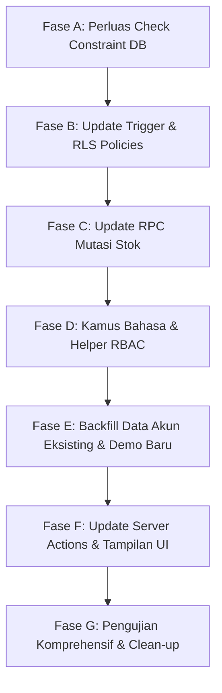

# Inventra — RBAC Consolidation & Dashboard KPI Refinement Review

- **Dokumen**: Laporan Audit & Rancangan Perbaikan (Pre-Batch 2)
- **Lokasi**: `docs/reports/Dashboard UI UX Refinement/rbac_and_kpi_review.md`
- **Tanggal Audit**: 14 Oktober 2026
- **Status Evaluasi**: 🔍 Audit Selesai — Menunggu Persetujuan Pengguna
- **Kebijakan Eksekusi**: Sesuai mandat, **tidak ada perubahan skema database, data pengguna, atau instalasi paket eksternal** yang dilakukan selama tahap audit ini.

---

## 1. Ringkasan Eksekutif

Audit komprehensif ini dilakukan untuk mengevaluasi kesiapan arsitektur sistem Inventra sebelum melanjutkan ke **Batch 2 (Transaksi Multi-Item & Riwayat Stok)**. Fokus audit mencakup:

1. **Konsolidasi Role-Based Access Control (RBAC):** Menganalisis mengapa sistem masih beroperasi dengan 2 role warisan (`admin_gudang` dan `owner`), mengidentifikasi seluruh titik keterikatan hardcoded pada 10 lapisan arsitektur, dan menyusun peta jalan migrasi non-destruktif menuju 3 role final (`administrator`, `staff_gudang`, `auditor`).
2. **Penyempurnaan KPI Dashboard:** Mengaudit kartu metrik (khususnya *Total Valuasi Stok* dan *Peringatan Stok Menipis*) secara visual pada 4 viewport standar (360px, 768px, 1024px, 1440px) menggunakan pengujian browser nyata, mengidentifikasi pemotongan label (*clipping/truncation*), serta merancang formatter IDR yang konsisten dan responsif.
3. **Transparansi Status Navigasi & Fitur:** Mengaudit menu rute yang masih berstatus roadmap (`/transactions`, `/reports`, `/reports/products`, `/assistant`) agar tidak membingungkan evaluator sebagai fitur aktif yang rusak.

---

## 2. Audit Aktual Role & Otorisasi

### 2.1 Penyelidikan Lapisan Sistem (10 Layer Inspection)

Pemeriksaan mendalam terhadap basis kode dan database Supabase aktif (`vwzlvsggpuvmkubkzfzp`) menghasilkan temuan pada 10 lapisan berikut:

| No | Komponen / Layer | File / Lokasi Aktual | Kondisi Aktual di Lapisan |
| :--- | :--- | :--- | :--- |
| 1 | **Tipe TypeScript** | `src/types/auth.ts` | Tipe union `UserRole` telah memuat 5 nilai: `'admin_gudang' \| 'owner' \| 'administrator' \| 'staff_gudang' \| 'auditor'`. Objek `USER_ROLES` dan `VALID_ROLES` juga telah mencatat kelimanya. |
| 2 | **Database Constraint** | `supabase/migrations/20261013000001_initial_schema.sql` (Line 27) | `public.profiles` memiliki check constraint ketat: `CONSTRAINT profiles_role_check CHECK (role IN ('admin_gudang', 'owner'))`. Database **menolak keras** jika ada nilai `administrator`, `staff_gudang`, atau `auditor` di-insert/update. |
| 3 | **Provisioning Trigger** | `supabase/migrations/20261013000002_rls_policies.sql` (Line 137) | Fungsi trigger `handle_new_user()` mengecek `v_role := coalesce(NEW.raw_app_meta_data->>'role', 'owner')`. Jika bukan `admin_gudang` atau `owner`, fungsi **memaksa role kembali ke `'owner'`**. |
| 4 | **Role Protection Trigger** | `supabase/migrations/20261013000002_rls_policies.sql` (Line 66) | Fungsi trigger `prevent_profile_role_change()` melarang modifikasi kolom `role` kecuali dipanggil oleh `service_role` atau superuser `postgres`/`supabase_admin`. |
| 5 | **RLS Policies** | `supabase/migrations/20261013000002_rls_policies.sql` | Kebijakan `products_insert_admin` dan `products_update_admin` mengecek `public.get_user_role(...) = 'admin_gudang'`. Kebijakan pada `public.categories` di migrasi 4 telah menambahkan `administrator`, namun `products` masih terkunci ke `admin_gudang`. |
| 6 | **RPC Mutasi Stok** | `supabase/migrations/20261013000003_stock_mutation_rpc.sql` (Line 44) | Fungsi PostgreSQL `public.record_stock_movement` mengecek: `IF v_user_role IS DISTINCT FROM 'admin_gudang' THEN RETURN FORBIDDEN; END IF;`. Panggilan oleh `owner`, `staff_gudang`, atau `auditor` ditolak seketika. |
| 7 | **Middleware & Guards** | `src/proxy.ts` & `src/services/auth-service.ts` | `proxy.ts` mengecek sesi autentikasi. `requireRole(allowedRoles)` tersedia di `auth-service.ts`, namun **belum pernah dipanggil** di halaman mana pun. Semua rute `(dashboard)` hanya memakai `requireAuth(locale)`. |
| 8 | **Server Actions** | `src/app/actions/{product,stock,category}-actions.ts` | `createProductAction`, `updateProductAction`, dan `recordStockMovementAction` memiliki guard eksplisit: `if (profile.role !== 'admin_gudang') return { success: false, error: 'FORBIDDEN' }`. |
| 9 | **UI & Sidebar Display** | `app-sidebar.tsx`, `app-header.tsx`, `settings-view.tsx`, `dashboard/page.tsx` | Seluruh komponen menggunakan logika biner: `const isAdmin = profile.role === 'admin_gudang' \|\| profile.role === 'administrator'`. Tampilan label menggunakan ternary hardcoded: `{isAdmin ? tAuth('roles.admin_gudang') : tAuth('roles.owner')}`. Akun selain admin gudang/administrator otomatis berlabel "Pemilik Usaha". |
| 10 | **Test Suite** | `tests/auth/*`, `tests/supabase/*`, `tests/unit/*` | 12+ file tes (termasuk 22 live database assertions) menguji secara ketat penolakan dan perizinan berbasis role `admin_gudang` dan `owner`. |

### 2.2 Akar Masalah: Mengapa Sistem Masih Menampilkan `admin_gudang` & `owner`?

Meskipun berkas TypeScript `src/types/auth.ts` telah memuat deklarasi role baru, sistem Inventra secara keseluruhan masih beroperasi dengan `admin_gudang` dan `owner` karena:

1. **Database Check Constraint Belum Bermigrasi:** PostgreSQL tabel `public.profiles` memiliki constraint `CHECK (role IN ('admin_gudang', 'owner'))`. Jika akun diubah menjadi `administrator`, `staff_gudang`, atau `auditor`, PostgreSQL akan langsung melemparkan error constraint violation `23514`.
2. **Kamus Bahasa Belum Memiliki Entri Role Baru:** File `messages/id/auth.json` dan `messages/en/auth.json` hanya memiliki kunci `roles.admin_gudang` dan `roles.owner`. Belum ada definisi terjemahan untuk `roles.administrator`, `roles.staff_gudang`, atau `roles.auditor`.
3. **Formulir Login Terikat pada Kredensial Demo 2-Akun:** `login-form.tsx` dan `auth-actions.ts` secara eksplisit membaca `process.env.DEMO_ADMIN_EMAIL` dan `process.env.DEMO_OWNER_EMAIL`.
4. **Keamanan Transaksional PostgreSQL Mengunci Mutasi:** Fungsi RPC `record_stock_movement` memeriksa kecocokan string literal `'admin_gudang'`. Akun dengan role `staff_gudang` atau `administrator` saat ini akan diblokir oleh basis data saat mencoba mencatat mutasi stok fisik.

---

## 3. Rancangan Migrasi Menuju Tiga Role Final

### 3.1 Matriks Akses Otoritas Final (Agreed RBAC Matrix)

Matriks hak akses berikut disusun berdasarkan prinsip hak akses terendah (*Principle of Least Privilege*) dan pemisahan tugas (*Separation of Concerns*):

| Modul / Domain Aksi | Administrator (`administrator`) | Staf Gudang (`staff_gudang`) | Auditor (`auditor`) | Lapisan Enforce Otoritas |
| :--- | :---: | :---: | :---: | :--- |
| **Katalog Produk — Lihat Data** | ✅ Ya | ✅ Ya | ✅ Ya (Read-Only) | RLS `products_select_authenticated` |
| **Katalog Produk — Tambah & Edit Item** | ✅ Ya | ❌ Tidak (atau Draf) | ❌ Ditolak | RLS `products_insert_admin` + Server Action |
| **Master Kategori — Kelola (CRUD)** | ✅ Ya (Penuh) | ❌ Tidak | ❌ Ditolak | RLS `categories_*_admin` + Server Action |
| **Mutasi Stok Tunggal (IN / OUT)** | ✅ Ya | ✅ Ya (Operasional) | ❌ Ditolak | Database RPC `record_stock_movement` |
| **Mutasi Stok Multi-Item (Batch 2)** | ✅ Ya | ✅ Ya (Operasional) | ❌ Ditolak | Database RPC `record_batch_stock_movements` |
| **Riwayat Mutasi & Audit Ledger** | ✅ Ya (Semua) | ✅ Ya (Semua) | ✅ Ya (Semua) | RLS `movements_select_authenticated` |
| **Ekspor Data Ledger (CSV/Excel)** | ✅ Ya | ✅ Ya | ✅ Ya | Server Action / Client Stream |
| **Dashboard — Metrik Operasional & Alert** | ✅ Ya | ✅ Ya | ✅ Ya | Server Component Data Fetcher |
| **Dashboard — Valuasi Stok Total (Rp)** | ✅ Ya | ⚠️ Ringkasan Terbatas | ✅ Ya (Penuh/Audit) | UI Level / Field Level Masking |
| **Pengaturan Profil Sendiri (Nama)** | ✅ Ya | ✅ Ya | ✅ Ya | Server Action `updateProfileNameAction` |
| **Pengubahan Role Pengguna** | ❌ Ditolak (DB Only) | ❌ Ditolak | ❌ Ditolak | Trigger `prevent_profile_role_change` |

> **Prinsip Kunci Keamanan:**
> Role **tidak pernah** dapat diubah oleh pengguna sendiri dari antarmuka web. Semua mutasi diverifikasi pada Server Action dan database RPC (`SECURITY DEFINER` dengan verifikasi `public.get_user_role(auth.uid())`), bukan sekadar menyembunyikan elemen UI atau tombol menu.

### 3.2 Pemetaan Akun Lama ke Role Baru

| Akun Eksisting | Role Lama | Role Baru Final | Kredensial Demo & Peran Operasional Baru |
| :--- | :--- | :--- | :--- |
| `admin@inventra.demo` | `admin_gudang` | `administrator` | Mempertahankan akses manajemen sistem, katalog, kategori, dan pengawasan stok menyeluruh. |
| `staff@inventra.demo` *(Baru)* | *(N/A)* | `staff_gudang` | Akun demo operasional baru untuk pencatatan mutasi stok fisik harian masuk/keluar tanpa hak mengedit master harga/kategori. |
| `owner@inventra.demo` | `owner` | `auditor` | Mempertahankan akses audit eksekutif hanya-baca, monitoring valuasi total aset, dan riwayat ledger tanpa hak mutasi fisik. |

### 3.3 Tahapan Rencana Migrasi Bertahap (Non-Destruktif)

Untuk mencegah downtime atau kegagalan tes saat transisi berlangsung, migrasi dirancang dalam 7 fase bertahap:



- **Fase A — Ekspansi Database Constraint (SQL Migration):**
  Ubah constraint tabel `public.profiles` agar menerima 5 peran sekaligus selama masa transisi:
  ```sql
  ALTER TABLE public.profiles DROP CONSTRAINT IF EXISTS profiles_role_check;
  ALTER TABLE public.profiles ADD CONSTRAINT profiles_role_check
    CHECK (role IN ('admin_gudang', 'owner', 'administrator', 'staff_gudang', 'auditor'));
  ```
- **Fase B — Pembaruan Trigger & RLS Policies:**
  Perbarui fungsi trigger `handle_new_user()` agar default ke `'auditor'` dan mengizinkan role baru. Perbarui RLS `products_insert_admin` dan `products_update_admin` agar mengizinkan `administrator`.
- **Fase C — Pembaruan Database RPC `record_stock_movement`:**
  Perbarui validasi otorisasi di dalam fungsi RPC:
  ```sql
  v_user_role := public.get_user_role(v_user_id);
  IF v_user_role NOT IN ('admin_gudang', 'administrator', 'staff_gudang') THEN
    RETURN json_build_object(
      'success', false,
      'error', 'FORBIDDEN',
      'message', 'Hanya administrator dan staf gudang yang memiliki izin mencatat mutasi stok'
    );
  END IF;
  ```
- **Fase D — Pembaruan Kamus Bahasa (`messages/*`) & Helper Domain:**
  Tambahkan kunci terjemahan untuk ketiga role baru di `auth.json`:
  ```json
  "roles": {
    "administrator": "Administrator Sistem",
    "staff_gudang": "Staf Gudang",
    "auditor": "Auditor & Pemilik Usaha",
    "adminDesc": "Akses menyeluruh manajemen katalog, kategori, mutasi, dan pengawasan sistem.",
    "staffDesc": "Akses operasional pencatatan mutasi stok fisik masuk dan keluar barang.",
    "auditorDesc": "Akses audit transaksi stok, monitoring valuasi, dan ringkasan eksekutif (hanya-baca)."
  }
  ```
- **Fase E — Backfill Data Profil & Provisioning Akun Demo:**
  Update baris `public.profiles` akun demo eksisting (`admin_gudang` $\to$ `administrator`, `owner` $\to$ `auditor`). Tambahkan provisioning akun demo ketiga untuk `staff@inventra.demo` (`staff_gudang`).
- **Fase F — Pembaruan Server Actions & Komponen UI:**
  Perbarui `createProductAction`, `recordStockMovementAction`, `category-actions.ts`, `app-sidebar.tsx`, `app-header.tsx`, `login-form.tsx`, dan `settings-view.tsx` agar menggunakan role baru secara native.
- **Fase G — Penyesuaian Test Suite & Pengetatan Constraint Akhir:**
  Perbarui unit test dan live integration tests. Setelah seluruh komponen terbukti stabil, buat migrasi final untuk mencabut role warisan (`admin_gudang` dan `owner`).

---

## 4. Audit Komponen Dashboard KPI & Total Valuasi Stok

### 4.1 Temuan Audit Visual Aktual (Browser Subagent Multi-Viewport)

Pengujian visual langsung menggunakan browser subagent terhadap sesi login aktual di `http://localhost:3000/id/dashboard` menghasilkan temuan empiris berikut:

| Viewport (Resolusi) | Layout KPI Grid | Temuan Visual & Truncation | Status Rendering |
| :--- | :--- | :--- | :---: |
| **1440 × 900 px (Desktop Luas)** | 4 Kolom (`xl:grid-cols-4`) | **Defek Truncation Terkonfirmasi:** Header kartu keempat terpotong menjadi **`PERINGATAN STOK ME...`** akibat class `truncate pr-2 text-xs uppercase tracking-wider` yang terhimpit ikon badge di kanan. Angka valuasi `Rp 6.434.309.760` muat namun mepet tepi kartu. | ⚠️ Perlu Perbaikan |
| **1024 × 768 px (Tablet Landscape / Laptop)** | 2 Kolom (`sm:grid-cols-2`) | Ruang kartu lebih lebar (~340px). Judul `PERINGATAN STOK MENIPIS` tidak terpotong. Angka valuasi terbaca jelas. | ✅ Lulus |
| **768 × 1024 px (Tablet Portrait)** | 2 Kolom (`sm:grid-cols-2`) | Sidebar otomatis beralih ke mobile sheet. Ruang kartu cukup lebar. Tidak ada label terpotong. | ✅ Lulus |
| **360 × 800 px (Mobile Layar Kecil)** | 1 Kolom (`grid-cols-1`) | Kartu menumpuk vertikal dengan lebar penuh (~328px). Nominal `Rp 6.434.309.760` terbaca utuh. Catatan: Dev overlay Next.js (badge "N") sedikit menutupi pojok kiri bawah saat di-scroll. | ✅ Lulus |

### 4.2 Analisis Masalah Tipografi & Format Mata Uang IDR

1. **Pemotongan Label (*Header Clipping*):**
   - Kode aktual `KpiStatCard` (`src/features/dashboard/kpi-stat-card.tsx` Line 33):
     ```tsx
     <CardTitle className="text-muted-foreground truncate pr-2 text-xs font-semibold tracking-wider uppercase">
       {title}
     </CardTitle>
     ```
   - Penerapan `truncate` dengan `uppercase` dan `tracking-wider` pada judul bahasa Indonesia (`Peringatan Stok Menipis`) maupun bahasa Inggris (`Total Inventory Valuation` = 25 karakter) memicu ellipsis yang tidak estetis dan menghilangkan makna kata.
2. **Skalabilitas Nominal Valuasi Besar:**
   - Valuasi saat ini: `Rp 6.434.309.760` (17 karakter).
   - Tipografi aktual: `text-xl font-bold tracking-tight break-words tabular-nums sm:text-2xl sm:break-normal xl:text-3xl`.
   - Pada resolusi 1280px–1366px (laptop standar) dengan sidebar terbuka (`w-64`), lebar kolom kartu KPI hanya ~210px. Jika valuasi inventaris mencapai puluhan atau ratusan miliar (misal `Rp 48.920.500.000` / 18 karakter), angka berisiko patah baris atau terpotong (*overflow*).
3. **Desentralisasi Formatter:**
   - `formatCurrency` saat ini didefinisikan secara lokal di dalam fungsi komponen `DashboardPage` (`dashboard/page.tsx` Line 48), bukan utilitas bersama yang teruji di `src/lib/formatters.ts`.
4. **Integritas Data (Anti-Halusinasi & Truthfulness):**
   - Nilai valuasi dihitung secara murni oleh domain service `calculateInventorySummary` (`src/services/product-service.ts`) dari database Supabase: $\sum (\text{stok} \times \text{harga})$.
   - **Aturan Tegas:** Sesuai persyaratan, tidak boleh ada persentase tren fiktif (misal: `+12.5% dari bulan lalu`) atau sparkline simulasi tanpa tabel snapshot riwayat historis di PostgreSQL.

### 4.3 Spesifikasi Solusi KPI & Valuasi Rupiah

1. **Utilitas Formatter Mandiri (`src/lib/formatters.ts`):**
   - Membuat fungsi terstandarisasi `formatCurrencyIDR(amount: number, locale = 'id')`.
   - Mendukung format ringkas cerdas (*Compact Currency Notation*):
     - $\ge \text{Rp } 1.000.000.000$: `Rp 6,43 M` (atau `Rp 6,43 Miliar` / `$6.43 B` untuk EN).
     - $\ge \text{Rp } 1.000.000$: `Rp 250,5 Jt` (atau `Rp 250,5 Juta` / `$250.5 M` untuk EN).
     - $< \text{Rp } 1.000.000$: Format nominal standar lengkap.
2. **Komponen `KpiStatCard` yang Lebih Tangguh:**
   - **Hilangkan `truncate` pada `CardTitle`:** Ganti dengan layout multi-line terkontrol (`line-clamp-2 min-h-[2rem] flex items-center leading-snug`).
   - **Tampilan Nilai Ringkas dengan Tooltip Nominal Penuh:** Kartu menampilkan nilai ringkas yang elegan, dengan tooltip interaktif Radix UI yang memperlihatkan nilai eksak hingga satuan Rupiah terakhir.
   - **Tipografi Tabular Responsif:** Mencegah layout shift dengan font tabular monospace angka (`tabular-nums font-bold text-lg sm:text-xl lg:text-2xl xl:text-2xl`).

---

## 5. Audit Status Fitur & Navigasi

Hasil pemeriksaan terhadap menu navigasi sidebar dan rute terkait:

| Rute URL | Label Menu | Status Implementasi Aktual | Tampilan di Sidebar Saat Ini | Rekomendasi Perbaikan Status |
| :--- | :--- | :--- | :--- | :--- |
| `/[locale]/dashboard` | Dashboard | ✅ Aktif (Live Metrics) | Normal Link | Pertahankan |
| `/[locale]/inventory` | Katalog Produk | ✅ Aktif (Catalog & Filters) | Normal Link | Pertahankan |
| `/[locale]/categories` | Kategori Produk | ✅ Aktif (CRUD Categories) | Normal Link | Pertahankan |
| `/[locale]/transactions` | Transaksi Stok | ⏳ **Roadmap Batch 2** | Terlihat seperti menu aktif normal tanpa pembeda | Tambahkan badge halus `[Batch 2]` atau status `Direncanakan` agar pengguna mengetahui fitur keranjang mutasi multi-item sedang disiapkan. |
| `/[locale]/movements` | Riwayat Mutasi | ✅ Aktif (Ledger & Single Mutation) | Normal Link | Pertahankan |
| `/[locale]/reports` | Analitik & Laporan | ⏳ **Roadmap Batch 3** | Terlihat seperti menu aktif normal tanpa pembeda | Beri penanda badge roadmap `[Batch 3]` untuk menghindari impresi fitur grafik belum berfungsi. |
| `/[locale]/reports/products` | Analisis Produk | ⏳ **Roadmap Batch 3** | Terlihat seperti menu aktif normal tanpa pembeda | Beri penanda badge roadmap `[Batch 3]`. |
| `/[locale]/assistant` | AI Assistant | ⏳ **Roadmap Batch 4** | Terlihat seperti menu aktif normal tanpa pembeda | Beri penanda badge roadmap `[Batch 4]`. Jangan tampilkan sebagai AI aktif sampai Batch 4 dieksekusi. |
| `/[locale]/settings` | Pengaturan | ✅ Aktif (5 Submenu & Profile) | Normal Link | Pertahankan |

---

## 6. Daftar File yang Akan Diubah (Implementation Scope)

Setelah rencana ini disetujui, berkas-berkas berikut akan dimodifikasi pada tahap eksekusi:

### 6.1 Database & Migrasi SQL
- `supabase/migrations/20261014000002_rbac_consolidation.sql` *(Baru)*:
  - Perluas constraint `profiles_role_check` menjadi 5 role.
  - Perbarui fungsi trigger `handle_new_user()` untuk mendukung role baru dengan default `auditor`.
  - Perbarui RLS policies pada `public.products` untuk role `administrator`.
  - Perbarui fungsi RPC `public.record_stock_movement` untuk mengizinkan `administrator` dan `staff_gudang`.
  - Migrasi data akun profil lama ke role baru (`admin_gudang` $\to$ `administrator`, `owner` $\to$ `auditor`).

### 6.2 Konfigurasi & Tipe Data
- `src/types/auth.ts`: Tambahkan helper fungsi otorisasi (`hasMutationPermission`, `hasCatalogManagePermission`, `isAuditorRole`).
- `.env.local` & `.env.example`: Tambahkan akun demo `DEMO_STAFF_EMAIL` dan `DEMO_STAFF_PASSWORD`.

### 6.3 Utilitas & Formatter
- `src/lib/formatters.ts` *(Baru)*: Utilitas format mata uang IDR lengkap dan ringkas (*compact notation*).

### 6.4 Komponen Antarmuka (UI Components)
- `src/features/dashboard/kpi-stat-card.tsx`: Dukungan tooltip nominal penuh, eliminasi clipping teks header, dan tipografi adaptif.
- `src/app/[locale]/(dashboard)/dashboard/page.tsx`: Integrasi formatter baru, penyesuaian label role 3-level.
- `src/components/shared/app-sidebar.tsx`: Penyesuaian visual badge role dan badge indikator roadmap pada menu rute masa depan.
- `src/components/shared/app-header.tsx`: Tampilan badge peran 3-level di header bar.
- `src/features/auth/login-form.tsx`: Penambahan tombol chip demo untuk 3 peran (`administrator`, `staff_gudang`, `auditor`).
- `src/features/settings/settings-view.tsx`: Penyesuaian tampilan role kartu profil dan badge keamanan.
- `src/features/catalog/catalog-table.tsx` & `src/features/movements/movement-table.tsx`: Penggunaan helper otorisasi baru.

### 6.5 Server Actions & Services
- `src/app/actions/auth-actions.ts`: Penambahan handler demo untuk role `staff_gudang`.
- `src/app/actions/product-actions.ts`: Pengecekan role `administrator`.
- `src/app/actions/stock-actions.ts`: Pengecekan role `administrator` dan `staff_gudang`.
- `src/proxy.ts`: Konsolidasi route matcher agar melindungi seluruh sub-rute dashboard.

### 6.6 Kamus Bahasa (i18n)
- `messages/id/auth.json` & `messages/en/auth.json`: Entri `roles.administrator`, `roles.staff_gudang`, `roles.auditor`.
- `messages/id/sidebar.json` & `messages/en/sidebar.json`: Entri status roadmap `sidebar.status.planned` dan `sidebar.status.roadmap`.
- `messages/id/dashboard.json` & `messages/en/dashboard.json`: Copy penjelas izin akses masing-masing dari 3 peran.

---

## 7. Rencana Pengujian (Test Strategy & Quality Gates)

Pengujian akan dijalankan secara berlapis untuk memastikan nol regresi terhadap 225 tes yang saat ini lulus:

1. **Unit Tests Baru:**
   - `tests/unit/formatters.test.ts`: Menguji `formatCurrencyIDR` pada nilai nol, ratusan ribu, jutaan, miliaran, dan triliunan, baik mode lengkap maupun compact dengan locale ID dan EN.
   - `tests/unit/kpi-overflow-prevention.test.ts`: Menguji bahwa judul kartu KPI panjang tidak terpotong dan menghasilkan DOM yang terstruktur.
   - `tests/unit/rbac-authorization.test.ts`: Menguji helper otorisasi peran (`administrator`, `staff_gudang`, `auditor`).
2. **Pembaruan Test Suite Eksisting:**
   - `tests/auth/auth-actions.test.ts`: Uji coba login demo untuk ketiga peran.
   - `tests/unit/stock-mutation-action.test.ts`: Uji bahwa `staff_gudang` dan `administrator` diizinkan melakukan mutasi, sedangkan `auditor` ditolak (`FORBIDDEN`).
   - `tests/supabase/rpc-logic-simulation.test.ts`: Uji simulasi izin RPC untuk ketiga peran.
3. **Live Integration Tests (Supabase):**
   - Menjalankan kembali suite `tests/supabase/live-integration.test.ts` untuk memvalidasi eksekusi RPC riil di PostgreSQL.
4. **Visual & Responsive Verification:**
   - Pengujian visual browser pada 360px, 768px, 1024px, dan 1440px untuk memverifikasi ketiadaan clipping label dan keterbacaan nominal Rupiah.

---

## 8. Analisis Risiko & Mitigasi

| No | Risiko Potensial | Dampak | Probabilitas | Strategi Mitigasi Terencana |
| :--- | :--- | :---: | :---: | :--- |
| 1 | **Database Constraint Violation** | Tinggi | Rendah | Menggunakan pendekatan migrasi bertahap non-destruktif (Fase A) yang memperluas check constraint sebelum memperbarui baris data atau kode aplikasi. |
| 2 | **Regresi pada Test Suite Eksisting (225 Tests)** | Sedang | Sedang | Menjalankan seluruh test suite Vitest di setiap fase perubahan dan memastikan pemetaan backward compatibility terjaga hingga rilis stabil. |
| 3 | **Kegagalan Sesi Pengguna Demo Lama** | Sedang | Rendah | Melakukan backfill transparan pada `public.profiles` dan memastikan handler `signInAction` mengenali pemetaan akun lama. |
| 4 | **Perbedaan Persepsi Angka Singkat Valuasi** | Rendah | Sedang | Selalu menyertakan tooltip interaktif dan detail nominal Rupiah penuh di samping angka ringkas. |

---

## 9. Kesimpulan & Rekomendasi Langkah Selanjutnya

Audit telah selesai dilaksanakan dengan hasil yang jelas:
- Akar masalah keterikatan sistem pada 2 role lama telah teridentifikasi secara presisi di level skema PostgreSQL, RPC, Server Action, UI, dan kamus bahasa.
- Rancangan migrasi non-destruktif ke 3 role final (`administrator`, `staff_gudang`, `auditor`) telah siap dieksekusi secara aman.
- Cacat visual pemotongan teks pada kartu KPI dashboard (*clipping*) pada viewport 1440px telah dibuktikan secara empiris dan solusi formatter IDR terpadu telah dirancang.

> [!IMPORTANT]
> **Pemberhentian Sesuai Arahan Pengguna:**
> Sesuai instruksi pada prompt ("*Berhenti setelah laporan tersedia. Jangan mulai Batch 2 atau melakukan migrasi sampai pengguna meninjau dan menyetujui rencana tersebut.*"), seluruh pekerjaan coding dan perubahan database dihentikan sampai laporan ini ditinjau dan disetujui oleh pengguna.
