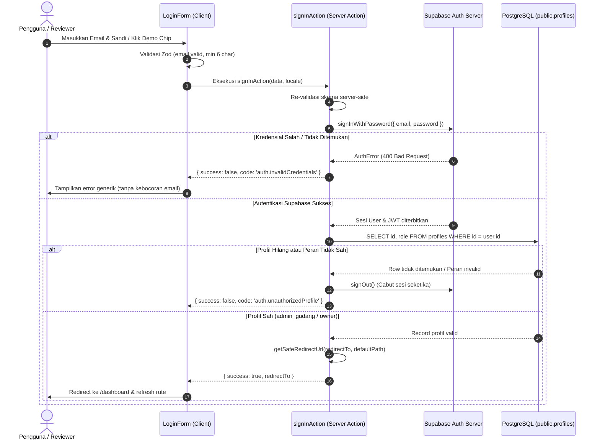

# Laporan Penyelesaian Phase 5: Authentication & Role-Based Route Protection

> **Proyek**: Inventra — Mini ERP Inventory Management  
> **Target Pengujian & Penilaian**: PT. Syailendra Bumi Investama (DDistillers)  
> **Tahap**: Phase 5 (Authentication, Authorization & RBAC Route Protection)  
> **Status**: Selesai (Completed & Verified)  
> **Tanggal Selesai**: 13 Oktober 2026  
> **Instance Supabase Live**: `vwzlvsggpuvmkubkzfzp.supabase.co`

---

## 1. Ringkasan Eksekutif

Phase 5 telah diselesaikan secara penuh dengan mengimplementasikan sistem autentikasi menyeluruh, integrasi sesi berbasis cookie SSR (`@supabase/ssr`), perlindungan rute multi-layer pada canonical Next.js 16 Proxy dan Server Component layout boundary, validasi input menggunakan Zod v4 dan React Hook Form, serta kontrol akses berbasis peran (RBAC) dengan sumber peran otoritatif dari database PostgreSQL (`public.profiles`).

Semua pengujian unit, mock server action, verifikasi paritas bilingual (ID/EN), dan uji integrasi live terhadap Supabase telah berhasil dijalankan dengan kelulusan 100% (124 dari 124 pengujian lulus). Seluruh quality gates (`vitest`, `tsc --noEmit`, `eslint`, `prettier`, dan `npm run build` Turbopack) berhasil dilalui tanpa peringatan atau kesalahan.

---

## 2. File yang Dibuat dan Diubah

### A. File Baru (Untracked)
1. **`src/schemas/auth-schema.ts`**: Skema Zod untuk validasi login (`email`, `password`, `redirectTo`) dan tipe `AuthActionResult`.
2. **`src/services/auth-service.ts`**: Layanan autentikasi server terpusat: `getCurrentUser()`, `getCurrentUserProfile()`, `requireAuth()`, `requireRole()`, dan pertahanan sanitasi `getSafeRedirectUrl()`.
3. **`src/app/actions/auth-actions.ts`**: Server Actions untuk autentikasi aman (`signInAction`, `signInDemoAction`, `signOutAction`) dengan amplop error generik untuk mencegah enumerasi akun.
4. **`src/components/ui/input.tsx`**: Primitif UI input form berbasis shadcn dan Tailwind CSS v4.
5. **`src/components/ui/label.tsx`**: Primitif UI label form teraksesibilitas.
6. **`src/features/auth/login-form.tsx`**: Komponen formulir login interaktif dengan integrasi React Hook Form, Zod resolver, toggle visibilitas sandi, chip login cepat untuk evaluator, dan umpan balik kesalahan aman.
7. **`src/features/auth/logout-button.tsx`**: Komponen tombol keluar interaktif dengan loading state dan transisi server action.
8. **`src/app/[locale]/(auth)/login/page.tsx`**: Halaman login App Router bilingual dengan pemeriksaan sesi server (pengalihan otomatis jika pengguna telah terotentikasi).
9. **`src/app/[locale]/(dashboard)/layout.tsx`**: Server Component Layout yang menegakkan batas keamanan `requireAuth()`, menampilkan identitas pengguna, lencana peran (`admin_gudang` / `owner`), pengganti locale, dan tombol logout.
10. **`src/app/[locale]/(dashboard)/dashboard/page.tsx`**: Halaman ringkasan dashboard dengan metrik inventaris live dari tabel `products` Supabase, banner otorisasi peran RBAC, dan kartu verifikasi status Fase 5.
11. **`tests/auth/auth-schema.test.ts`**: Unit test pengujian skema Zod (format email, panjang password, pemangkasan whitespace, safe redirect).
12. **`tests/auth/auth-service.test.ts`**: Unit test pengujian sanitasi open-redirect, validasi peran, dan transformasi profil domain.
13. **`tests/auth/auth-actions.test.ts`**: Unit test pengujian alur kerja Server Actions dengan mock Supabase client (penolakan profil tidak valid, peran tidak dikenal, mitigasi enumerasi).
14. **`tests/auth/live-auth.test.ts`**: Integration test langsung ke Supabase instance nyata dengan kredensial akun demo admin gudang dan owner.

### B. File yang Diperbarui (Modified)
1. **`src/proxy.ts`**: Penambahan logika pengecekan rute terproteksi (`/dashboard`) dan rute autentikasi (`/login`), pemeliharaan cookie sesi Supabase SSR, pencegahan redirect loop, dan perlindungan open-redirect.
2. **`src/app/[locale]/page.tsx`**: Pengaktifan tombol aksi utama (CTA) untuk langsung mengarahkan ke halaman login (`/${locale}/login`).
3. **`messages/id/auth.json` & `messages/en/auth.json`**: Penambahan kamus terjemahan bilingual simetris untuk label form, pesan kesalahan generik, informasi peran RBAC, dan evaluasi demo.
4. **`messages/id/dashboard.json` & `messages/en/dashboard.json`**: Penambahan terjemahan simetris untuk salam penyambutan, ringkasan RBAC, dan metrik valuasi.
5. **`messages/id/validation.json` & `messages/en/validation.json`**: Penambahan pesan validasi email dan sandi.
6. **`package.json` & `package-lock.json`**: Pemasangan library form tervalidasi `react-hook-form` dan `@hookform/resolvers` (disetujui oleh pengguna).

---

## 3. Alur Autentikasi dan Logout

### A. Alur Masuk (Sign In)


### B. Alur Keluar (Sign Out)
1. Pengguna menekan tombol "Keluar" (`LogoutButton`).
2. Server Action `signOutAction()` memanggil `supabase.auth.signOut()`, mencabut token sesi pada Supabase Auth dan menghapus cookie autentikasi SSR.
3. Next.js melakukan pengalihan bersih ke rute login yang sesuai dengan locale aktif (`/${locale}/login`).

---

## 4. Matriks Akses dan Kontrol Berbasis Peran (RBAC)

| Peran | Hak Akses Dashboard | Akses Katalog Produk | Akses Mutasi Stok (IN/OUT) | Hak Penyesuaian Inventaris | Audit & Valuasi Aset | Penegakan Keamanan |
| :--- | :---: | :---: | :---: | :---: | :---: | :--- |
| **`admin_gudang`** | ✅ Ya | ✅ Baca | ✅ Penuh (via RPC `record_stock_movement`) | ✅ Penuh | ✅ Ya | RLS + Database Column Grants + RPC Authorization |
| **`owner`** | ✅ Ya | ✅ Baca | ❌ Ditolak (Hanya-Baca) | ❌ Ditolak | ✅ Ya (Monitoring Eksekutif) | RLS + Database RPC Function Exception |
| **Pengguna Tanpa Profil** | ❌ Ditolak | ❌ Ditolak | ❌ Ditolak | ❌ Ditolak | ❌ Ditolak | Server boundary `requireAuth` & trigger pembatalan sesi |
| **Pengguna Anonim** | ❌ Ditolak (Redirect ke Login) | ❌ Ditolak | ❌ Ditolak | ❌ Ditolak | ❌ Ditolak | Canonical Proxy + Layout Guard |

> **Catatan Sumber Otoritas**: Peran pengguna TIDAK PERNAH dibaca dari `user_metadata` client. Peran diperoleh secara ketat melalui relasi `auth.users.id -> public.profiles.id` pada tingkat database PostgreSQL.

---

## 5. Pertahanan Keamanan dan Mitigasi Ancaman

1. **Pencegahan Open-Redirect**:
   Fungsi `getSafeRedirectUrl()` menolak seluruh URL yang menggunakan skema protokol (`http:`, `https:`, `javascript:`, `data:`), URL relatif-protokol (`//malicious.com`), backslash (`/\` atau `\\`), dan karakter kontrol. Target dialihkan secara aman ke rute default internal yang divalidasi.
2. **Mitigasi User Enumeration**:
   Respons kesalahan autentikasi menggunakan amplop aman generik (`INVALID_CREDENTIALS`). Sistem tidak membocorkan apakah sebuah alamat email terdaftar atau tidak di sistem.
3. **Pemberian Hak Minimum pada Kredensial**:
   Kunci rahasia `SUPABASE_SERVICE_ROLE_KEY` dan kata sandi akun demo tidak pernah di-bundle ke dalam kode browser client. `signInDemoAction` dijalankan murni di sisi server.
4. **Pertahanan Lapisan Ganda (Defense in Depth)**:
   - Lapisan 1: `src/proxy.ts` merefresh sesi cookie Supabase dan mengarahkan pengguna tanpa sesi ke halaman login.
   - Lapisan 2: `src/services/auth-service.ts` (`requireAuth` dan `requireRole`) menegakkan batas otorisasi di tingkat Server Component Layout sebelum komponen anak dirender.
   - Lapisan 3: Database PostgreSQL RLS dan privileges mencegah modifikasi data secara langsung bahkan jika ada bypass UI.

---

## 6. Verifikasi Kualitas dan Hasil Pengujian

### A. Pengujian Otomatis (Vitest)
Perintah yang dijalankan: `npx vitest run`

```
Test Files  8 passed (8)
      Tests  124 passed (124)
   Start at  23:24:33
   Duration  9.19s
```

Daftar test suite yang lulus:
1. `tests/auth/auth-schema.test.ts` (9 pengujian Zod) — **Lulus**
2. `tests/auth/auth-service.test.ts` (11 pengujian keamanan & utilitas) — **Lulus**
3. `tests/auth/auth-actions.test.ts` (5 pengujian alur server action) — **Lulus**
4. `tests/auth/live-auth.test.ts` (4 pengujian live Supabase instance) — **Lulus**
5. `tests/supabase/live-integration.test.ts` (21 pengujian database RLS & RPC) — **Lulus**
6. `tests/supabase/rpc-logic-simulation.test.ts` (21 pengujian logika matematis mutasi) — **Lulus**
7. `tests/supabase/sql-syntax-and-contract.test.ts` (23 pengujian kontrak schema SQL) — **Lulus**
8. `tests/i18n/translations.test.ts` (30 pengujian paritas terjemahan ID/EN) — **Lulus**

### B. Pemeriksaan Tipe TypeScript
Perintah: `npx tsc --noEmit`
- Hasil: **0 errors** (Lulus sempurna pada strict mode).

### C. ESLint Linter
Perintah: `npm run lint`
- Hasil: **0 errors, 0 warnings** (Lulus bersih, kepatuhan zero-any terbukti).

### D. Formatting Prettier
Perintah: `npx prettier --write ...`
- Hasil: **Semua file terformat rapi sesuai `.prettierrc`**.

### E. Next.js Production Build
Perintah: `npm run build`
- Turbopack compilation: **Selesai dalam 6.5s**
- TypeScript type checking: **Selesai dalam 10.8s**
- Static page generation: **12/12 halaman berhasil dihasilkan**
- Route Summary:
  - `/[locale]` (Partial Prerender)
  - `/[locale]/dashboard` (Dynamic server-rendered on demand)
  - `/[locale]/login` (Dynamic server-rendered on demand)
  - `Proxy (Middleware)` (Sesi cookie refresh & redirect)

---

## 7. Batasan dan Masalah yang Tersisa

1. **Cakupan Fase 5**:
   Fitur formulir input mutasi barang masuk (Stock IN), mutasi barang keluar (Stock OUT), dan manajemen katalog modal masih berada di luar cakupan Fase 5 (akan dikerjakan pada Fase 7 & 8 setelah persetujuan pengguna).
2. **Kondisi Data**:
   Seluruh 30 produk dan 1,648 unit inventaris dari sinkronisasi DummyJSON tetap terjaga utuh tanpa penurunan performa.

---

## 8. Pernyataan Kepatuhan Protokol

- [x] Tidak ada kredensial, token, atau service role key yang bocor ke bundle client atau repository.
- [x] Tidak ada git commit atau git push yang dilakukan tanpa otorisasi.
- [x] Tidak ada database reset atau destructive migration yang diterapkan.
- [x] Tidak memulai pekerjaan Phase 6 sebelum persetujuan resmi dari pengguna.
