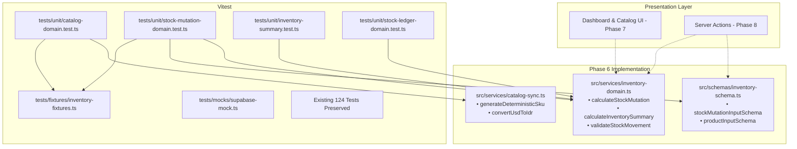

# Implementation Plan — Phase 6: Vitest & Core Unit Tests

## Goal Description

Establish a comprehensive, isolated, and deterministic unit testing suite for the core domain logic of Inventra (Mini ERP Inventory Management). This includes pure domain logic for:

1. **Catalog & SKU Engine**: Deterministic SKU generation, fixed exchange rate USD-to-IDR conversion, incomplete payload sanitization, and idempotent catalog synchronization preserving operational stock.
2. **Stock Mutation & Invariant Engine**: Positive integer validation, stock IN/OUT computation, overdraft protection (insufficient stock rejection), and mathematical invariant verification ($stock_{after} = stock_{before} \pm quantity$).
3. **Inventory Summary & KPI Engine**: Correct SKU counting, total unit summing, asset valuation, and the critical low-stock threshold rule strictly defined as $stock < 5$ (not $\le 5$).
4. **Stock Movement Ledger**: Validation of movement types, before/after stock consistency, and mandatory mutation notes.
5. **Test Infrastructure & Separation**: Clear separation between fast, offline unit tests (`test:unit`) and credentials-dependent live tests (`test:live`).

---

## User Review Required

> [!IMPORTANT]
> **Coverage Tooling Status**: `@vitest/coverage-v8` is currently **not installed** in `package.json`. Per the strict project rules ("Jangan memasang dependency coverage baru tanpa izin"), we will not install any coverage package. Instead, we will report exact test suite counts and execution metrics. If you would like Istanbul or V8 coverage reports enabled in the future, please authorize installing `@vitest/coverage-v8`.

> [!NOTE]
> **Strict Domain Isolation**: To avoid duplication and ensure high cohesion, pure domain logic functions will reside in `src/services/inventory-domain.ts` and Zod validation schemas in `src/schemas/inventory-schema.ts`. These functions will be imported and reused directly by Phase 7 (Dashboard & Catalog UI) and Phase 8 (Stock IN/OUT Server Actions).

> [!IMPORTANT]
> **Test Suite Separation**: Unit tests will run completely in-memory with zero network or database dependencies in $< 500\text{ms}$. Live integration tests (`tests/**/live-*.test.ts`) that require live Supabase credentials remain separated and fully functional.

---

## Open Questions

None. All functional requirements, constraints, and business rules are fully specified in `PRD.md`, `ARCHITECTURE.md`, `TESTING.md`, and the Phase 6 prompt.

---

## Proposed Changes



---

### Component 1: Domain Schemas & Calculation Services

#### `[NEW]` [inventory-schema.ts](file:///c:/Experience/Projects/inventra/src/schemas/inventory-schema.ts)

Zod validation schemas for stock mutations and product catalog operations:

- `stockMutationInputSchema`:
  - `productId`: UUID string (`z.string().uuid()`).
  - `type`: Discriminated enum `'IN' | 'OUT'`.
  - `quantity`: Positive integer strictly $> 0$ (`z.number().int().positive()`). Rejects 0, negatives, decimals, `NaN`, and `Infinity`.
  - `note`: Non-empty string trimmed between 3 and 500 characters.
- `productInputSchema`:
  - `sku`: Trimmed uppercase alphanumeric string with hyphens (`/^[A-Z0-9-]+$/`).
  - `name`: Non-empty trimmed string.
  - `category`: Non-empty trimmed string.
  - `unit`: Non-empty trimmed string (e.g. `'pcs'`).
  - `price`: Non-negative integer (`z.number().int().nonnegative()`).
  - `stock`: Non-negative integer (`z.number().int().nonnegative()`).

#### `[NEW]` [inventory-domain.ts](file:///c:/Experience/Projects/inventra/src/services/inventory-domain.ts)

Pure domain computation and business invariant verification functions:

- `calculateStockMutation(currentStock: number, type: MovementType, quantity: number): StockMutationCalculationResult`
  - Validates positive integer for quantity and non-negative integer for current stock.
  - If `type === 'OUT'` and `quantity > currentStock`: Returns `{ success: false, error: 'INSUFFICIENT_STOCK', message: 'Stok tidak mencukupi' }`.
  - If `type === 'IN'`: Returns `{ success: true, stockBefore: currentStock, stockAfter: currentStock + quantity, change: quantity }`.
  - If `type === 'OUT'`: Returns `{ success: true, stockBefore: currentStock, stockAfter: currentStock - quantity, change: -quantity }`.
  - Strictly asserts mathematical invariant: $stock_{after} = stock_{before} \pm quantity$.
- `calculateInventorySummary(products: Array<{ stock: number; price: number }>): InventorySummary`
  - `totalSkus`: Count of valid products.
  - `totalUnits`: Sum of stock across all products.
  - `totalInventoryValue`: Sum of $(stock \times price)$ with precision guard (`Number.MAX_SAFE_INTEGER`).
  - `lowStockCount`: Count of items strictly with $stock < 5$ (explicit compliance: $0, 1, 2, 3, 4$ are low stock; $5$ is normal stock).
  - Handles empty catalog safely ($0$ across all metrics).
  - Safely ignores/flags invalid numeric values ($NaN$, negative numbers).
- `validateStockMovement(movement: StockMovement): boolean`
  - Verifies that recorded movement row satisfies invariant $stockAfter = stockBefore + (type == 'IN' ? quantity : -quantity)$.
  - Verifies $quantity > 0$ and note validity.

---

### Component 2: Test Infrastructure, Fixtures & Mocks

#### `[NEW]` [inventory-fixtures.ts](file:///c:/Experience/Projects/inventra/tests/fixtures/inventory-fixtures.ts)

Reusable, deterministic domain object factories for testing:

- `createMockProduct(overrides?: Partial<Product>): Product`
- `createMockStockMovement(overrides?: Partial<StockMovement>): StockMovement`
- `createMockDummyJsonProduct(overrides?: Partial<DummyJsonProduct>): DummyJsonProduct`

#### `[NEW]` [supabase-mock.ts](file:///c:/Experience/Projects/inventra/tests/mocks/supabase-mock.ts)

Deterministic in-memory mock factory for Supabase client queries, RPC calls, and errors without network reliance.

#### `[MODIFY]` [package.json](file:///c:/Experience/Projects/inventra/package.json)

Add standard NPM scripts for test execution separation without modifying any dependencies:

```json
{
  "scripts": {
    "test": "vitest run",
    "test:unit": "vitest run --exclude \"**/*live*\"",
    "test:live": "vitest run **/*live*.test.ts",
    "test:watch": "vitest"
  }
}
```

---

### Component 3: Unit Test Suites

#### `[NEW]` [catalog-domain.test.ts](file:///c:/Experience/Projects/inventra/tests/unit/catalog-domain.test.ts)

1. **SKU Uniqueness & Formatting**:
   - Generates clean uppercase deterministic SKUs from DummyJSON attributes.
   - Falls back to `CATEGORY-ID` formatting when `product.sku` is empty or missing.
   - Trims and normalizes whitespace in SKUs.
2. **USD to IDR Conversion**:
   - Accurately converts USD using the fixed project baseline rate ($1\text{ USD} = 16,000\text{ IDR}$).
   - Correctly rounds fractional values to integer IDR.
   - Safely returns $0$ for negative, $NaN$, or non-finite inputs.
3. **Payload Sanitization & Idempotent Sync**:
   - Handles missing thumbnails, empty image arrays, and null descriptions gracefully.
   - Rejects products with empty names or negative prices.
   - Verifies operational stock preservation: updating existing product metadata does not alter existing warehouse stock levels.

#### `[NEW]` [stock-mutation-domain.test.ts](file:///c:/Experience/Projects/inventra/tests/unit/stock-mutation-domain.test.ts)

1. **Quantity Input Validation**:
   - Rejects zero quantity ($0$).
   - Rejects negative quantities ($-1, -100$).
   - Rejects fractional/decimal quantities ($1.5, 0.25$).
   - Rejects non-numbers ($NaN, Infinity, "10"$).
   - Rejects notes shorter than 3 characters or containing only whitespace.
2. **Stock IN Calculations**:
   - Increments stock correctly: initial $10 + 5 \rightarrow 15$.
   - Allows stock IN on an out-of-stock product: $0 + 10 \rightarrow 10$.
3. **Stock OUT Calculations & Overdraft Prevention**:
   - Decrements stock correctly: initial $10 - 3 \rightarrow 7$.
   - Allows exact full inventory draw: initial $10 - 10 \rightarrow 0$.
   - **Rejects overdraft**: initial $10 - 11 \rightarrow$ returns `INSUFFICIENT_STOCK`.
   - Rejects stock OUT when initial stock is already $0$.
4. **Mathematical Invariant Proofs**:
   - Verifies sequential mutation chains: $(10 + 5 - 3) = 12$.
   - Asserts zero partial state on calculation failures.

#### `[NEW]` [inventory-summary.test.ts](file:///c:/Experience/Projects/inventra/tests/unit/inventory-summary.test.ts)

1. **Catalog Aggregations**:
   - Correctly counts total SKUs.
   - Correctly sums total stock units.
   - Correctly computes total inventory valuation ($\sum stock \times price$).
2. **Low Stock Threshold Verification (Strictly $stock < 5$)**:
   - $stock = 0 \rightarrow$ Low Stock ($0 < 5$ is true).
   - $stock = 1 \rightarrow$ Low Stock ($1 < 5$ is true).
   - $stock = 4 \rightarrow$ Low Stock ($4 < 5$ is true).
   - $stock = 5 \rightarrow$ **Normal Stock** ($5 < 5$ is false; verifies it is NOT $\le 5$).
   - $stock = 6 \rightarrow$ Normal Stock ($6 < 5$ is false).
3. **Edge Cases**:
   - Empty catalog returns all zeroes without errors.
   - Handles large values up to `Number.MAX_SAFE_INTEGER` without precision collapse.
   - Rejects or filters negative stock rows safely.

#### `[NEW]` [stock-ledger-domain.test.ts](file:///c:/Experience/Projects/inventra/tests/unit/stock-ledger-domain.test.ts)

1. **Movement Type Validation**:
   - Validates `'IN'` and `'OUT'`.
   - Rejects unsupported types like `'TRANSFER'`, `'ADJUST'`, `'VOID'`.
2. **Ledger Record Consistency**:
   - Asserts $stockAfter = stockBefore \pm quantity$ consistency.
   - Rejects records where $stockAfter$ does not match recorded calculation.
   - Rejects records missing user ID or product ID.

---

## Verification Plan

### Automated Tests

1. **Run Pure Unit Tests (Fast & Offline)**:
   ```bash
   npx vitest run --exclude "**/*live*"
   ```
   _Expected: All unit tests pass in $< 500\text{ms}$ with zero network calls._
2. **Run Live Tests (Against Supabase Live Instance)**:
   ```bash
   npx vitest run tests/**/live-*.test.ts
   ```
   _Expected: All live tests pass against live Supabase instance._
3. **Run Full Test Suite**:
   ```bash
   npx vitest run
   ```
   _Expected: All existing 124 tests + new unit tests pass (100% pass rate)._
4. **TypeScript Verification**:
   ```bash
   npx tsc --noEmit
   ```
   _Expected: 0 errors._
5. **Linting Check**:
   ```bash
   npm run lint
   ```
   _Expected: 0 errors, 0 warnings._
6. **Production Build**:
   ```bash
   npm run build
   ```
   _Expected: Turbopack compiles successfully; all routes generated._

### Manual Verification

1. Inspect test separation: Verify that `npx vitest run --exclude "**/*live*"` executes with internet disconnected or missing `.env.local` without throwing errors.
2. Verify that low stock rule asserts strictly $stock < 5$ (border tests on $4, 5, 6$).
