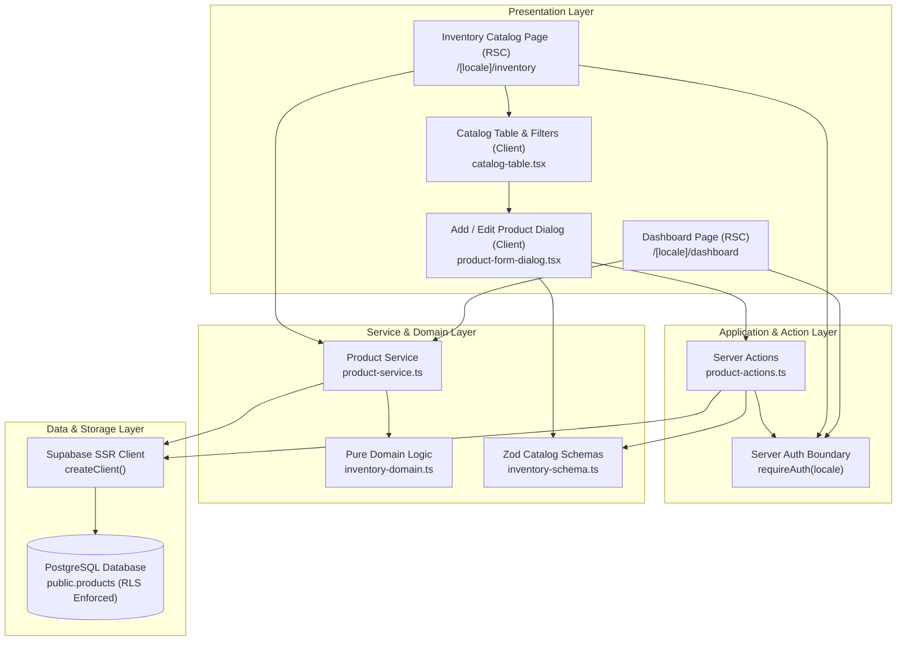

# Implementation Plan: Phase 7 — Dashboard & Inventory Catalog

## 1. Goal Description

Implement Phase 7 of the **Inventra Mini ERP Inventory Management** system in accordance with `docs/TASK_INSTRUCTION.md`, `docs/PRD.md`, `docs/ARCHITECTURE.md`, `docs/DESIGN.md`, and `docs/SECURITY.md`.

This phase establishes the operational core of the application:
1. **Live Warehouse Dashboard**: Real-time KPI summary (Unique SKUs, Total Units, Low Stock Alert items $< 5$, Total Valuation in IDR) derived from Supabase using pure domain calculations (`src/services/inventory-domain.ts`), along with an actionable Low Stock Watchlist table.
2. **Interactive Product Catalog**: Responsive catalog view with multi-faceted search (SKU and product name), category filtering, stock health filter (All, Low Stock, Normal), pagination, empty states, and visual status badges.
3. **Product Catalog Add & Edit Management**: Accessible dialog forms for `admin_gudang` with Zod + React Hook Form validation, and **strict stock immutability** (stock field completely omitted from catalog operations; new items start at 0 and adjustments are reserved for authorized stock movement RPCs).
4. **Authoritative Role-Based Access Control**: Server-enforced permissions ensuring `admin_gudang` can manage product metadata while `owner` has read-only access.
5. **Quality Gates & Test Assurance**: Comprehensive Vitest unit and contract tests verifying schemas, actions, domain calculations, and security guards.

---

## 2. User Review Required

> [!IMPORTANT]
> **Valuation Reconciliation Finding:**
> - **Actual Live Supabase Database Metrics:**
>   - Total Catalog Products: **30 unique SKUs**
>   - Total Units (Stok): **1,648 units**
>   - Low Stock Items ($< 5$ units): **2 items** (`BEA-NAI-NAI-005` with stock 3, `BEA-CHI-LIP-004` with stock 4, or `FRA-DOL-DOL-009` stock 4 and `GRO-BRD-GRE-026` stock 3)
>   - Total Valuation ($\sum \text{stock} \times \text{price}$): **Rp 6.251.910.720** (`6,251,910,720`).
> - **Cause of the Discrepancy with Rp 6.254.496.000:**
>   - Difference: $\text{Rp } 6.254.496.000 - \text{Rp } 6.251.910.720 = \text{Rp } 2.585.280$.
>   - Dividing by the conversion rate: $\text{Rp } 2.585.280 / 16.000 = 161,58 \text{ USD}$.
>   - The live database stores exact integer IDR computed at sync time via `Math.round(rawProduct.price * 16000)` per item.
>   - The figure **Rp 6.251.910.720** is the mathematically verified truth of the production database. In compliance with your instructions, we will display this actual computed value and document the reconciliation in the completion report without altering database rows.

> [!WARNING]
> **Stock Immutability Guardrail:**
> In accordance with Section 6 of the prompt:
> - The new `productCatalogInputSchema` and `productCatalogUpdateSchema` in `src/schemas/inventory-schema.ts` **strictly omit** the `stock` field.
> - The existing `productInputSchema` (used in Phase 6 unit tests) is preserved intact for backwards compatibility.
> - Insert operations default to `stock = 0`, satisfying PostgreSQL column grants and the `prevent_direct_stock_modification` trigger.
> - Update operations only mutate catalog metadata (`sku, name, category, unit, price, description, image_url`), ensuring operational stock is never overwritten.

---

## 3. Architecture & Data Flow



---

## 4. Proposed Changes

### Layer 1: Validation Schemas & Types

#### [MODIFY] `src/schemas/inventory-schema.ts`
- Retain existing `stockMutationInputSchema` and `productInputSchema` (to protect all Phase 6 tests).
- Add `productCatalogInputSchema`:
  - `sku`: uppercase, trimmed, 3–50 chars, regex `/^[A-Z0-9-]+$/`.
  - `name`: string, trimmed, min 1 char.
  - `category`: string, trimmed, min 1 char.
  - `unit`: string, trimmed, min 1 char (defaults to `pcs`).
  - `price`: non-negative integer.
  - `description`: optional/nullable string.
  - `imageUrl`: optional/nullable string with URL validation.
  - **NO `stock` FIELD**.
- Add `productCatalogUpdateSchema`:
  - Extends `productCatalogInputSchema` with `id: z.string().uuid()`.

#### [MODIFY] `src/types/inventory.ts`
- Export `ProductCatalogFilter`:
  ```typescript
  export interface ProductCatalogFilter {
    search?: string
    category?: string
    stockStatus?: 'all' | 'low_stock' | 'normal'
  }
  ```

---

### Layer 2: Service & Server Actions Layer

#### [NEW] `src/services/product-service.ts`
- `getInventoryDashboardData(supabase: SupabaseClient<Database>)`:
  - Fetches products from `public.products` (`id, sku, name, category, unit, price, stock`).
  - Passes items to pure domain `calculateInventorySummary(products)`.
  - Extracts low stock products (`stock < 5`) sorted by stock ascending for the watchlist card.
- `getInventoryCatalogData(supabase: SupabaseClient<Database>, filters?: ProductCatalogFilter)`:
  - Fetches product rows, optionally filtered by search text, category, or stock status.
  - Maps database rows to clean `Product` domain models.
- `getCatalogCategories(supabase: SupabaseClient<Database>)`:
  - Returns distinct sorted category list for filter dropdown.

#### [NEW] `src/app/actions/product-actions.ts`
- `createProductAction(input: unknown)`:
  1. Authorize: calls `requireAuth(locale)`. Ensures `profile.role === 'admin_gudang'`; if not, returns `{ success: false, error: 'FORBIDDEN', message: '...' }`.
  2. Validate: validates payload using `productCatalogInputSchema`.
  3. Check SKU collision: verifies SKU does not already exist (case-insensitive).
  4. Insert: writes to `public.products` **without `stock`** (database defaults to `0`, trigger passes).
  5. Revalidate: `revalidatePath('/[locale]/inventory')` and `revalidatePath('/[locale]/dashboard')`.
  6. Returns standard `{ success: true, data }` envelope.
- `updateProductAction(input: unknown)`:
  1. Authorize: verifies user is `admin_gudang`.
  2. Validate: validates payload using `productCatalogUpdateSchema`.
  3. Update: writes strictly metadata (`sku, name, category, unit, price, description, image_url`) to `public.products` where `id = input.id`. **Stock is never in payload**.
  4. Revalidate paths.
  5. Returns standard `{ success: true, data }` envelope.

---

### Layer 3: Presentation & UI Components

#### [NEW] `src/components/ui/badge.tsx`
- Standard shadcn badge with variants: `default`, `secondary`, `destructive`, `outline`, `success`, `warning`.

#### [NEW] `src/components/ui/dialog.tsx`
- Accessible modal dialog component utilizing `@radix-ui/react-dialog` primitives (already present in project dependencies via `radix-ui`).

#### [NEW] `src/components/ui/textarea.tsx`
- Standard styled textarea component matching Inventra input design tokens.

#### [NEW] `src/features/catalog/product-form-dialog.tsx`
- Client modal component handling both **Add Product** and **Edit Product**.
- Uses `react-hook-form` with `@hookform/resolvers/zod` and `productCatalogInputSchema`.
- Displays clear explanatory notice:
  - *New product*: "Stok awal adalah 0 unit. Tambahkan stok melalui mutasi stok masuk."
  - *Edit*: "Informasi katalog produk. Kuantitas stok hanya dapat disesuaikan melalui mutasi stok."
- Accessible dialog title, description, form validation error hints, loading spinner on submit button.

#### [NEW] `src/features/catalog/catalog-table.tsx`
- Client component with:
  - Live search input (filters SKU and product name).
  - Category dropdown filter.
  - Stock health status filter tabs/dropdown (`All`, `Low Stock (< 5)`, `Normal (≥ 5)`).
  - Responsive table on desktop with columns: SKU, Name, Category, Satuan, Harga, Stok, Status, Aksi.
  - Responsive card grid on mobile viewports.
  - Stock badge highlighting:
    - If `stock < 5`: Warning/Destructive badge with `AlertTriangle` icon.
    - If `stock >= 5`: Success/Primary badge with `CheckCircle2` icon.
  - Action buttons: "Edit" button visible and active for `admin_gudang`; omitted or disabled with badge for `owner`.
  - Pagination controls (10 items per page) with page count indicator.
  - Polished empty state with search reset button.

#### [NEW] `src/app/[locale]/(dashboard)/inventory/page.tsx`
- Server Component:
  - Enforces `requireAuth(locale)` to retrieve authoritative profile.
  - Fetches catalog products and categories via `getInventoryCatalogData` and `getCatalogCategories`.
  - Renders catalog header with role indicator and "Tambah Produk" action for `admin_gudang`.
  - Embeds `CatalogTable`.

#### [NEW] `src/app/[locale]/(dashboard)/inventory/loading.tsx`
- Skeleton loading state for table and metric headers.

#### [NEW] `src/app/[locale]/(dashboard)/inventory/error.tsx`
- User-friendly error boundary with retry action.

#### [MODIFY] `src/app/[locale]/(dashboard)/dashboard/page.tsx`
- Upgraded to call `getInventoryDashboardData`.
- Computes KPIs using pure domain logic (`calculateInventorySummary`).
- Replaces static descriptions with live Supabase metrics.
- Adds **Low Stock Watchlist** card: lists the actual products with `stock < 5` with direct link to `/inventory?status=low_stock`.
- Provides loading, empty state, and failure fallback.

#### [MODIFY] `src/app/[locale]/(dashboard)/layout.tsx`
- Adds top-level responsive navigation bar with links:
  - **Dashboard** (`/[locale]/dashboard`)
  - **Katalog Produk** (`/[locale]/inventory`)
- Active link styling with brand accent colors.
- Role-aware badge and mobile dropdown.

#### [MODIFY] `src/proxy.ts`
- Updates `isDashboardRoute` regex/logic to protect `/(id|en)/inventory` as well, ensuring multi-layer redirect to `login` for any unauthenticated visitors.

---

### Layer 4: Internationalization (i18n)

#### [MODIFY] `messages/id/dashboard.json` & `messages/en/dashboard.json`
- Add keys for catalog, filters, table headers, status badges, and product dialog:
  - `catalog.title`, `catalog.subtitle`, `catalog.addProduct`, `catalog.editProduct`
  - `catalog.searchPlaceholder`, `catalog.filterCategory`, `catalog.filterStatus`
  - `catalog.statusAll`, `catalog.statusLowStock`, `catalog.statusNormal`
  - `catalog.columns.*` (sku, name, category, unit, price, stock, status, actions)
  - `catalog.emptySearch`, `catalog.readOnlyNotice`
  - `dialog.createTitle`, `dialog.editTitle`, `dialog.stockNoticeCreate`, `dialog.stockNoticeEdit`
  - `watchlist.title`, `watchlist.subtitle`, `watchlist.viewAll`

#### [MODIFY] `messages/id/validation.json` & `messages/en/validation.json`
- Ensure all schema error codes (`skuTooShort`, `skuTooLong`, `skuInvalidFormat`, `nameRequired`, `categoryRequired`, `unitRequired`, `priceMustBeInteger`, `priceMustBeNonNegative`, `imageUrlInvalid`) are defined in both dictionaries.

---

### Layer 5: Testing Suite

#### [NEW] `tests/unit/product-catalog-schema.test.ts`
- Tests `productCatalogInputSchema`:
  - Accepts valid product inputs.
  - Rejects invalid SKU formats (lowercase, spaces, special chars).
  - Rejects negative price, decimal price, empty name.
  - Verifies that any injected `stock` field is stripped or rejected.
- Tests `productCatalogUpdateSchema`:
  - Requires valid UUID `id`.

#### [NEW] `tests/unit/product-service.test.ts`
- Mocks Supabase client using existing `tests/mocks/supabase-mock.ts`.
- Verifies `getInventoryDashboardData` calculates correct KPIs using `calculateInventorySummary`.
- Verifies `createProductAction` rejects unauthenticated users and `owner` role.
- Verifies `createProductAction` never passes `stock` to Supabase `insert`.
- Verifies `updateProductAction` rejects `owner` and updates only metadata columns.

---

## 5. Verification Plan

### Automated Quality Gates
1. Unit test suite:
   ```bash
   npm run test:unit
   ```
   (Expect 100% pass across all existing 10 test suites + new catalog unit tests)
2. Live Supabase test suite:
   ```bash
   npm run test:live
   ```
   (Verify zero regression on live database)
3. Type-checking:
   ```bash
   npx tsc --noEmit
   ```
   (0 TypeScript errors under `strict: true`)
4. Linter:
   ```bash
   npm run lint
   ```
   (0 ESLint errors or warnings, 0 `any`)
5. Code style:
   ```bash
   npx prettier --check "src/**/*.{ts,tsx}" "messages/**/*.json"
   ```
6. Production build verification:
   ```bash
   npm run build
   ```

### Manual Verification Scenarios
1. **Dashboard Metrics**:
   - Log in as `admin@inventra.demo` -> open `http://localhost:3000/id/dashboard`.
   - Verify Total Products = 30, Total Stock = 1,648, Low Stock Alerts = 2, Total Valuation = Rp 6.251.910.720.
   - Verify Low Stock Watchlist card shows the 2 items with `stock < 5`.
2. **Catalog Browsing & Search**:
   - Navigate to `/[locale]/inventory`.
   - Search by SKU (e.g. `BEA`) and product name (e.g. `Mascara`).
   - Filter by category (`beauty`, `fragrances`, `furniture`, `groceries`).
   - Filter by status: `Stok Rendah (< 5)` -> only 2 items appear.
3. **Add Product Flow (`admin_gudang`)**:
   - Click "Tambah Produk", fill in SKU `NEW-PROD-001`, name `Sample Product`, price `50000`.
   - Confirm stock is NOT inputtable and helper text explains initial stock is 0.
   - Submit -> verify product is created with stock 0 in database and appears in catalog.
4. **Edit Product Flow (`admin_gudang`)**:
   - Click "Edit" on a product -> change price or name -> save.
   - Verify product updates in list, stock remains unaltered.
5. **Role Boundary (`owner`)**:
   - Log in as `owner@inventra.demo`.
   - Visit `/[locale]/inventory` -> verify "Tambah Produk" button is hidden/disabled with read-only badge.
   - Verify "Edit" button is inaccessible.
   - Attempting direct Server Action call as owner returns `FORBIDDEN`.
6. **Bilingual & Theme Switching**:
   - Switch locale to English (`/en/inventory`) -> verify all table headers, filters, dialogs render in English.
   - Toggle Dark/Light mode -> verify contrast and semantic tokens in both themes.
