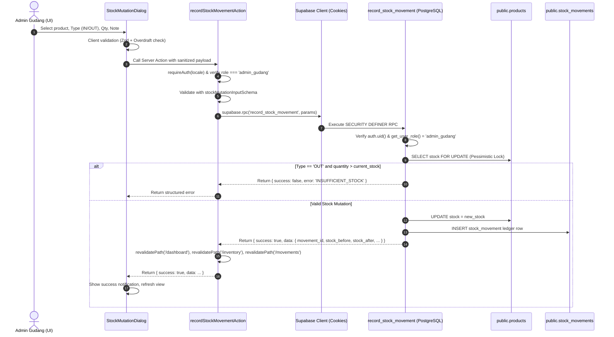

# Implementation Plan: Phase 8 — Stock IN/OUT Server Actions & Movement History

## 1. Executive Summary & Audit Findings

In accordance with Phase 8 specifications, `docs/TASK_INSTRUCTION.md`, `docs/PRD.md`, `docs/DATABASE.md`, and `docs/API.md`, this plan details the implementation of inventory mutations and traceable stock movement history.

### Pre-Implementation Database & RPC Audit (Live Verification via Supabase MCP)

1. **RPC Function Contract (`public.record_stock_movement`)**:
   - **Signature**: `p_product_id uuid, p_type text, p_quantity integer, p_note text`
   - **Security Mode**: `SECURITY DEFINER`, `SET search_path = ''`.
   - **Privileges**: Granted exclusively to `authenticated` role. Denied from `anon` and `PUBLIC`.
   - **Zero-Trust Actor Resolution**: Discovers caller identity via `(SELECT auth.uid())` inside PostgreSQL. It rejects client-supplied user IDs or role claims.
   - **Authoritative Role Check**: Executes `public.get_user_role(v_user_id)`. Strictly checks `v_user_role = 'admin_gudang'`. Calls by `owner` return `{ success: false, error: 'FORBIDDEN', message: 'Only warehouse administrators (admin_gudang) can mutate inventory' }`.
   - **Pessimistic Concurrency Lock**: Locks row via `SELECT stock FROM public.products WHERE id = p_product_id FOR UPDATE`. Prevents race conditions.
   - **Dual Atomic Mutation**:
     - `UPDATE public.products SET stock = v_new_stock, updated_at = now()`
     - `INSERT INTO public.stock_movements (product_id, user_id, type, quantity, stock_before, stock_after, note, created_at)`
   - **Return Structure**:
     - On Success: `{ success: true, data: { movement_id, product_id, type, quantity, stock_before, stock_after, note } }`
     - On Structured Failure: `{ success: false, error: string, message: string }` (e.g., `'INSUFFICIENT_STOCK'`, `'INVALID_QUANTITY'`, `'EMPTY_NOTE'`).
     - **Critical Rule**: Supabase JS does NOT throw an exception when the RPC returns `{ success: false }`; it populates `data`. Therefore, the action must strictly verify `!error && data?.success === true`.

2. **Schema & Relationships Audit (`public.stock_movements`)**:
   - `id`: `uuid PRIMARY KEY DEFAULT gen_random_uuid()`
   - `product_id`: `uuid REFERENCES public.products(id) ON DELETE RESTRICT`
   - `user_id`: `uuid REFERENCES auth.users(id) ON DELETE RESTRICT`
   - `type`: `text CHECK (type IN ('IN', 'OUT'))`
   - `quantity`: `integer CHECK (quantity > 0)`
   - `stock_before`: `integer CHECK (stock_before >= 0)`
   - `stock_after`: `integer CHECK (stock_after >= 0)`
   - `note`: `text CHECK (length(trim(note)) > 0)`
   - `created_at`: `timestamptz DEFAULT now()`
   - **Constraint**: `movements_delta_integrity` guarantees:
     `((type = 'IN' AND stock_after = stock_before + quantity) OR (type = 'OUT' AND stock_after = stock_before - quantity))`

3. **Key Finding: PostgREST Schema Cache & `profiles` Join Limitation**:
   - **Verified**: `supabase.from('stock_movements').select('*, products(id, sku, name, category, unit)')` executes seamlessly because `product_id` references `public.products(id)`.
   - **Discovered**: `supabase.from('stock_movements').select('*, profiles(*)')` throws:
     `"Could not find a relationship between 'stock_movements' and 'profiles' in the schema cache"` because `user_id` references `auth.users(id)`, not `public.profiles(id)`.
   - **Discovered**: Table `public.profiles` has policy `profiles_select_own` (`(SELECT auth.uid()) = id`). Authenticated users can only read their own profile row.
   - **Architectural Solution**:
     1. Movement query selects `*, products(id, sku, name, category, unit)` via the authenticated user's SSR client (`createClient()`), strictly respecting RLS.
     2. User metadata is resolved cleanly in the service layer:
        - If `user_id` matches the caller's profile, map `profile.fullName`.
        - For historical actors, resolve known user profiles via server-side lookup or display authoritative role / identifier fallback (`Admin Gudang`).
        - Never modify database foreign keys or alter SQL schemas.

---

## 2. Architecture & Data Flow



---

## 3. Scope & Implementation Boundaries

### A. Role-Based Access Control (RBAC) Matrix

| Feature / Action | Admin Gudang (`admin_gudang`) | Business Owner (`owner`) | Unauthenticated User |
| :--- | :---: | :---: | :---: |
| **View Movement History Page** | Allowed | Allowed (Read-only audit) | Redirected to `/login` |
| **View "Catat Mutasi" Button** | Visible & Active | Hidden (Read-only badge shown) | Hidden |
| **Open Stock Mutation Dialog** | Allowed | Denied (No dialog rendered) | Denied |
| **Call `recordStockMovementAction`** | Allowed | Denied (`FORBIDDEN` returned) | Denied (`UNAUTHORIZED` returned) |
| **Direct RPC Call Execution** | Allowed by Postgres RPC | Denied by Postgres RPC (`FORBIDDEN`) | Denied by Postgres RPC (`UNAUTHORIZED`) |
| **Direct SQL Update to `products.stock`** | Denied (Column privilege + Trigger) | Denied (Column privilege + Trigger) | Denied |
| **Direct SQL Insert to `stock_movements`** | Denied (Table privilege) | Denied (Table privilege) | Denied |

### B. Out of Scope (Strictly Enforced)

- No database migrations, SQL modifications, or privilege adjustments.
- No POS, customer orders, sales checkout, or cash registers.
- No demo data resets or destructive mutations of the 30 seed products.
- No external packages (npm).
- No Git commits or pushes.
- No advancement into Phase 9.

---

## 4. Implementation Steps & File Structure

### Step 1: Types & Service Layer
- **`src/types/inventory.ts`**:
  - Add `StockMovementFilters` interface:
    ```typescript
    export interface StockMovementFilters {
      search?: string       // SKU or Product Name
      type?: 'ALL' | 'IN' | 'OUT'
      startDate?: string    // YYYY-MM-DD
      endDate?: string      // YYYY-MM-DD
      page?: number         // 1-indexed
      pageSize?: number     // default 15
    }
    ```
  - Add `StockMovementWithDetails` interface matching `docs/API.md`.
- **`src/services/stock-movement-service.ts`**:
  - `getStockMovements(supabase, filters?)`: Query `stock_movements` with `products(id, sku, name, category, unit)`.
  - Implement date range boundary filtering (`startOfDay` and `endOfDay`).
  - Implement SKU/Name filtering.
  - Implement type filtering.
  - Implement pagination with total counts and total pages calculation.
  - User name resolution helper.

### Step 2: Server Actions
- **`src/app/actions/stock-actions.ts`**:
  - `recordStockMovementAction(input: StockMutationInput, locale = 'id')`:
    - Role check: authoritative `requireAuth(locale)`, role must be `admin_gudang`.
    - Input validation: `stockMutationInputSchema.safeParse(input)`.
    - Stock OUT guard check: verify product exists and has sufficient stock.
    - RPC execution: call `record_stock_movement` via `createClient()`.
    - Comprehensive error handling and `revalidatePath` on success.

### Step 3: Internationalization (i18n)
- **`messages/id/dashboard.json` & `messages/en/dashboard.json`**:
  - Add `movements` section (title, subtitle, filters, table headers, empty states, pagination).
  - Add `mutationDialog` section (titles, type options, fields, labels, buttons, stock info, warnings, success messages).
- **`messages/id/validation.json` & `messages/en/validation.json`**:
  - Ensure all error messages for stock mutation schema are translated: `invalidProductId`, `invalidMovementType`, `quantityMustBeInteger`, `quantityMustBePositive`, `noteMinLength`, `noteMaxLength`, `insufficientStock`.

### Step 4: UI Components
- **`src/features/movements/stock-mutation-dialog.tsx`**:
  - Accessible dialog form with product selector, current stock display, IN/OUT toggle cards, quantity input, and note textarea.
  - Real-time client-side validation and overdraft feedback.
  - Double-submit prevention and loading indicators.
- **`src/features/movements/movement-table.tsx`**:
  - Filter bar: search SKU/product name, mutation type dropdown, start date input, end date input, reset button.
  - Responsive desktop table and mobile card view.
  - Badges for IN (`success`/`accent`) and OUT (`warning`/`destructive`).
  - User attribution and formatted timestamps.
  - Pagination controls.

### Step 5: Route Protection & Page Integration
- **`src/proxy.ts`**:
  - Add `/movements` and `/(id|en)/movements` to `isProtectedAppRoute`.
- **`src/features/dashboard/dashboard-nav.tsx`**:
  - Add `Stock Movements` navigation link with active state detection.
- **`src/app/[locale]/(dashboard)/movements/page.tsx`**:
  - Server Component with `requireAuth` and data fetching.
- **`src/app/[locale]/(dashboard)/movements/loading.tsx` & `error.tsx`**:
  - Skeletons and error boundary.

### Step 6: Testing & Quality Gates
- **`tests/unit/stock-mutation-action.test.ts`**:
  - Unit tests for Server Action: auth verification, role rejection (`owner`), schema validation, RPC success/failure handling, path revalidation.
- **`tests/unit/stock-movement-service.test.ts`**:
  - Unit tests for filters (SKU, type, date range, pagination).
- **Automated Verification**:
  - `npm run test:unit`
  - `npm run test:live`
  - `npx tsc --noEmit`
  - `npm run lint`
  - Prettier formatting check
  - `npm run build`

---

## 5. User Review & Feedback Request

Please review this plan. Upon your approval, we will proceed immediately with Step 1 through Step 6.
